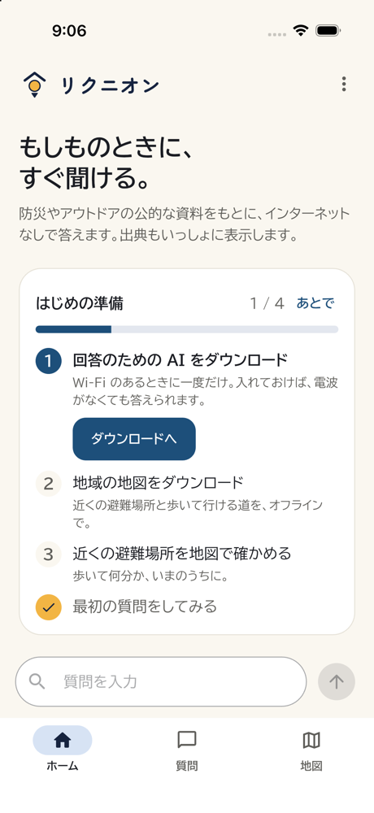
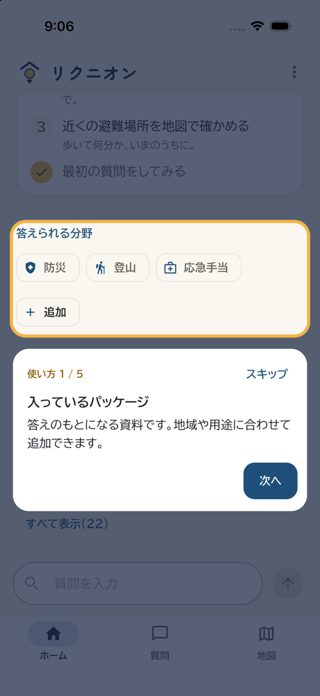
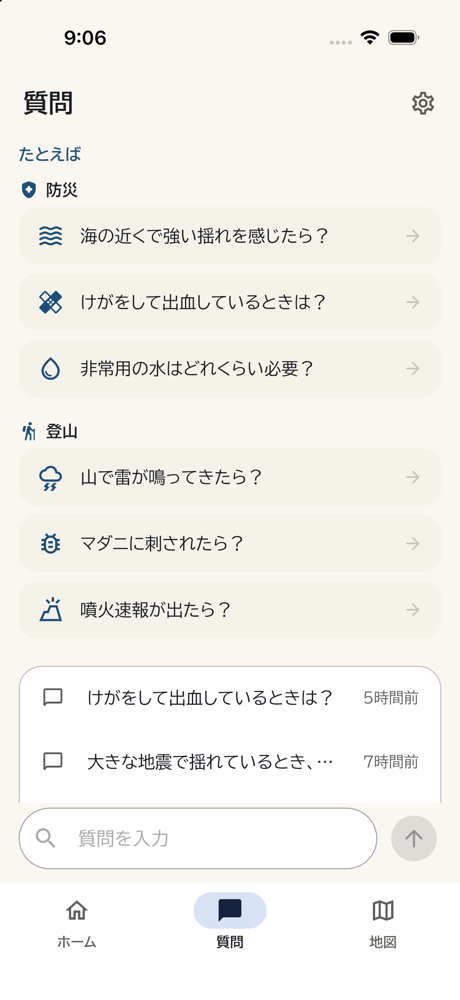
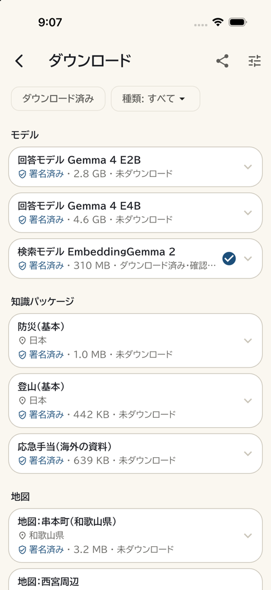
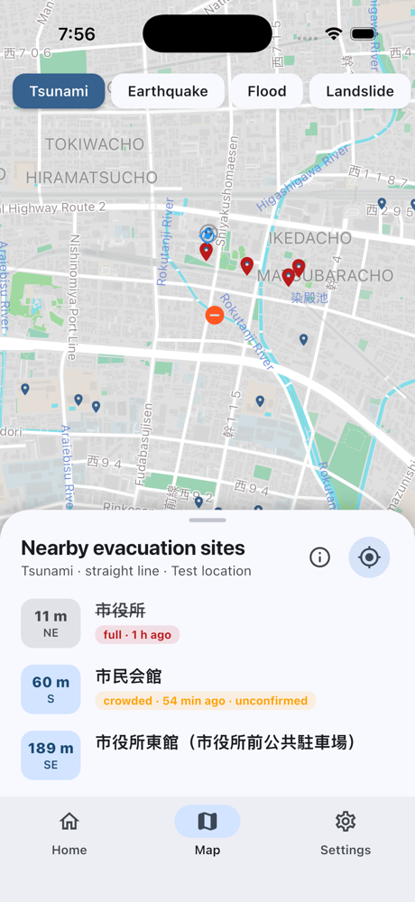
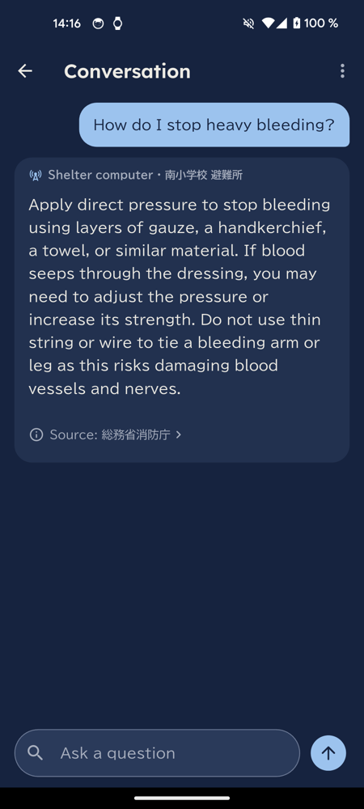

# Lychnion (リクニオン)

An offline safety assistant for Japan. Ask what to do in an earthquake, a
tsunami, on a mountain or after an injury, and get an answer from official
sources, with the source shown, also without a phone signal. A map shows
the nearest evacuation site and how to walk there.

Everything runs on the device: the AI model, the search, the guides and
the maps. The network is only needed to download them once. One Flutter
codebase for iOS, Android, macOS and Windows.

**Status:** prototype (0.x), not yet in the App Store or Google Play. The
data is for testing; do not rely on it alone in an emergency.

<p>
  
  
  
  
</p>

iPhone simulator, 2026-11-18, before the answer model is downloaded.

<p>
  
  
</p>

iPhone simulator, 2026-11-05. Shelter status and warnings on the map are
test data.

## What it does

- **Answers offline, with sources.** Questions in Japanese or English are
  answered only from the installed knowledge packages (official pages,
  mostly PDL1.0). Every answer shows its source; for hazards like tsunamis
  a fixed official safety line comes first.
- **Map and nearest site.** Offline maps with evacuation sites per hazard,
  expected tsunami areas and walking routes. Home shows the nearest site
  and how far it is on foot.
- **First steps and a guided tour.** A new user is led to a working app:
  download the answer AI, a map of their area, look at the nearest site,
  ask a first question. Then a short tour shows where everything is
  (⋮ → 使い方ツアー / "Guided tour" shows it again).
- **Downloads for your region.** Models, guides and maps come from a
  signed catalog. Each shows the area it is for (日本, 和歌山県, …), and
  the user's region comes first (set by hand in Settings, or from the
  position on the device).
- **Signed, from anywhere.** Every guide, map and model has a record
  signed by its publisher; the app checks the signature and every file's
  SHA-256, so a file may come from any server, a USB stick, a base or
  another phone.
- **Base (ベース).** A notebook PC with the desktop app serves answers,
  current information and downloads to everyone on the same Wi-Fi, also
  to phones without the app. See [Base](#base).
- **Other publishers.** A city or a club can publish its own guides and
  maps, signed with its own key, and people add it by QR code. See
  [Publishers and catalogs](#publishers-and-catalogs).

## Base

A notebook PC with the desktop app can serve everyone on the same Wi-Fi:
in an evacuation shelter, a mountain hut, a school or a camp. The app
calls it a 「ベース」 / "base" (in code and older docs: shelter
computer). Phones with the app and phones without it both get:

- answers to their questions, from the computer's model (faster than most
  phones);
- current information entered on the computer (shelter status, closed
  roads, warnings);
- with the app only: the computer's guides, maps and models, so a phone can
  download them there without internet.

<p>
  
  
</p>

Pixel 5a over Wi-Fi, 2026-11-18, before the rename to "base". Left:
browser, no app. Right: the app. The current information is test data.

**On the computer:**

1. Settings → ベース / Base → turn on 「この端末をベースにする」 /
   "Use this computer as a base".
2. Enter the base's name, for example 「南小学校 避難所」 or a hut's name.
   Phones show it.
3. Show the QR code to people. 「ブラウザで」 / "In the browser" works on
   every phone; 「アプリで」 / "With the app" connects the app. Only one
   code is shown at a time, so a camera cannot pick up the wrong one.
   「大きく表示」 / "Show large" fills the screen, for a monitor at the
   entrance.

Sharing starts once the answer model has loaded. Turn the switch off to
stop. The status chip on the home screen says 「公開中」 / "Sharing".

**Phone to phone:** a phone can pass on what it has downloaded (guides,
maps, models) without a base: Downloads → share button →
「近くの人に共有」 / "Share with people nearby", while that screen is open.
The other phone scans the code and picks what it wants in Downloads.
Both need the same Wi-Fi, or one phone's hotspot; no internet is needed.
Phones don't answer each other's questions (too slow).

**On a phone:** scan the code with the normal camera app. The browser page
asks and answers in Japanese or English (menu at the top right). The app
asks before it connects and remembers the base.

**The network:** the phones and the computer must be on the same Wi-Fi,
and it must let devices reach each other. Many guest and office networks
block this ("client isolation"). The safest setup is a Wi-Fi the shelter
controls: the computer's own hotspot or a small router. No internet is
needed. The page uses plain http on a local address: Chrome shows "not
secure" in the address bar but no warning page (checked on the Pixel 5a).
Opening the page by itself when a phone joins the Wi-Fi is planned
([#3](https://github.com/lychnion/lychnion/issues/3)).

More: [shelter results](docs/shelter-results.md),
[distribution design](docs/distribution.md).

## Publishers and catalogs

Lychnion's own guides and maps are signed with Lychnion's key, which is
built into the app. Others can publish too:

- **Add a publisher:** Settings → オフラインデータ / "Offline data" →
  Publishers. A city or club gives a link or QR code
  (`lychnion://publisher?…`); the app then accepts guides and maps it
  signs. Removing a publisher deletes its guides and maps.
- **Publish your own (desktop):** Publishers → "Publish your own" makes a
  signing key that stays on that computer, shows its QR code, and signs a
  guide or map file. A computer that is a base then serves it to phones.
- **Follow a catalog:** Settings → Offline data → Catalogs → "Follow a
  catalog". Its guides and maps appear in Downloads, but only those signed
  by Lychnion or a publisher you added.
- **Headless node:** [`packages/lychnion_node`](packages/lychnion_node)
  is a single program for a server or a small box: it fills a folder from
  one or more catalogs, keeps it current, and serves it like a base.

Design and the steps still open (sync between nodes, a publisher guide):
[docs/distribution.md](docs/distribution.md).

## Knowledge packages

Packages and map areas are built, signed and published in
[lychnion/lychnion-data](https://github.com/lychnion/lychnion-data) (see
"How packages are made" there). The app bundles a few of them in
`assets/packages/` and `assets/maps/`, with its own copy of the catalog in
`assets/downloads/`. To refresh them, copy the built files from a
`lychnion-data` checkout. Add `--dart-define=BARE=true` to `flutter run`
to compare with the model alone.

## Run

Needs Flutter 3.44+ (Dart 3.12+), Xcode for Apple platforms, the Android SDK
for Android. Flutter's Swift Package Manager support must stay on (default).

```bash
flutter pub get
flutter run -d macos
```

Follow the first steps on Home, or open Settings → Offline data →
Downloads (ダウンロード), and download the answer model (Gemma 4 E2B,
2.8 GB) and the search model (EmbeddingGemma 2, 310 MB). The
app loads them as soon as they are checked, on every platform. Wi-Fi only by
default. The list comes from
[assets/downloads/catalog.json](assets/downloads/catalog.json); package and
map files are releases of the public repo
[lychnion/lychnion-data](https://github.com/lychnion/lychnion-data).

Older ways still work: on macOS, click **Load GGUF file** and pick a model. The app copies it into
its own storage. On Android and iOS, the app downloads the model from the URL
field (default: Gemma 4 E2B Q4_0 from `ggml-org/gemma-4-E2B-it-GGUF`, 2.8 GB).

**Run test questions** asks eight fixed Japanese questions
([lib/spike/bench_prompts.dart](lib/spike/bench_prompts.dart)) and saves the
answers with timings as JSON in the app's documents folder.

Dev flags (spike 3 adds `EMBED_MODEL_PATH` for EmbeddingGemma 2
`embeddinggemma-2-Q8_0.gguf` from `ggml-org/embeddinggemma-2-GGUF`, and
`MIN_COS`, e.g. 0.70):

```bash
flutter run -d macos --dart-define=GGUF_MODEL_PATH=/path/inside/app/storage.gguf --dart-define=AUTO_BENCH=true
```

Downloads for testing (local server with Range support):

```bash
python3 -I tool/serve_downloads.py <folder with catalog.json and files> 8765
flutter run -d macos --dart-define=DOWNLOAD_BASE_URL=http://127.0.0.1:8765/
```

`AUTO_DOWNLOAD=id,…` downloads catalog items on start (for scripted tests).
`SHELTER_SERVER=true` (with `SHELTER_NAME=…`) turns sharing on at start,
whatever the setting says. `DEMO_FACTS=true` adds test facts; they need a
map area (downloaded, or `MAP_PMTILES_PATH`).
`MIN_COS` now defaults to 0.70.

## Repository layout

- `lib/`: the app. `lib/llm/local_llm.dart` is the only code that talks to
  the model engine; `lib/download/` holds the catalog, downloads,
  publishers and followed catalogs; `lib/shelter/` the base (server,
  browser page data, QR codes; the page itself is
  `assets/web/shelter.html`); `lib/ui/` Home, first steps and the tour.
- `packages/lychnion_format`: signed records, as pure Dart (also used by
  the signing tool in lychnion-data).
- `packages/lychnion_fetch`: downloads with resume and hash checks, pure
  Dart.
- `packages/lychnion_node`: the headless node.
- `tool/`: tools for the app's own assets (icons, fonts, region file) and
  a local download server for tests. Package and map tools are in
  [lychnion-data](https://github.com/lychnion/lychnion-data).
- `docs/`: [distribution design](docs/distribution.md),
  [versions](docs/versioning.md) (app semver `v0.1.0`, data
  `2026.11.5`, format numbers), the [plan](docs/poc-plan.md) and the
  results notes below.

## How we got here

Research notes from the prototype, oldest first:

- Spike 1 ([results](docs/spike-1-results.md)): Gemma 4 E2B (GGUF) runs on
  the device through [flutter_edge_ai](https://pub.dev/packages/flutter_edge_ai)
  and its llama.cpp engine.
- Spike 2 ([results](docs/spike-2-results.md)): answers only from a small
  Bousai package of official sources, with checked citations and fixed
  safety lines.
- Spike 3 ([results](docs/spike-3-results.md)): vector search
  (EmbeddingGemma 2), relevance cut-off, questions in Japanese and English.
- Spike 4 ([results](docs/spike-4-results.md)): near-topic answers; volcano
  page added, "partly covered" label; a yes/no self-check did not work with
  the 2B model.
- Spike 5 ([results](docs/spike-5-results.md)): Gemma 4 E4B for desktop
  (better answers, half the speed); OCR'd bear source disabled after it
  inverted advice.
- Spike 6 ([results](docs/spike-6-results.md)): checked sources for bears
  and getting lost (政府広報オンライン), two more safety lines; 28 / 28
  covered, 9 / 9 uncovered.
- Shelter computer ([results](docs/shelter-results.md)): the desktop app
  answers phones on the local network (E4B); a Pixel 5a with no model gets
  answers in 2.5 s instead of 48 s. Phones connect by scanning a QR code
  on the shelter computer, or by typing its address. Since 2026-11-18 a
  switch in Settings turns this on, and phones without the app can use a
  web page from the shelter computer (see [Base](#base)). The app
  now calls this a 「ベース」 / "base".
- Real devices ([results](docs/device-results.md)): iPad Air 5 (M1) runs
  the full app offline: about 22 tokens/s, answers in 2 to 9 s, same answers
  as on the Mac. Pixel 5a (2021, 6 GB): same quality but about 48 s per
  answer on the CPU, and memory is borderline.
- Offline map ([results](docs/map-results.md)): Nishinomiya area, GSI
  evacuation sites by hazard, nearest sites from the current position;
  answers about a hazard show the nearest site and link to the map.
- Downloads ([results](docs/download-results.md)): models, knowledge
  packages and map areas download inside the app, with resume and SHA-256
  check; the app then runs fully offline. Tested on macOS.
- Current facts ([results](docs/facts-results.md)): shelter status,
  blocked roads and warnings with age and source, apart from the AI; full
  shelters are skipped; staff enter them on the shelter computer, phones
  pull them every minute; 16 bytes per update in the radio-sized format.

## Name and brand

Lychnion (Greek λυχνίον, "small lamp") is the public name. The brand
(logo, colours, icons) follows the Lychnion brand canvas. "fieldkit" is
the old code name; base QR codes made with it (`fieldkit://`) still work.
App icons are drawn by `tool/build_icons.py`. Fonts: BIZ UDPGothic for
app text, cut down to the common Japanese characters, Lexend for the
wordmark and Zen Maru Gothic for リクニオン, made by `tool/build_fonts.py`.

## Licence

The code is free software under the
[GNU Affero General Public License, version 3](LICENSE), with an
[app store exception](LICENSE-APPSTORE-EXCEPTION.md) so the app can be
published in the App Store and Google Play. Anyone who passes the app on,
changed or not, must give its users the source code. This includes a
shelter computer that answers phones over the network. Copyright: the
[Lychnion authors](AUTHORS). To contribute, see
[CONTRIBUTING.md](CONTRIBUTING.md).

Data and models keep their own licences:

| What | Licence |
|---|---|
| Knowledge packages (official pages) | Mostly PDL1.0 (compatible with CC BY 4.0); each source is listed in `lychnion-data/packages/*.json` and shown with every answer |
| Maps: OpenStreetMap data | ODbL (share-alike) |
| Maps: 国土地理院 and 国土数値情報 layers | GSI terms, CC BY 4.0 |
| Region boundaries (`assets/regions/`, Natural Earth admin-1) | Public domain |
| Models (Gemma 4, EmbeddingGemma 2) | Apache 2.0 |
| Fonts (BIZ UDPGothic, Lexend, Zen Maru Gothic) | SIL OFL 1.1 |

Versions up to commit `064f50a` were published under Apache 2.0.
