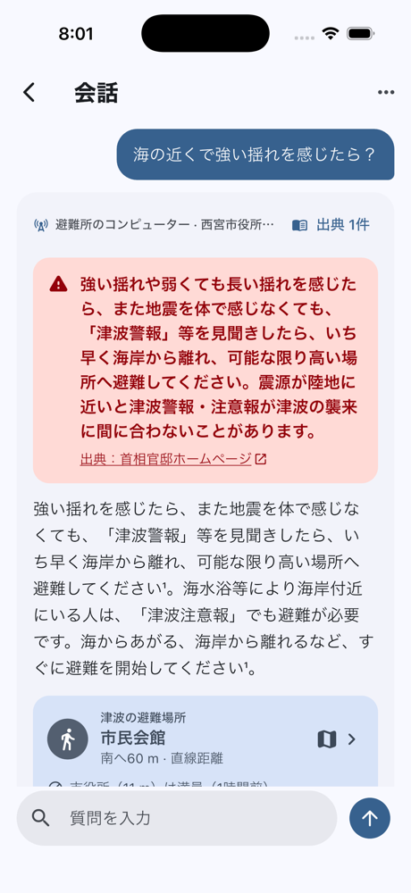
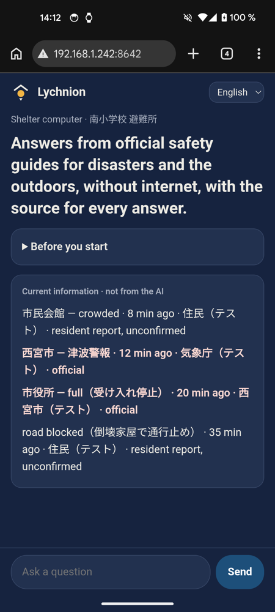

# Lychnion (リクニオン)

An offline safety assistant for Japan. Ask what to do in an earthquake, a
tsunami, on a mountain or after an injury. The answer comes from official
sources and shows its source, even without a phone signal. A map shows the
nearest evacuation site and how to walk there.

Everything runs on the device: the AI model, the search, the guides and
the maps. You need the network only to download them once. One Flutter
codebase for iOS, Android, macOS and Windows.

**Status:** prototype (0.x), not yet in the App Store or Google Play. The
data is for testing; do not rely on it alone in an emergency.

<p>
  
  
  
  
</p>

## What it does

- **Answers offline, with sources.** Japanese or English questions are
  answered only from installed guides, and every answer shows its source.
  ([Help](help/en/02-asking.md))
- **Map and nearest site.** Offline maps with evacuation sites, tsunami
  areas and walking routes. ([Help](help/en/03-map.md))
- **Downloads for your region.** Models, guides and maps come from a
  signed catalog. ([Help](help/en/04-downloads.md))
- **Base.** A notebook PC serves answers, current information and
  downloads to every phone on the same Wi-Fi. ([Help](help/en/05-base.md))
- **Share nearby.** Phones pass guides and maps to each other without
  internet. ([Help](help/en/06-share-nearby.md))
- **Other publishers.** A city or a club can publish its own signed
  guides and maps. ([Help](help/en/07-publishers.md))

## Build and run

You need Flutter 3.50 or newer, plus Xcode for Apple platforms or the
Android SDK for Android.

```bash
flutter pub get
flutter run -d macos
```

Then follow the first steps on Home. They download the answer model
(2.8 GB) and the search model (310 MB). More in
[docs/development.md](docs/development.md).

## Documentation

- **Using the app:** [help/](help/README.md), in Japanese and English.
  The same texts are the app's built-in help.
- **Developing:** [docs/](docs/README.md): dev flags, release builds,
  data packages, the base, and research notes.
- **Website:** [lychnion.com](https://lychnion.com)

## Licence

The code is free software under the
[GNU Affero General Public License, version 3](LICENSE), with an
[app store exception](LICENSE-APPSTORE-EXCEPTION.md) so the app can be
published in the App Store and Google Play. Anyone who passes the app on,
changed or not, must give its users the source code. This includes a base
that answers phones over the network. Copyright: the
[Lychnion authors](AUTHORS). To contribute, see
[CONTRIBUTING.md](CONTRIBUTING.md).

Data and models keep their own licences:

| What | Licence |
|---|---|
| Knowledge packages (official pages) | Mostly PDL1.0 (compatible with CC BY 4.0); each answer shows its source |
| Maps: OpenStreetMap data | ODbL (share-alike) |
| Maps: 国土地理院 and 国土数値情報 layers | GSI terms, CC BY 4.0 |
| Region boundaries (`assets/regions/`, Natural Earth admin-1) | Public domain |
| Models (Gemma 4, EmbeddingGemma 2) | Apache 2.0 |
| Fonts (BIZ UDPGothic, Lexend, Zen Maru Gothic) | SIL OFL 1.1 |

Versions up to commit `064f50a` were published under Apache 2.0.

## Links

- Data packages and maps: [lychnion/lychnion-data](https://github.com/lychnion/lychnion-data)
- Website: [lychnion/lychnion.github.io](https://github.com/lychnion/lychnion.github.io)
- Issues: [lychnion/lychnion/issues](https://github.com/lychnion/lychnion/issues)
