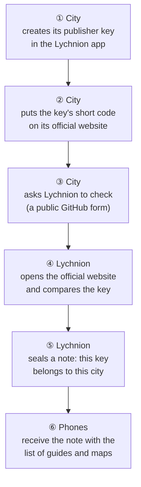
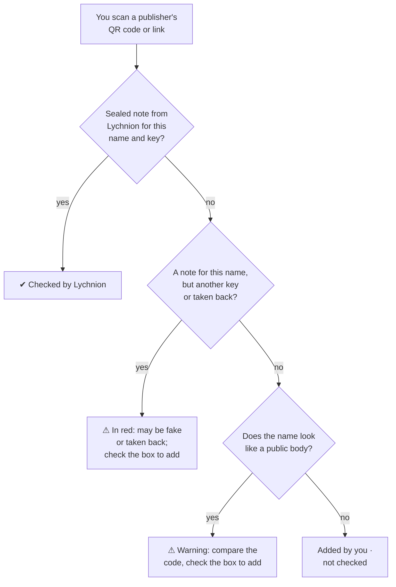

# "Checked by Lychnion", in plain words

This page explains, without security terms, what the label **Checked by
Lychnion** means, how a city or another public body gets it, how hard it
is to fake, and where its limits are. The technical version is
[attestations.md](attestations.md).

## Why the label exists

Lychnion can install guides and maps from other publishers too, for
example your city. You add a publisher by scanning its QR code or
opening its link.

The problem: **anyone can make a QR code that says "Sendai City".** A
fake poster in a shelter, or a link shared on social media after a
disaster, could pretend to be your city. Without help, the app can only
say "add only publishers you know".

So Lychnion checks official publishers itself, and the app shows the
result.

## The idea: a seal only Lychnion can make

Think of a document with an official seal on it.

- Every publisher has its own **key**. It has two parts: a secret part
  that only the publisher keeps, and a public part that anyone may see.
  With the secret part, the publisher puts a seal on everything it
  publishes. The app checks the seal with the public part. A guide with
  a wrong or missing seal is never installed.
- The **short code** is the first 8 characters of the public part. People
  can compare it by eye.
- Lychnion has a key too. The app has the public part of Lychnion's key
  **built in**, so it can recognise Lychnion's seal.
- When a person at Lychnion has checked that a key belongs to, say,
  Sendai City, Lychnion writes a short note. The note says: "this key
  belongs to Sendai City, checked on this day, on this official web
  page". Lychnion puts **its own seal** on the note. This sealed note is
  called an **attestation**.

The note travels to phones together with the list of guides and maps.
When a phone sees a publisher whose key matches a sealed note from
Lychnion, it shows **Checked by Lychnion**.

## How a city gets checked

1. The city creates its key on a computer, in the Lychnion app ("Publish
   your own"). The secret part stays on that computer. The app can also
   make an encrypted backup, which the city keeps offline.
2. The city puts the key's short code on a page of its **official
   website**. The address ends in `.lg.jp` or `.go.jp` (only public
   bodies can get these), or it is the city's long-used official
   address.
3. The city asks Lychnion to check, with a form on GitHub. The form needs
   a GitHub account, and everything written in it is public, so it asks
   for no personal data.
4. A person at Lychnion opens that official page and compares the code
   with the whole key. Anyone can make the same check; it needs no
   special access.
5. Lychnion seals the note with its own key. Only one person signs for
   Lychnion.
6. The note travels with the list of guides and maps: by download, on a
   USB stick, from a base computer in a shelter, or from a phone nearby.
   It works offline.

The form opens together with the tools that seal the notes
(lychnion/lychnion-data#38).

## What the phone does when you scan a publisher's QR code

- **Checked by Lychnion**: the phone found Lychnion's sealed note for
  exactly this name and this key. It shows the name Lychnion checked,
  not the name in the QR code.
- **In red, another key**: Lychnion checked a publisher with this name,
  but with another key. The QR code may be fake.
- **In red, check taken back**: Lychnion took its check back, for
  example because the city changed its website or merged with another.
  Add it only if you know why, for example after asking the city.
- **A warning**: nobody checked this publisher, but its name looks like a
  public body (a city, a prefecture, a ministry, a fire department, the
  police…) or like a checked publisher. Compare the code with the
  official website.
- In these three cases, the app asks you to check the box "I compared
  the code" before you can add the publisher.
- **Added by you · not checked by Lychnion**: an ordinary publisher, for
  example a club. It works normally. Lychnion does not check clubs, so
  it will stay "not checked", and that is fine.
- A QR code for a key that the publisher itself has cancelled is refused.

Similar labels appear in Settings → Publishers and in Downloads. Under
the passages of an answer, a line says whose guide it is, for example
"via “Aoba Club” · not checked by Lychnion".

## Why it is hard to fake

- **A new seal cannot be made without Lychnion's secret key.** The note
  itself can be copied, but changing one letter in it (another city
  name, another key) breaks the seal, and the phone ignores the note.
- **Lychnion's key is kept in a password manager**, never on a server or
  in an automated build, and one person signs with it.
- **The phone checks by itself.** It does not trust a website, a shelter
  computer or a USB stick to tell it what is checked. Whoever passes the
  notes on cannot change them; they can only pass them on or leave them
  out.
- **The note is about one key.** A fake that copies a checked name has
  another key, so the phone shows it in red, not as checked.
- **Lychnion can take a check back** with a newer sealed note, for
  example when a city changes its website, merges with another, or its
  key is misused.

## What the label does not mean

- **It is a label, not a permission.** A publisher does not need it to
  publish, and it never lets a publisher do more.
- **It says whose guide it is, not that the guide is right.** Lychnion
  checks who the publisher is, not every sentence it writes.
- **The official safety line is Lychnion's only.** When a question
  matches one, the answer starts with an official safety line. Only
  Lychnion's own guides provide it, never another publisher's, checked
  or not.
- **"Not checked" does not mean bad.** A city that has not applied yet
  can be added after you confirm; when Lychnion checks it later, the
  label changes by itself, and nothing has to be added again. A shelter
  group or a club handing out its QR code will stay "not checked".
- **No warning does not mean safe.** The warning only appears for names
  with words from a list. A fake with another name ("Sendai Shelter
  Info") gets no warning. Only "Checked by Lychnion" means checked.

## Where it can still go wrong

Being honest about the limits helps you use it well:

- **The check is only as good as the official page.** Lychnion trusts
  that the city's website shows the right code, and that the person
  checking is not fooled. If a city's website were taken over, Lychnion
  could be fooled too. That is why Lychnion checks again when someone
  reports a problem, and can take a check back.
- **Checking the box without comparing.** For a name that looks
  official, the box is the last protection. Compare the code with the
  official website, or ask staff at the city office or shelter. If you
  cannot, do not add it.
- **The short code is short.** For a publisher Lychnion has not checked,
  comparing the short code is the only protection. It is enough against
  a fake made in a hurry, but a well-funded attacker could make a key
  with the same short code. Lychnion compares the whole key, which is
  why "Checked by Lychnion" counts for more than the code.
- **News travels slowly offline.** When Lychnion takes a check back,
  phones learn it with the next list they receive. A phone that gets no
  new lists keeps the old label, and a shelter computer or USB stick
  could also hold back the newer note on purpose.
- **If Lychnion's key were stolen**, a thief could seal false notes.
  Lychnion could announce that the key is no longer valid, but only
  phones that receive that news would stop trusting the false notes,
  and the thief could try to announce the opposite. Lychnion's key is
  kept with care for this reason, and better protection is planned
  (lychnion/lychnion#118). With one person holding it, losing it is
  also a risk.
- **A shelter computer speaks for itself.** In answers that come from a
  base computer, the labels are that computer's word, and the app says
  so.

## More

- [attestations.md](attestations.md): who can apply, how Lychnion checks,
  and how a check is taken back.
- [distribution.md](distribution.md#whom-to-trust-attestations): the
  exact format and how notes travel between devices.
- The issue form "Ask Lychnion to check your publisher key" in
  [lychnion/lychnion-data](https://github.com/lychnion/lychnion-data/issues/new/choose)
  (open once lychnion/lychnion-data#38 is merged).
