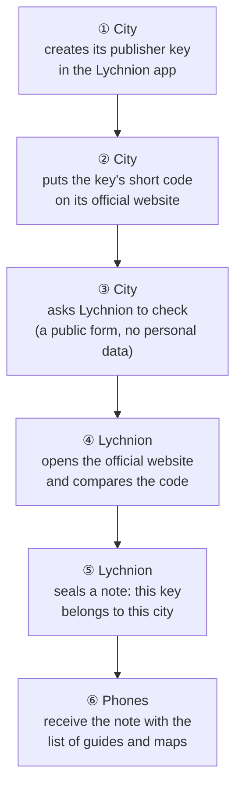
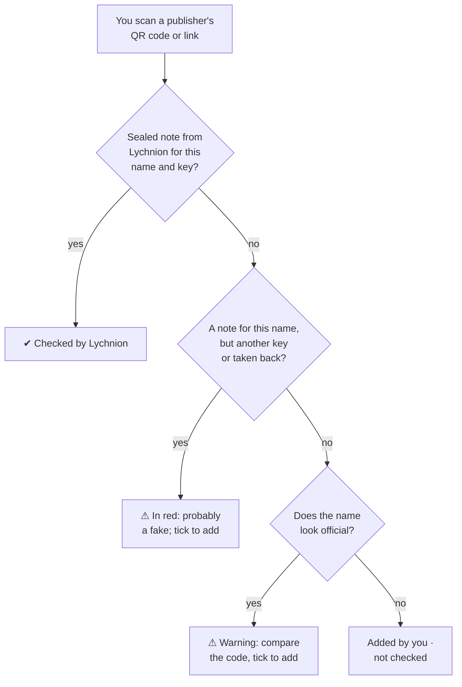

# "Checked by Lychnion", in plain words

This page explains, without security terms, what the label **Checked by
Lychnion** means, how a city or another public body gets it, and why a
fake cannot get it. The technical version is
[attestations.md](attestations.md).

## Why the label exists

Lychnion can install guides and maps from other publishers too, for
example your city. You add a publisher by scanning its QR code or
opening its link.

The problem: **anyone can make a QR code that says "Sendai City".** A
fake poster in a shelter, or a link shared on social media after a
disaster, could pretend to be your city. Before this label, the app
could only say "add only publishers you know".

So Lychnion checks official publishers itself, and the app shows the
result.

## The idea: a seal only Lychnion has

Think of a document with an official seal on it.

- Every publisher has its own **key**, a secret only it keeps. With it,
  it puts a seal on everything it publishes. The app can check the seal,
  and a guide with a wrong or missing seal is never installed.
- Lychnion has a key too, and the app has Lychnion's seal **built in**:
  it knows exactly what Lychnion's seal looks like.
- When Lychnion has made sure that a key really belongs to, say, Sendai
  City, it writes a short note, "this key belongs to Sendai City,
  checked on this day, on this official web page", and puts **its own
  seal** on the note. This sealed note is called an **attestation**.

The note travels to phones together with the list of guides and maps.
When a phone sees a publisher whose key matches a sealed note from
Lychnion, it shows **Checked by Lychnion**.

## How a city gets checked

1. The city creates its key on a computer, in the Lychnion app ("Publish
   your own"). The secret part never leaves that computer.
2. It puts the key's short code on a page of its **official website**
   (an address ending in `.lg.jp` or `.go.jp`, which only public bodies
   can get, or its long-used official address).
3. It asks Lychnion to check, with a public form. The form asks for no
   personal data.
4. Lychnion opens that official page and compares the code with the key.
   Anyone can do the same check; it needs no special access.
5. Lychnion seals the note with its own key. Only the holder of
   Lychnion's key can do this.
6. The note travels with the list of guides and maps: by download, on a
   USB stick, from a base computer in a shelter, or from a phone nearby.
   It works offline.

## What the phone does when you scan a publisher's QR code

- **Checked by Lychnion**: the phone found Lychnion's sealed note for
  exactly this name and this key. It shows the name Lychnion checked,
  not the name in the QR code.
- **In red**: Lychnion checked a publisher with this name, but with
  another key, or it took its check back. The QR code is probably fake.
  The app asks you to tick "I compared the code" before you can add it.
- **A warning**: nobody checked this publisher, but its name looks like
  a city, a ministry, a fire department or a checked publisher. The app
  asks you to compare the code with the official website, and to tick
  "I compared the code", before you can add it.
- **Added by you · not checked by Lychnion**: an ordinary publisher, for
  example a club. It works normally; Lychnion just does not know it.

The same labels appear in Settings → Publishers, in Downloads, and under
the passages of an answer, so you always see whose guide you are
reading.

## Why a fake cannot get the label

- **The seal cannot be copied.** Making Lychnion's seal needs Lychnion's
  secret key. Only one person holds it; it is kept in a password vault
  and never saved to a disk or a server. Changing one letter of a sealed note (another city
  name, another key) breaks the seal, and the phone ignores the note.
- **The phone checks by itself.** It does not trust a website, a shelter
  computer or a USB stick to tell it what is checked. Whoever passes the
  notes on can only pass them on unchanged, or leave them out.
- **The note is about one key.** A fake with a copied name has another
  key, so the phone shows it in red instead of "Checked by Lychnion".
- **Lychnion can take a check back**, with a newer sealed note, if a
  city changes its website, merges with another, or its key is misused.
  If Lychnion's own key were ever stolen, Lychnion can revoke it, and
  all notes sealed with it stop counting.

## What the label does not mean

- **It is a label, not a permission.** A publisher does not need it to
  publish, and it never lets a publisher do more. Only Lychnion's own
  guides give the official safety line at the top of an answer.
- **It says whose guide it is, not that the guide is right.** Lychnion
  checks who the publisher is, not every sentence it writes. Official
  warnings always come first.
- **"Not checked" does not mean bad.** A city that has not applied yet,
  or a shelter handing out its QR code in a disaster, can still be added
  after you confirm. When Lychnion checks it later, the label changes by
  itself; nothing has to be added again.

## Where it can still go wrong

Being honest about the limits helps you use it well:

- **Ticking without comparing.** For a name that looks official, the
  tick is the last protection. Compare the code with the official
  website, or ask staff at the city office or shelter. If you cannot,
  do not add it.
- **News travels slowly offline.** When Lychnion takes a check back,
  phones learn it with the next list they receive. A phone that never
  gets new lists keeps the old label.
- **The short code is short.** It is enough against a fake made in a
  hurry, but someone with a lot of computing power could make a key with
  the same short code. That is why Lychnion compares the whole key, and
  why the label, not the code alone, is what counts.
- **A shelter computer speaks for itself.** In answers that come from a
  base computer, the labels are that computer's word, and the app says
  so.

## More

- [attestations.md](attestations.md): who can apply, how Lychnion checks,
  and how a check is taken back.
- [distribution.md](distribution.md#whom-to-trust-attestations): the
  exact format and how notes travel between devices.
- The issue form "Ask Lychnion to check your publisher key" in
  [lychnion/lychnion-data](https://github.com/lychnion/lychnion-data/issues/new/choose).
