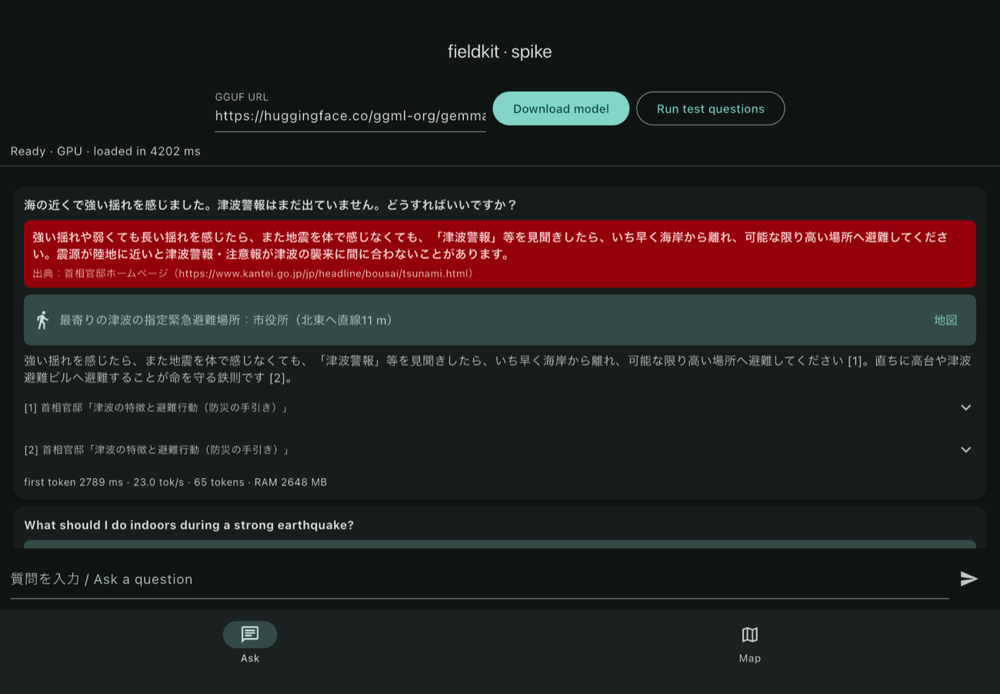

# Real device test: iPad Air (5th generation)

Date: 2026-11-04. iPad Air 5 (Apple M1, 8 GB), iPadOS, release build signed
with a free Apple ID (personal team). Same app and data as spike 4:
Gemma 4 E2B Q4_0 (2.65 GB), EmbeddingGemma 2 Q8_0 (296 MB), Bousai package,
Nishinomiya map (25 MB), cut-off 0.70, no relevance check.
Raw results: [spike-results/ipad-air5-m1-spike4.json](spike-results/ipad-air5-m1-spike4.json).

| | iPad Air 5 (M1, 8 GB) | MacBook Pro M4 Max |
|---|---|---|
| Engine | GPU (Metal) | GPU (Metal) |
| Model load | 14 s first time, 4.2 s after | 1.5 to 4.5 s |
| Speed | about 22 tokens/s (15 to 24) | about 115 tokens/s |
| First token (prompt with 4 passages) | median 2.1 s, max 4.2 s | 0.15 to 0.5 s |
| Whole answer | median 3.5 s, max 9.1 s | 1 to 2 s |
| App memory | about 1.9 to 2.6 GB | 1.6 to 3 GB |
| 35 test questions | 23 / 23 covered, 10 / 12 uncovered | same |

33 of 35 answers were word for word the same as on the Mac. The full run of
35 questions took about 2.5 minutes. The map (vector mode, with labels) and
the link from answers to the nearest evacuation site work the same as on the
Mac.

## What this means

- **A recent iPhone or iPad runs the full app.** Answers take a few seconds,
  which is fine for this use. The 8 GB M1 is roughly what current iPhone Pro
  models have; older or smaller iPhones still need testing.
- **Most of the waiting is reading the sources, not writing.** The first
  token waits for the model to read about 1,000 tokens of passages. Shorter
  passages, or fewer of them, would make answers start sooner.
- **Memory is fine on 8 GB:** about 2 GB for both models, well below the
  emulator's 4.5 GB (iOS maps the model file instead of copying it).

## Setup notes

- Free Apple ID: "Extended Virtual Addressing" cannot be signed with a
  personal team, so only "Increased Memory Limit" is set. Apps signed this way
  stop working after 7 days and must be reinstalled.
- Models and map are copied over the cable into the app's Documents folder:
  `xcrun devicectl device copy to --domain-type appDataContainer
  --domain-identifier dev.fieldkit.fieldkit`. The app accepts `docs:` paths
  for this (`lib/util/paths.dart`).
- iOS release builds do not show the app's log in `devicectl --console`;
  the test writes its results and screenshots to Documents, copied back with
  `xcrun devicectl device copy from`.

## Next

- Pixel 5a (2021, 6 GB): the low end, probably needs a smaller model.
- Download of models and packages inside the app (now copied by cable).
