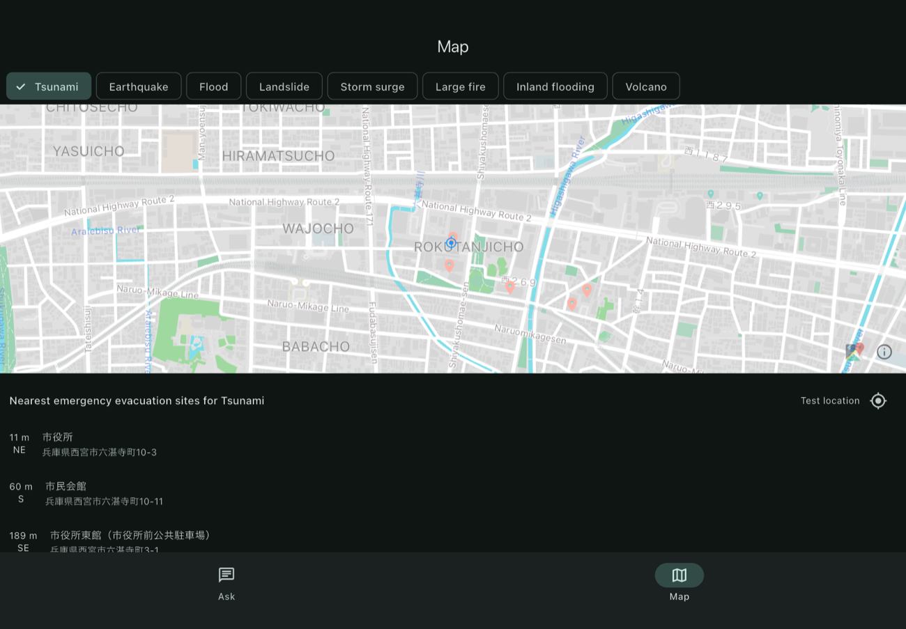

# Real device test: iPad Air (5th generation)

Date: 2026-11-04. iPad Air 5 (Apple M1, 8 GB), iPadOS, release build signed
with a free Apple ID (personal team). Same app and data as spike 4:
Gemma 4 E2B Q4_0 (2.65 GB), EmbeddingGemma 2 Q8_0 (296 MB), Bousai package,
Nishinomiya map (25 MB), cut-off 0.70, no relevance check.
Raw results: [spike-results/ipad-air5-m1-spike4.json](spike-results/ipad-air5-m1-spike4.json).

| | iPad Air 5 (M1, 8 GB) | MacBook Pro M4 Max |
|---|---|---|
| Engine | GPU (Metal) | GPU (Metal) |
| Model load | 14 s first time, 4.2 s after | 1.5 to 4.5 s |
| Speed | about 22 tokens/s (15 to 24) | about 115 tokens/s |
| First token (prompt with 4 passages) | median 2.1 s, max 4.2 s | 0.15 to 0.5 s |
| Whole answer | median 3.5 s, max 9.1 s | 1 to 2 s |
| App memory | about 1.9 to 2.6 GB | 1.6 to 3 GB |
| 35 test questions | 23 / 23 covered, 10 / 12 uncovered | same |

33 of 35 answers were word for word the same as on the Mac. The full run of
35 questions took about 2.5 minutes. The map (vector mode, with labels) and
the link from answers to the nearest evacuation site work the same as on the
Mac.

## What this means

- **A recent iPhone or iPad runs the full app.** Answers take a few seconds,
  which is fine for this use. The 8 GB M1 is roughly what current iPhone Pro
  models have; older or smaller iPhones still need testing.
- **Most of the waiting is reading the sources, not writing.** The first
  token waits for the model to read about 1,000 tokens of passages. Shorter
  passages, or fewer of them, would make answers start sooner.
- **Memory is fine on 8 GB:** about 2 GB for both models, well below the
  emulator's 4.5 GB (iOS maps the model file instead of copying it).

## Setup notes

- Free Apple ID: "Extended Virtual Addressing" cannot be signed with a
  personal team, so only "Increased Memory Limit" is set. Apps signed this way
  stop working after 7 days and must be reinstalled.
- Models and map are copied over the cable into the app's Documents folder:
  `xcrun devicectl device copy to --domain-type appDataContainer
  --domain-identifier com.lychnion.app`. The app accepts `docs:` paths
  for this (`lib/util/paths.dart`).
- iOS release builds do not show the app's log in `devicectl --console`;
  the test writes its results and screenshots to Documents, copied back with
  `xcrun devicectl device copy from`.

## Next

- Pixel 5a (2021, 6 GB): the low end, probably needs a smaller model.
- Download of models and packages inside the app (now copied by cable).

# Pixel 5a (2021, 6 GB, Android 14)

Date: 2026-11-05. Same app and data, Gemma 4 E2B Q4_0 + EmbeddingGemma 2,
CPU only (llama.cpp picks the CPU on Android). Raw results:
[spike-results/pixel5a-gemma4-e2b.json](spike-results/pixel5a-gemma4-e2b.json).

| | Pixel 5a (6 GB) | iPad Air 5 (M1) | Mac M4 Max |
|---|---|---|---|
| Engine | CPU | GPU | GPU |
| Model load | 12 to 14 s | 4 to 14 s | 1.5 to 4.5 s |
| Writing speed | about 5.5 tokens/s | about 22 | about 115 |
| Reading the sources (first token) | median 44 s, max 130 s | median 2.1 s | 0.15 to 0.5 s |
| Whole answer | **median 48 s, max 2.5 min** | median 3.5 s | 1 to 2 s |
| App memory | 2.0 to 2.4 GB | about 2 GB | 1.6 to 3 GB |
| 35 test questions | 22 / 23 covered, 10 / 12 uncovered | 23 / 23, 10 / 12 | 23 / 23, 10 / 12 |

- **Quality holds, speed does not.** The answers are as good as on the
  Mac (16 of 35 word for word the same; the only new miss is the English
  avalanche question, answered "no answer in the sources"). But nearly a
  minute per answer is too slow for an emergency.
- **The bottleneck is reading, not writing.** On the CPU the model reads
  the question and four passages (about 400 to 1,000 tokens) at well under
  50 tokens/s. Fewer and shorter passages would help more than a faster
  writer.
- **Memory is borderline.** Android closes most other apps (Gmail, Chrome,
  Slack, Settings) to make room, and kills fieldkit itself as soon as
  another app comes to the front. The model then has to load again.
- Embedding the 108 passages the first time took 133 s (cached afterwards).
  A package should ship with its vectors, so phones never do this.
- Speed dropped during the run (first answers about 25 to 40 s, later up to
  2.5 min), most likely because the phone got warm and slowed down.

## What this means for older phones

Small models are faster but lost quality on the Mac (Qwen3-1.7B 20 / 23,
LFM2.5-1.2B-JP 14 / 23) and both computed the family water amount wrong
(12 L instead of 36 L). So for phones like the Pixel 5a the options are:

1. Same model, less to read: two shorter passages instead of four, and
   vectors shipped in the package.
2. A smaller model plus more fixed safety lines, so the critical answers do
   not depend on the model.
3. Use the phone as a client: the desktop version at a shelter answers
   phones nearby over local Wi-Fi (as in the Idea 4 desktop version).

## Setup notes (Android)

- Release builds keep their private folder closed to adb. Models are pushed
  to the app's folder on shared storage, `Android/data/<package>/files`
  (`docs:` paths). The app has to create that folder itself first; if adb
  creates it, the app cannot see the files.
- The test turns on "Stay awake while charging" over adb during the run and
  restores it afterwards (`settings put global stay_on_while_plugged_in`).

## Less to read (2026-11-05)

Test of option 1 above, on the Mac (35 questions). Pixel times are estimated
from the Pixel run: about 18 tokens/s reading, 5.5 tokens/s writing.
Raw results: `spike-results/macos-read-*.json`.

| Passages per answer × size | Covered | Uncovered refused | Tokens read (median) | Pixel answer, estimated |
|---|---|---|---|---|
| 4 × 420 characters (default) | 23 / 23 | 10 / 12 | 794 | 48 s (measured) |
| 2 × 420 | 21 / 23 | 10 / 12 | 484 | ~33 s |
| 3 × 220 | 21 / 23 | 9 / 12 | 495 | ~33 s |
| 2 × 220 | 22 / 23 | 9 / 12 | 391 | ~29 s |

- Reading less saves up to 40 %, but the Pixel class stays near half a
  minute: the instructions, the question and (for English) the translation
  step are a fixed cost. Quality drops slightly (the shelter list, river
  water, in one variant the English tsunami question).
- Default stays at 4 × 420 for iPad and desktop. `TOP_K` (app) and
  `--max-chars` (package builder) remain as settings for phones.
- Older Android phones need a different fix: GPU use (newer llamadart
  versions include Vulkan on Android, not yet tested) or the shelter desktop
  answering phones over local Wi-Fi.

**Vectors in the package:** `lychnion-data/tool/add_vectors.py` adds the passage vectors
to the package (108 × 768 floats, package 376 → 816 KB). The app uses them
when they match its embedding model, so indexing drops from 133 s on the
Pixel (3 s on the Mac) to nothing.

## Three passages instead of four (2026-11-18)

Same 35 questions, Gemma 4 E2B (the phone model) on the Mac, packages of
lychnion-data 2026.11.5. Raw results:
`spike-results/macos-e2b-k4-2026-11-18.jsonl`, `…-k3-…`.

| Passages per answer | Tokens read (mean) | First word (mean) | Grounded | Not covered, refused |
|---|---|---|---|---|
| 4 (default) | 790 | 330 ms | 29 / 35 | 5 |
| 3 | 647 | 272 ms | 30 / 35 | 5 |

- 18 % less to read, so the first word comes 18 % sooner. On the Pixel 5a
  (about 18 tokens/s reading) that would be about 8 s sooner per answer.
- Quality about the same: better for the tsunami question (adds that a
  tsunami advisory is enough to leave the beach), getting lost, volcanic
  ash and 噴火警戒レベル3 (answered instead of "not in the sources").
  One real loss: for a snakebite the fourth passage ("limit movement")
  falls away. One English earthquake answer read worse, but with the same
  passages: sampling, not the cut.
- **Decided 2026-11-18: keep 4 passages everywhere.** `TOP_K=3` stays
  available for slow phones.

## Pixel 5a: CPU again, and the GPU (2026-11-18)

Gemma 4 E2B, release build, 4 passages, packages of lychnion-data
2026.11.5. Raw results: `spike-results/pixel5a-e2b-cpu-2026-11-18.jsonl`.

| Question | Tokens read | First word | Whole answer |
|---|---|---|---|
| Earthquake indoors | 759 | 36.7 s | 49.5 s |
| Tsunami near the sea | 1047 | 58.7 s | 70.2 s |
| Drinking water | 628 | 31.0 s | 43.4 s |

- Same as on 2026-11-05: reading about 18–21 tokens/s, writing about
  5 tokens/s; reading is about three quarters of the time.
- **GPU: not available.** With `--dart-define=LLM_BACKEND=gpu` the model
  does not load: llama.cpp's Vulkan backend needs Vulkan 1.2 or later, and
  the Pixel 5a's driver is older. Phones of this class stay on the CPU;
  newer phones with Vulkan 1.2 can try the GPU.
- Prompt prefix reuse (llamadart `reusePromptPrefix`, on by default): the
  three answers fit about 190 tokens skipped per question, which matches
  the instructions; three points, so likely but not proven.
- Only 3 of 8 questions finished before the run's time limit; the phone
  still had an unreachable base saved, which the app tries first.

## Pixel 5a: llamadart 0.15.1 against 0.17.5 (2026-11-19)

The engine update: llamadart 0.15.1 (llama.cpp runtime v0.7.0-1) to
0.17.5 (v0.8.0-1), with flutter_edge_ai 2.6.0 and flutter_edge_ai_llama
0.1.0. Same phone, model (Gemma 4 E2B Q4_0), packages and three questions
as above; release builds with `LLM_BACKEND=cpu`,
`GGUF_MODEL_PATH=docs:models/gemma-4-E2B-it-Q4_0.gguf` and the questions
in `ASK`; two runs each, the phone plugged in. Raw results:
`spike-results/pixel5a-e2b-cpu-llamadart-0.15.1-2026-11-19.jsonl` and
`…-0.17.5-2026-11-19.jsonl`.

First word, then whole answer (mean of two runs):

| Question | Tokens read | 0.15.1 | 0.17.5 |
|---|---|---|---|
| Earthquake indoors | 759 | 37.0 s / 50.2 s | 41.7 s / 55.1 s |
| Tsunami near the sea | 1047 | 55.3 s / 66.7 s | 62.9 s / 74.5 s |
| Drinking water | 628 | 30.5 s / 44.1 s | 32.7 s / 44.9 s |

- **Not faster: reading is about 7–14 % slower** (about 18 instead of
  20.5 tokens/s); all four 0.17.5 answers to the first two questions came
  after all four 0.15.1 answers. Writing stays at about 5 tokens/s.
- The answers are word for word the same; memory is about the same
  (2.1–2.3 GB).
- Both versions use 4 threads on this phone (0.17 caps the default at the
  number of cores, at most 4).
- The phone gets warm during a run (skin about 43 °C); runs started at a
  battery temperature of 28–33 °C. Two runs each, so small differences
  are not certain, but the direction was the same every time.
- On the Mac (CPU) the same question took 3.6 s / 4.8 s before and
  3.5 s / 4.6 s after, the same answer.
- So for phones like this: the base (a computer on the same Wi-Fi) is the
  way to fast answers.

## Pixel 5a: Google's LiteRT-LM engine, CPU and GPU (2026-11-19)

The question: can the Pixel 5a answer much faster with another engine in
flutter_edge_ai? Same phone, packages and app as above; Gemma 4 E2B in two
builds of the same model:

- llama.cpp (today's engine): `gemma-4-E2B-it-Q4_0.gguf`, 2.84 GB.
- LiteRT-LM (Google's engine, `flutter_edge_ai_litertlm` 1.20.2):
  `gemma-4-E2B-it.litertlm` from `litert-community/gemma-4-E2B-it-litert-lm`,
  2.59 GB, Apache 2.0. Google quantized it with training (a mix of 2-, 4-
  and 8-bit weights).

**MediaPipe is not an option.** The brief was `flutter_edge_ai_mediapipe`
(`.task` files). Google put MediaPipe's LLM API into maintenance and ships
Gemma 4 E2B only as `.litertlm` for phones; its one `.task` build is for
the web. LiteRT-LM is MediaPipe's successor, from the same package author.

Six questions (the three Japanese ones above, three in English), each
variant twice in the order A, then B reversed, the phone cooled to at most
31 °C battery temperature before each run (it reached 31–32 °C after one).
Raw results: `spike-results/pixel5a-e2b-litertlm-2026-11-19.jsonl`.

| | llama.cpp CPU | LiteRT-LM CPU | LiteRT-LM GPU, context 2048 | LiteRT-LM GPU, context 4096 |
|---|---|---|---|---|
| Model load (again) | 12.5 s | **2 s** | 11.5 s | 12.3 s |
| Model load (first time) | not measured | 11.5 s | 25 s | not measured |
| Reading (tokens/s) | about 16–20 | **about 45–60** | about 45–70 | about 40–60 |
| Writing (tokens/s) | about 5 | **about 5.8** | about 3.6 | about 2.5 |
| Earthquake (ja), first word / whole | 37.8 s / 50.5 s | **14.3 s / 24.8 s** | 17.4 s / 31.3 s | 19.7 s / 45.9 s |
| Tsunami (ja) | 57.7 s / 69.7 s | **23.3 s / 34.9 s** | 17.3 s / 34.7 s | 21.2 s / 45.7 s |
| Drinking water (ja) | 33.0 s / 47.5 s | **12.3 s / 18.6 s** | 14.7 s / 25.8 s | 17.3 s / 32.8 s |
| Earthquake (en) | 41.5 s / 49.2 s | **11.8 s / 18.6 s** | 13.5 s / 29.9 s | 15.6 s / 32.1 s |
| Lost while hiking (en) | 56.7 s / 69.2 s | **15.4 s / 28.3 s** | 13.6 s / 31.2 s | 16.0 s / 44.5 s |
| Drinking water (en) | 19.1 s / 23.4 s | **8.3 s / 12.4 s** | 7.9 s / 14.5 s | 9.1 s / 18.1 s |
| **Whole answer, mean** | **51.6 s** | **22.9 s** | 27.9 s | 36.5 s (one run) |
| App memory, peak (PSS) | 2.2 GB | 2.3 GB | 2.1 GB | 2.4 GB |

- **LiteRT-LM answers more than twice as fast, on the CPU.** About 23 s
  instead of 52 s per answer. The reading step (the question and four
  passages) runs about 2.5 times faster. Google's engine is tuned for
  phone processors, and its model file is smaller and quantized with
  training, so less has to be read from memory.
- **The GPU does not help on this phone.** It works (OpenCL on the
  Adreno 619, all layers on the GPU, where llama.cpp's Vulkan does not
  run), and it reads about as fast as the CPU. But it writes slower:
  3.6 tokens/s against 5.8. With a context above 2048 tokens the engine
  computes Gemma 4 with 32-bit numbers on the GPU (16-bit numbers break
  there, LiteRT-LM #4001), and writing drops to 2.5 tokens/s.
- **Quality holds.** All 36 LiteRT-LM answers used the right passages
  and cited only real sources (no invalid citation). The texts are nearly
  word for word the same as with llama.cpp. Both engines still answer the
  English drinking water question with "not in the sources" (the search
  finds the passage, the model does not use it): a retrieval and prompt
  issue, not an engine one.
- Loading: LiteRT-LM on the CPU keeps a cache next to the model, so the
  second load takes 2 s instead of 12.5 s. The GPU compiles its programs
  once (25 s), then loads in 11.5 s.
- Memory is about the same as llama.cpp (2.1–2.4 GB for the app,
  including the search model, which stays on llama.cpp).
- The app gets about 25 MB larger (LiteRT-LM's library, arm64).
- Still not fast: about 12–35 s per answer on this phone. A base on the
  same Wi-Fi stays the way to answers in a few seconds.

**Recommendation: adopt LiteRT-LM on Android, on the CPU.** Keep
llama.cpp for the desktop and iOS (Metal is fast there), for the search
model, and as the fallback. Drop MediaPipe. Do not use the GPU on phones
of the Pixel 5a's class; on newer phones the GPU may win (Google's
figures for a Galaxy S26 Ultra: 7 times faster reading on the GPU), which
needs a test on such a phone.

How the spike works: `GGUF_MODEL_PATH` may point to a `.litertlm` file;
the file ending picks the engine (`lib/llm/local_llm.dart`).
`LLM_BACKEND=cpu|gpu` and the new `LLM_CONTEXT=2048` work for both
engines. The downloads catalog still offers only the GGUF file.

## iPhone simulator (2026-11-05)

The app builds and runs on the iPhone 17 simulator (Xcode 27.2, Apple
Silicon Mac). Xcode 27's `lipo` checks one architecture per call, so
Flutter's framework check for "arm64 x86_64" failed; `ios/Flutter/Debug.xcconfig`
now builds the simulator for arm64 only.

Model and map files go into the app's Documents folder
(`xcrun simctl get_app_container <device> com.lychnion.app data`), then
`docs:` paths work as on a real iPhone. The simulator runs the model on the
CPU: loading took 14 s, the tsunami question answered with the safety line,
the nearest open site (full 市役所 skipped) and a cited answer. Speed on the
simulator says nothing about real phones.
