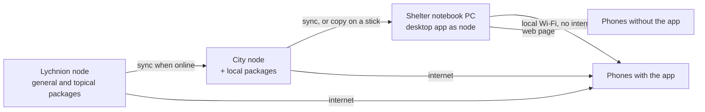

# Distribution: apps and data packages

> **Name:** since 2026-11-18 the app calls the shelter computer a
> 「ベース」 / "base", because it also fits huts, schools and camps.
> This note keeps "shelter"; the code says "base" since 2026-11-19.

Design note, 2026-11-18. Status: steps 1, 2, 3 and 7 built; storage,
node sync and publishing extended the same day.
Not over-engineered on purpose: every step below works on its own.

## The situation we design for

**Ideal:** people install the app and its packages while they have
internet, and keep them up to date before anything happens. Outdoor users
(hiking, skiing, sailing) mostly do this.

**Realistic, for disasters:**

- People hear about the app only after something happened, for example at
  a shelter.
- People who installed it long ago never updated the packages.
- New information appears during the emergency: new official guidance, a
  local map, closed roads, shelter status.
- Internet is down or comes back only now and then.
- Local governments set up their own distribution on site, often on an
  ordinary notebook PC, sometimes on prepared hardware.

So the data has to move over **whatever connection exists**: internet,
the shelter's local Wi-Fi, a USB stick, later phone to phone. And every
copy, from wherever it came, must be **provably genuine and current**.

## Principles

1. **Trust the signature, not the source.** A package is trusted because
   its publisher signed it, not because of the server, stick or phone it
   came from. Then any transport is fine.
2. **Content is addressed by its hash** (SHA-256, as in today's catalog).
   A file either matches or is thrown away.
3. **Versions only go up.** A device never accepts an older version of
   something it has (no rollback to outdated or tampered data).
4. **Packages are data, never code.** SQLite, PMTiles, JSON. The app
   opens only files whose signature and hash it has checked.
5. **Small steps.** Each step below is useful alone. P2P networks are a
   possible later transport, not a foundation.

## Building blocks

### Publishers and keys

Every publisher has an Ed25519 key pair: Lychnion for the general
packages, and for example a city for its local packages. The app ships
with the Lychnion public key. Other publishers' keys are added by the
user (built 2026-11-18, step 4a):

- A publisher gives out a link, as text or QR code:
  `lychnion://publisher?name=jp.city.kobe&title=神戸市&key=<public key>`.
  `name` is the `publisher` field of its records (lower case, digits,
  `.`, `_`, `-`); `title` is only shown.
- Scanning or opening the link asks first, showing the title, name and
  key id. Settings → Publishers lists the added publishers, adds one from
  a pasted link (desktop) and removes one.
- The app then accepts records signed by that key for that name, for
  downloads, updates and what a base passes on. A base passes on what
  it has installed; a phone installs a city's package from it only once
  that phone has added the city too.
- An added publisher's packages are searched and quoted with their
  source like any guide, but their safety lines (`alerts`) are not used:
  only packages signed by Lychnion supply the fixed official safety line
  above an answer ([#66](https://github.com/lychnion/lychnion/issues/66)).
- Added publishers bring guides and maps, never models: a `model` record
  is accepted only from Lychnion, in catalogs, on USB sticks, from bases
  and on nodes, and an added publisher's model installed by an older
  build is never loaded ([#67](https://github.com/lychnion/lychnion/issues/67)).
  A model's file is parsed by native code, chat template included, and
  its text is what answers.
- Names built into the app (`lychnion`) cannot be added. A name already
  added with another key is refused: the user removes it first, so a
  changed key is never taken over silently. Two exceptions, both from
  the publisher's own key statements: a replacement signed by the old
  key, and a new link for a publisher whose key was revoked (see
  "Backing up and replacing the key").
- Removing a publisher deletes what was installed from it; what the app
  or a running base had loaded from it is unloaded. Ids and file names
  stay with the publisher that installed them: an added publisher can
  never replace Lychnion's items or files (also not by upper/lower case,
  or by naming a file like the app's own records). Lychnion's ids and
  file names are reserved even before they are installed: the bundled
  packages, every item of the bundled catalog and Lychnion's items in
  every catalog of Lychnion's the app has checked. An added publisher's
  record for one is refused, from a USB stick, a followed catalog or a
  base, and a copy installed that way by an older build is not used;
  Lychnion's own replaces it, whatever version it claims, and removes the
  copy's files that no other item lists
  ([#68](https://github.com/lychnion/lychnion/issues/68)). An added
  publisher's item that an older build let use one of Lychnion's file
  names stops working once Lychnion's item is installed (Lychnion's file
  wins); removing that publisher never deletes a file another item still
  lists. The
  headless node does not reserve ids yet: it accepts such a record until
  it pulls Lychnion's source, which then takes the id back.

A city's publisher key is separate from a base's key (the one that signs
facts, `lib/facts/signing.dart`): the city signs on one machine, and bases
only carry its signed records.

**Publishing on the desktop** (built 2026-11-18, step 4b). Settings →
Publishers → "Publish your own" (desktop app only):

1. Create the publisher key once: a name (`jp.city.kobe`, cannot change)
   and a shown name (神戸市). The key is saved in the app folder
   (`publisher/publisher.json`, in a folder only this user can read) and never
   served or shared. The screen shows the publisher's QR code and link
   for phones, and where the key file is. Back it up from there
   (see "Backing up and replacing the key").
2. "Publish a guide or map": pick a package file (`<id>.sqlite`, built
   with the lychnion-data tools; id, version, titles and notice are read
   from it) or a map area's files (all named `<id>.…`). Check the form,
   then "Sign and publish".
3. The app signs the record, copies the files in and installs them, so
   the base passes them on at once. The signed record is also kept in
   `publisher/records/<id>/<version>.json` (the lychnion-data layout).

Refused: a version not higher than one this publisher signed or that is
installed (versions only go up), an id installed from another publisher,
a package whose file says another id or version, a package the app
cannot use (it is opened as the app does to answer: the `meta`, `sources`,
`passages` and `alerts` tables, and at least one passage), and file names
that do not start with the id. This computer adds its own publisher to its list,
so it trusts what it signs.

Guides are made with
[lychnion-studio](https://github.com/lychnion/lychnion-studio) (step 6),
not only with our Python tools.

### Backing up and replacing the key

Built 2026-11-19 ([#41](https://github.com/lychnion/lychnion/issues/41)),
in Publish your own (desktop app).

**Backup.** "Save a key backup" writes `<name>.lychnion-key`: name,
title, public key, the private key encrypted with a passphrase (at least
12 characters; Argon2id, then AES-256-GCM; name and public key are bound
to it), and a warning in English and Japanese. The passphrase is
normalised (Unicode NFKC) first, also for the length check, so the same
passphrase typed on another system (composed or decomposed kana,
full-width digits) opens it; a backup made before that is opened with
the passphrase as typed, composed or decomposed. Keep it offline
(1Password, or a USB stick in a safe), never on a server, in a repository
or on a stick you hand out. A forgotten passphrase cannot be recovered.
"Restore from a backup" works only on a computer without a key (a key is
never replaced silently); a wrong passphrase, a damaged or changed file,
or another kind of file is refused and nothing is written. A backup of
a key that this computer knows as revoked or replaced is refused too. A
file asking for more than 128 MiB or 4 rounds of Argon2id is refused as
damaged; the key is derived in a separate isolate. A computer that never saw the
publisher's statements cannot tell that a backup holds a replaced key:
restore the newest backup only, and destroy backups of replaced keys or
keep them as safely as the newest one. Restoring therefore asks first,
showing the key id and the date the backup was made, and Replace is
refused once the computer learns that its key was replaced already (a
second successor would make phones treat the key as stolen).

**Replacement limit.** Phones take at most 50 replacements of one
publisher. The desktop app warns when five or fewer are left and refuses
a replacement past the limit; from then on a key is changed with "Revoke
the key", and phones add the new link. It counts the replacements in the
publisher file and those the computer learned from catalogs, whichever
is more: a key restored from a backup does not carry its earlier
replacements. The publisher file
(`publisher/publisher.json`) is not encrypted: copy the backup, never
that file.

**Key statements.** Small signed statements, carried in a catalog's
`keys` list (`packages/lychnion_format`, `KeyStatement`):

```json
{"format": 1, "type": "replace", "publisher": "jp.city.kobe",
 "old": "<old public key>", "new": "<new public key>",
 "signed": "2026-11-19T09:00:00+09:00",
 "signature": "<by the old key>", "new_signature": "<by the new key>"}
{"format": 1, "type": "revoke", "publisher": "jp.city.kobe",
 "old": "<public key>", "signed": "…", "signature": "<by that key>"}
```

Both signatures cover the statement without its signatures, as records
do (canonical JSON).

- **Replace** ("Replace the key", the old key still there): the old key
  signs the new one and the new key countersigns. A phone that trusts the
  old key for that publisher then trusts the new one too; chains (A→B→C)
  are followed. Records signed by the old key stay valid, so the old key
  is not retired: keep its backup safe (it holds its revocation, in case
  the old key is stolen later), and make a new backup of the new key.
  Whoever holds an old key can also revoke it, and phones that know only
  that key then drop its successors too: a replacement does not protect
  against that, only a new link does.
- **Revoke** ("Revoke the key", when someone else may have it): signed by
  the key itself, so whoever holds it can revoke it, a thief too, which
  does no harm. The app makes a new key. Phones stop trusting the revoked
  key and every record it signed (installed items are no longer used, as
  when a publisher is removed), and remember it: its old link stays
  refused, also after the publisher was removed. The publisher stays
  listed as revoked until the user adds its new link (QR). Nothing signed
  by a revoked key can speak for a new key, so a phone cannot tell owner
  and thief apart; the user decides by adding the new link.
- **Theft shows as a conflict:** a key that names two different
  successors is treated as revoked, and so is every key reached only
  through a revoked key.
- **Lost computer:** a backup holds a ready-made revocation of its key,
  not encrypted. "Revoke a lost key from a backup" uses it without the
  passphrase.

**Key scopes** (lychnion/lychnion#125, part of the key plan in #118). So
that one stolen everyday key cannot sign everything, a key may sign only
what its **scope** allows. A record, attestation or status signed by a
key outside the scope it needs is refused like a bad signature.

| Scope | Lets a key sign |
| --- | --- |
| `data` | guides, maps, contour lines and other items that are not models; a publisher status |
| `models` | records of kind `model` |
| `safety-lines` | the official safety lines in a package: they count only when the package's signer holds this scope (and is Lychnion's, #66) |
| `attestations` | Lychnion's attestations ("Checked by Lychnion") |
| `keys` | grants, and revocations of keys it granted (directly or further down) |

- Keys a device trusts on its own (built in, or added by a link) hold
  every scope, so nothing signed today stops counting. After a data
  release that re-signs the records with scoped keys, an app update will
  limit Lychnion's built-in key (the root) to `keys`; it then stays
  offline (lychnion/lychnion#118).
- A **grant** names a key with a scope; the granting key must hold
  `keys`, and both keys sign, as for a replacement:

  ```json
  {"format": 1, "type": "grant", "publisher": "lychnion",
   "old": "<granting key>", "new": "<granted key>",
   "scope": ["data"], "signed": "…",
   "signature": "<by old>", "new_signature": "<by new>"}
  ```

  `scope` is a non-empty list of the scopes above, sorted, each once. A
  key may grant many keys (no theft conflict, unlike a key naming two
  successors). Grants to one key add up. A successor by `replace` holds
  the scopes of the key it replaces. **`keys` is as strong as the root:**
  its holder can grant any scope, also `keys`; a scope is never narrowed,
  only revoked and granted again. A grant counts only when its granter
  holds `keys` (checked before the signature, and again in a later round
  of the same list, so the order in a list does not matter).
- **Revoked by the root:** a `revoke` may carry `"by": "<key>"`, signed
  by that key instead of the revoked one. It counts only when the
  revoked key is a **descendant** of `by`'s family (`by` and its
  predecessors and successors by `replace`; reached through grants and
  successors, never a key the device trusts on its own, such as the
  built-in root), is not also reached without that family (granted by
  someone else too), and `by` holds `keys` and is itself still trusted
  once all revocations apply. So the root, or its successor, can cut off
  a stolen everyday key it does not hold; a delegate cannot revoke the
  root, its granter, a sibling or a key the root granted too; and a
  revoked delegate's revocations stop counting. When such revocations
  keep undoing each other, all of them count. A phone takes one only
  when it would count (checked before the signature). A revocation by
  the key itself counts as before.
- **Priority and caps:** phones take, and keep when their list is full,
  revocations by the key itself first, then statements made by a root or
  its successors (only the root's holder can make them, so they are
  never crowded out, and their grants and revocations have no cap), then
  the rest in list order. A key
  outside that family makes at most 50 grants and 50 revocations `by`
  it that a phone takes: a stolen delegate fills only its own share.
- **Key ids:** records name a key by a short id, so a granted or successor
  key whose id is a root's, or another such key's, is never trusted (a
  thief would need about 2^48 tries to make one).
- **A revoked key's grants lapse:** a granted key is trusted only through
  a trusted, not revoked granter, as a successor is. Revoking the root
  also drops the keys it granted.
- **More than one signature:** a record may carry `signatures: [{"key":
  "<key id>", "signature": "…"}]` (at most 8) next to `key` and
  `signature`. Each entry signs the record without `signature` and
  `signatures`; `signature` signs the record without `signature` only, so
  it covers the list too and is made last. Older apps check only `key`
  and `signature` and keep reading such records (with the weaker check
  until they update). A record is valid when enough distinct keys of its
  publisher holding the needed scope signed it: one for now
  (`KeyScope.required`, for `data`, `models` and `safety-lines`), to be
  raised (for example 2 of 3 for `models` and `safety-lines`) once there
  are more key holders. A key named twice counts once. Attestations and
  key statements carry one signature each; requiring more for them needs
  a format change (#118 stage 2).
- **Official safety lines:** a package's lines count only when its record
  is valid for `safety-lines` too (checked like a record, with that
  scope). Lychnion's download of a bundled package is used only then;
  one signed by a key without `safety-lines` leaves the bundled file in
  use, so its lines are never lost, and Downloads says on that item that
  it is not used (the log says why). Data releases therefore sign the
  bundled packages with a key that may sign safety lines: whichever key
  signs routine data releases must hold `safety-lines`, or those
  releases never reach Ask. Which scopes the everyday key gets is part of
  the key plan (#118).
- **Older builds** ignore grants and revocations `by` another key: a key
  the root revoked stays trusted there, records signed only by a granted
  key are refused there, and when such a build rewrites its stored list
  of statements, it leaves grants and those revocations out (a newer
  build learns them again from the next catalog or stick).
- Added publishers can use grants and scopes too; nothing else changes
  for them.

After a replacement or revocation (and again each time Publish your own
opens, in case a step failed) the desktop app re-signs the newest
record of each item it published with the new key, so what is installed
there stays in use. The statements are kept with the key
(`publisher/publisher.json`) and in `publisher/keys.json` (no private
key), whose `keys` the publisher puts into its catalog. When a stick,
a base or a node leaves statements out to keep its catalog under 2 MB,
it says how many (the stick's message, the base's log, the node's
output).

**How phones learn of them**, often offline: statements check themselves,
so any carrier will do. A catalog (Lychnion's, a followed one, and its
last copy), a USB stick (the desktop app writes the statements it knows
to the stick and reads them from it), a base and a phone nearby (their
catalog carries the statements the computer knows), and the headless
node (`pull` keeps the statements made by keys it trusts and serves
them; a record whose key was revoked is set aside, its files kept). A phone keeps statements made by a key it trusts at that
moment for that publisher (anyone can sign a statement about a key of
their own; those are not kept), at most 1000, in `publishers.json`
(format 2). Statements are taken in rounds, so their order in a list
does not matter, and only those made by a trusted key are verified;
after a few bad signatures in one list the rest of that list is not
verified (another catalog still counts). At most 50 replacements are
kept per publisher, so a thief cannot fill the list with a chain of keys
of its own, and revocations and theft proofs (a second successor of one
key) are kept even when the list is full. So are a publishing
computer's own statements, and, when the list is read back, the
replacements through each key the user added (back to the first key,
and on while each key has one successor; at most 50 per publisher): a
full list must not make a computer forget that its old key was replaced.
If even that room is used up, the key change says so. Keys and
signatures in a statement must be written one way (base64url without
padding), so one statement cannot count many times. When a catalog,
stick or base has
more statements than fit, revocations and theft proofs are kept first,
then each chain of replacements from its first key, so what is kept
still connects to a key phones know. It checks a catalog's records
after applying that catalog's statements, so records of a new key count
at once.

All of them read and write catalog.json through one class,
`CatalogDocument` in `packages/lychnion_format` (the app, the base, USB
sticks, the node, and lychnion-data's tools), and `keys.json` through
`KeysFile`, so a new catalog field is added in one place.

**Older apps** ignore `keys`: they keep trusting only the old key, show
records of the new key as having a bad signature, and do not honour a
revocation. The record and catalog formats are unchanged.

### Package records

For each package version, the publisher signs a small record:

```json
{
  "id": "jp.outdoor.hiking",
  "version": "2026.11.1",
  "publisher": "lychnion",
  "title": {"ja": "登山（基本）", "en": "Hiking (basics)"},
  "licence": "PDL1.0; sources listed in the package",
  "files": [{"name": "jp.outdoor.hiking.sqlite", "size": 401408, "sha256": "…"}],
  "signed": "2026-11-18T09:00:00+09:00",
  "signature": "…"
}
```

A record stays valid wherever it is copied. A catalog is then just a list
of records, so a node can carry packages of several publishers **without
re-signing them**.

### Node

A node is anything that serves records and files to apps. It does three
things:

1. **Serves** its catalog (a list of signed records) and the files, over
   plain HTTP: on the internet, or on a local network without internet.
2. **Syncs** the catalogs it follows (for example Lychnion's general and
   topical packages, or a neighbouring city's), whenever it has internet.
   It copies the records unchanged, so their signatures stay valid.
3. **Publishes** its own packages, signed with its own key.

No Git or GitHub needed. A node is meant to be run by a city's staff or a
club, so it comes in forms they can operate:

- **The Lychnion desktop app** (macOS, Windows): a "share packages" switch
  turns any notebook PC into a node, for example the shelter computer.
  Following catalogs and adding own packages happen in the app.
- **A headless node** for a server or a small box: the same Dart code as a
  single program (`dart compile exe`) or a container. For people who
  operate servers. Built 2026-11-18: `packages/lychnion_node`
  (`serve`, `pull`, `check`; README there). `pull --every 30m` (or
  `serve --pull … --every 30m`, step 5c) keeps it current; the download and catalog code is shared with the app in
  `packages/lychnion_fetch`.
- **A static folder.** A node can export its catalog and files as plain
  files, to put on any web host or a USB stick. GitHub Pages works too,
  for those who already use GitHub, but it is one option, not a
  requirement.

The signing key stays on the machine that publishes the node's own
packages (or on a separate machine), never in a shared folder or
repository.



A city makes its own guide from its web pages with
[lychnion-studio](https://github.com/lychnion/lychnion-studio) (step 6);
PDFs and a desktop window are still open.

### Following catalogs

Built 2026-11-18 (step 4c), in the app on every platform. Settings →
Catalogs lists the catalogs this device follows next to Lychnion's: a
city's or a club's `catalog.json` on its web server (or a static node,
or a base's address).

- Added by pasting an address or by a link
  `lychnion://catalog?url=<address>&name=<shown name>` (text or QR),
  after a question. At most 20.
- Each is fetched at app start and when Downloads refreshes, one after
  another; the last copy is kept (`downloads/followed/`), so it works
  offline. The screen shows per catalog how many items are shown, how
  many are not (publisher not added, or a bad signature), when it was
  fetched, and why the last fetch failed.
- Its items join Downloads with the same rules as everywhere: only
  records of Lychnion and of added publishers, ids stay with their
  publisher, versions only go up. Lychnion's catalog keeps an item of
  the same version (its addresses first); a followed catalog adds items
  and newer versions. A connected base still comes first.
- Following never trusts a key; that is the publisher link. Removing a
  catalog keeps what was installed from it. A base passes on what it
  installed, as before.
- Limits: a catalog over 2 MB is refused while it arrives, each fetch
  has a time limit (about 45 s), and all followed catalogs are fetched
  at the same time. Only a copy that reads as a catalog replaces the
  last good one. The same size and time limits apply to Lychnion's own
  catalog and to a base's.
- Network: a followed catalog may point anywhere (any web server, a
  base on the local Wi-Fi, redirects included), and its unsigned
  `urls` and `mirrors` add download addresses, also for Lychnion's
  items. A hostile catalog can therefore make the app ask other servers
  for files by hash, and those servers see which files are downloaded;
  it cannot make the app use a wrong file (hashes decide). Two followed
  catalogs offering the same id from different added publishers: the
  one higher in the list wins.
- Not yet: downloading new versions by itself, and nodes syncing with
  each other (step 5).

### What phones do

Phones do not join any network of nodes. They fetch records and files
directly: from a catalog over the internet when they can, from the shelter
computer when they are on its Wi-Fi. They check the signature and hash,
keep the newest version, and the app loads it.

### Storage: files by hash, any server

GitHub release files are where Lychnion's packages start, not what the
system depends on: maps for all of Japan reach many gigabytes, and other
publishers (cities, clubs) need their own place.

- Every node keeps files under the same layout, `blobs/sha256/<hash>`, and
  a signed record lists its files by hash. A phone or node can fetch a
  file from **any** node it can reach and knows by the hash that it is the
  right one.
- So the host does not matter: GitHub, an object store without download
  fees (for example Cloudflare R2), a city's web server, the shelter
  laptop, a USB stick.

How it works (built 2026-11-18, step 3):

- **Catalog, format 2.** `records` (signed), `base`, `urls` (file hash →
  one address, for files that are not next to the catalog, like the
  models on Hugging Face), and `mirrors`: nodes that keep files by hash.
  Mirrors are in the catalog, not in the signed records, so adding or
  removing a mirror needs no new version. They need no signature: the
  hash in the signed record decides whether a file is right. Apps from
  before step 3 ignore `mirrors`; `urls` keeps one address (a string) per
  file for them.

  ```json
  {
    "format": 2,
    "base": "https://github.com/lychnion/lychnion-data/releases/download/2026.11.4/",
    "records": ["…"],
    "urls": {"8e30…": "https://huggingface.co/…/gemma-4-E2B-it-Q4_0.gguf"},
    "mirrors": ["https://mirror.example.org/lychnion/"]
  }
  ```

- **The app** tries every address of a file in turn: a shelter's first
  (local Wi-Fi), then the file's own address (`urls`, or `base` and the
  file name), then `<mirror>/blobs/sha256/<hash>` on each mirror. When one
  is unreachable, answers with an HTTP error or the connection drops, it
  goes on with the next one **from the byte where it stopped** (the part
  file belongs to the hash, not to a server). An answer of the wrong size
  or byte range (a captive portal's page, another file) is not written.
  When a finished file still has the wrong hash, every address gets one
  more turn on its own, from byte 0, so bytes of two sources never mix.
  At most 10 mirrors are used, and only http(s) addresses. A shelter's
  catalog adds its addresses in front; the internet ones stay as
  fallback.
- **Static node.** `dart run lychnion-data/tool/records.dart export CATALOG --out DIR
  FOLDER…` writes `catalog.json` and every file it finds (checked against
  the signed records) as `blobs/sha256/<hash>`, for a USB stick or any
  web host. Files it does not have keep their address from the source
  catalog. `lychnion-data/tool/records.dart catalog --mirror URL` adds mirrors to a
  catalog.
- The shelter computer serves the same layout
  (`/blobs/sha256/<hash>`, see step 2).
- No second host for Lychnion's own files yet: GitHub releases name files,
  not hashes, so they stay the files' own addresses. A mirror (for example
  R2) is a later decision.

### Sync between nodes

- A node follows publishers (their keys and catalogs) and keeps their
  records and files. Records keep their publisher's signature, so any
  node can carry anyone's packages: a city mirrors Lychnion's, Lychnion
  may mirror a city's. Every extra node is one more place to get the data
  from.
- Nodes sync whenever any connection exists: mobile data on one phone,
  satellite, the hours when the network is back, or a USB stick carried
  between places. The newest signed version wins; versions only go up.
- Finding nodes without a central server: a short built-in list of known
  nodes (first start), the shelter's QR code, and discovery on the local
  Wi-Fi.

Built (2026-11-18, steps 5a and 5b):

- **Short internet windows.** When the connection comes back, and every
  30 minutes while the app runs, it reads Lychnion's and the followed
  catalogs again. With automatic updates on, new versions of what is
  installed are fetched at once: on a phone over Wi-Fi or a cable only
  (checked before every item, so a phone that falls back to mobile data
  stops), on a computer (a base) over any connection, also a metered
  one. A download that fails waits 30 minutes before it is tried again
  by itself; losing the connection or a full disk ends the run without
  holding the items back. The catalogs are not read by themselves over
  mobile data the user does not allow, nor more often than every five
  minutes on a flapping connection.
- **A base keeps everything.** Desktop app, Downloads settings: "Keep
  everything for phones" downloads every guide and map from the
  catalogs (the AI models too, if ticked) and keeps them current, so
  phones on the base's Wi-Fi get all of it there. The settings show
  what is still to fetch. An item stopped or deleted by hand waits 30
  minutes; to keep items away for good, turn the switch off.
- The headless node keeps itself current with `pull --every 30m`, or
  `serve --pull URL --every 30m` in one process (step 5c): after a
  failed run it tries again after 1, 2, 4 … minutes, so a short
  internet window is not missed (README in `packages/lychnion_node`).

**A USB stick** (step 5d), for places without any network. The stick
holds a normal node folder (`lychnion/catalog.json`,
`lychnion/blobs/sha256/<hash>`), so every tool reads and writes it:

- Desktop app, Downloads settings → "Copy to a USB stick": everything
  installed here is added to the stick. The stick keeps what it has; an
  item is replaced only by a newer version, and files no record lists
  any more are removed from it.
- "Load from a USB stick": only records of Lychnion and of added
  publishers, every file checked by its hash before it is installed (all
  files of an item before any of them replaces the installed one),
  versions only go up, ids and file names stay with their publisher. A
  summary says what was new, what was not newer, and what was not
  trusted. A base then passes it on to phones as usual.
- Headless node: `pull` also takes a folder
  (`lychnion_node pull --into /srv/lychnion /media/stick`); a node's
  own folder can be copied to a stick as it is.
- Phones cannot read a stick yet (folder access differs on Android and
  iOS).

**Finding bases on the local Wi-Fi** (step 5e, built 2026-11-18). While
a base shares on the local network, the desktop app announces it with
Bonjour (mDNS) as `_lychnion._tcp`, with its name and signing key.
On a phone, Settings → "Connect to a base" lists the bases on the same
Wi-Fi above the address field. Tapping one asks the same question as a
scanned QR code; nothing connects by itself. An announcement is not
trusted: only private addresses are listed (10/8, 172.16/12,
192.168/16, 100.64/10), the address is only where to ask, and the
announced key is not kept. A base found on the Wi-Fi or typed in by its
address gives answers and downloads (checked by signature anyway), but
its signed facts (shelter status and other notices) show as unverified.
A `lychnion://base` link pins the base's key: a computer at that address
with another key is then refused. But a web page, a message or another
app can open the same link as the QR code, and the app cannot tell them
apart, so the link alone gives no fact trust (lychnion/lychnion#63).
The base's facts count as official only after the user compares the
key's code (12 characters, from the key's SHA-256) with the code on the
base's screen: in the connect dialog, or later by tapping the base in
Settings. Then the earlier facts are checked again (also at every
start). Settings lists the trusted bases with their codes; removing one
makes its facts unconfirmed again. At most 20 bases
are listed, one per announced name, at its latest address. Not yet: a
phone following its base to a new address by itself, and the headless
node announcing itself.

**The base's network.** Many shared and guest Wi-Fi networks (offices,
co-working spaces) block traffic between devices (client isolation).
There a phone neither finds the base nor reaches it by its address or
QR code. A base needs its own Wi-Fi (the computer's hotspot or a small
router it controls) or a network that allows traffic between devices;
see "Finding: Wi-Fi that blocks devices from each other" in
`docs/shelter-results.md`. A network that only blocks multicast hides
the list of bases; the address and the QR code still work there.

### Updates during a disaster

A city signs a new version of its local package on its node (new shelter
information, a local map). It spreads to the shelter laptops as soon as
they have any connection, and phones on a shelter's Wi-Fi get it there.
Current facts (shelter status, closed roads) already travel the same way,
signed, from shelter computers.

### Freshness: publisher status

Offline, whoever carries data (a mirror, a USB stick, a base, a phone
nearby) can always hold something back: a newer version, a key
revocation, an attestation taken back. No signature prevents that. A
**publisher status** (lychnion/lychnion#117) makes it visible instead,
and never stops old data from working.

A status (`format: 1`,
`packages/lychnion_format/lib/src/publisher_status.dart`) is signed by a
key of its publisher and says what is newest from it:

```json
{"format": 1, "publisher": "lychnion",
 "signed": "2026-11-24T09:00:00+09:00",
 "items": {"jp.bousai.core": "2026.11.10", "jp.map.kushimoto": "2026.11.3"},
 "keys": [<key statement>, …],
 "attestations": [<withdrawn attestation>, …],
 "signer": "<key>", "signature": "…"}
```

- `items`: the newest version of each of its items (at most 1,000;
  ids and versions as records have them).
- `keys`: its own key statements (replacements, revocations), in full,
  only about its own keys. A successor key may sign the status together
  with the statement that names it; only statements a key trusted here
  made are verified for that (`relevantStatements`), and for at most 8
  statuses of one catalog, so statuses cannot make a reader check
  hundreds of statements about keys of a stranger. A reader that knows
  the replacement from the catalog's `keys` needs no inline check.
- `attestations`: only in Lychnion's status, and only withdrawals, in
  full. A carrier that passes on the newest status passes on these too;
  holding them back means holding back the whole status, which then
  shows as old news.
- At most 512 KB, a signing time as for attestations (seconds and a
  zone, 2020 to 2100), and the newest status of a publisher decides (on
  the same time, the same one on every device).

It travels in a catalog's optional `status` list (the newest of each
publisher, at most 100), through every carrier like other signed data. A
catalog too large for 2 MB leaves statuses out last, after attestations
and key statements; Lychnion's is kept first. Older apps ignore `status`.

What a device does with it (`lib/download/status_list.dart`):

- It keeps the newest status of each publisher whose key it trusts, in
  `downloads/status.json` (`format: 1`), checks them again with its
  current keys whenever it reads the file, and stops using one whose key
  was revoked meanwhile.
- The key statements and withdrawals inside **every** status it reads
  (not only the newest; within the scan limits of `relevantStatements`)
  join the catalog's own (`Catalog.parse`, and likewise for a stick and a
  node), so they count for that catalog's records at once and are kept
  and passed on. A status the device already keeps is read again when it
  lost some of what it carried (a reset file, a save that failed).
- Statuses are checked in one pass: one signed by a successor key whose
  statement only another status of the same catalog carries is taken
  with the next catalog (or at once, when the catalog's `keys` carry it).
- A status signed more than a day after the reader's clock never decides
  (`PublisherStatus.deciding`), on a device, a stick, a base or a node:
  a stolen key's status dated far ahead cannot push the real one out.
- It passes statuses on in the catalog it writes to a stick and the one a
  base serves; a node keeps those of every source and passes them on.
- Downloads says when a publisher's status names a newer version of an
  item than the one offered and the one installed ("a newer version
  2026.11.10 exists, but it is not available here yet"). It shows when
  the device last heard from Lychnion, and after 30 days without a newer
  status from Lychnion it says gently that the data may be out of date.
  Before any status arrived it says nothing. It never blocks anything.

Lychnion's tools will sign a status with every catalog (the last step of
#117); other publishers can sign one with the same format later.

A thief holding a publisher's key can sign a status too, also one dated
far ahead with old `items` and no revocation. So a device must take in
the key statements and withdrawals of **every** valid status it sees, not
only of the newest; check the statuses it keeps again with its current
keys whenever it reads them (a revoked key's status then lapses); and not
let a status signed more than a day ahead of its own clock decide.

### Publishing your own packages

Built in a first slice (2026-11-19, step 6) in its own repository,
[lychnion/lychnion-studio](https://github.com/lychnion/lychnion-studio),
so the app does not grow with tools only publishers need: a command line
(`draft` turns a city's own web pages into an editable draft, `build`
writes the guide in the format the app reads, `check` opens it as the app
does) and the publisher guide (`docs/publishing.md` there). The guide is
then signed with "Publish your own" in the desktop app. The guide file's
tables, writing one and the check are one package,
`packages/lychnion_guide` here, used by the studio and by the desktop
app before it signs a guide; an app test makes sure that every guide the
check accepts opens where the app reads guides to answer. Not yet: PDFs,
pages in Shift_JIS or EUC-JP (their text is copied by hand for now),
translation, a desktop window, publishing to a node.

What cities and others need, as planned:

- **A guide:** what makes a good package (clear scope; every source with a
  licence; a notice saying what it is not for), translations and their
  review, and the signing key (kept offline, with a plan for replacing it).
- **A tool:** a "package studio" in the desktop app (and the same as a
  command line for developers) that turns web pages, PDFs and shelter
  lists into a package, checks licences, translates with a larger model
  and marks the texts for human review, signs, and publishes to the
  publisher's node.
- **Import from your own website:** a city points the studio at its own
  web pages (disaster pages, shelter lists, hazard maps) and gets a draft
  package. The city owns that content, so it decides itself what may be
  published, with no licence questions; nothing is published without its
  review and signature. Built from the tools we already have
  (`lychnion-data/tool/build_package.py`, `lychnion-data/tool/add_translations.py`,
  `lychnion-data/tool/pdf_sections.py`).

### Whom to trust: attestations

The app has Lychnion's key built in; other keys are added by QR code at
a shelter. Lychnion also checks official publishers and signs
attestations for them (lychnion/lychnion#119), so people do not have to
judge a key alone. The list gives labels, not access: a publisher never
needs to be on it to publish, an attestation never adds a publisher by
itself, and it never lets one publish more (models and safety lines stay
Lychnion's).

An **attestation** (`format: 1`,
`packages/lychnion_format/lib/src/attestation.dart`) is signed by a key
of the `lychnion` publisher and names a publisher's key, its name for
people (`title`, `ja`/`en`), the day the key was checked, how (`method`,
for example `official-website`) and where (`url`, https). It travels in
a catalog's optional `attestations` list, next to `keys`, through every
carrier like other signed data:

```json
{"format": 1,
 "publisher": "jp.city.sendai", "key": "<Ed25519, base64url>",
 "title": {"ja": "仙台市", "en": "Sendai City"},
 "checked": "2026-11-23", "method": "official-website",
 "url": "https://www.city.sendai.jp/…",
 "signed": "2026-11-23T14:00:00+09:00",
 "signer": "<Lychnion's key>", "signature": "…"}
```

- Only the listed fields, base64url written one way, at most 500 per
  catalog or stick (about 300 KB; older apps download them too), and no
  more checks after 32 wrong signatures from one source. A title has no
  control, format (zero-width, direction) or separator characters and at
  most 60 characters; the address is plain https, without `user@` or a
  port. `signed` is a time with seconds and a zone (`Z` or `+09:00`)
  between 2020 and 2100, so every device orders attestations the same
  way and no attestation can be dated beyond any later withdrawal.
- It counts only when its `signer` is a key the device trusts for
  `lychnion`, after key statements: a successor of Lychnion's key may
  attest, a revoked key's attestations lapse.
- **The newest attestation for a publisher name decides** (on the same
  time, a withdrawal wins, then the same one on every device). Lychnion
  takes an attestation back with a newer one marked `"withdrawn": true`;
  it attests again with a newer one. A withdrawal can be held back by a
  carrier until freshness exists (lychnion/lychnion#117).
- An attested key's successors, and the keys it replaced, by the
  publisher's own key statements, are attested too; a key the publisher
  revoked shows as revoked. A link with the same name but another key is
  told apart ("another key than the attested one").
- A device keeps attestations as they came, in
  `downloads/attestations.json` (`format: 1`, at most 500; what decides
  for each publisher first, withdrawals before others), apart from
  `publishers.json`. It checks them again with its current keys whenever
  it reads the file, and stops using those of a Lychnion key that is
  revoked meanwhile.
- **Carried like key statements:** the app keeps the attestations of
  every catalog it reads (Lychnion's, followed ones, a base's, a nearby
  phone's) and of a stick it loads, and passes them on in the catalog it
  writes to a stick and the one a base serves. A node keeps those of
  every source it pulls and passes them on in its own catalog. A carrier
  passes on only attestations that a key it trusts for Lychnion signed.
- A catalog too large for 2 MB leaves attestations out before key
  statements (withdrawals last).

**Older apps** ignore `attestations`, and leave them out when they write a
catalog (a base, a stick, a node), as with `keys`.

**Shown** as "Checked by Lychnion" (with the name Lychnion checked),
"Added by you · not checked by Lychnion", or in red when the name's
attestation is withdrawn or for another key, in the publishers screen,
the add dialog and Downloads (`lib/download/publisher_label.dart`).
Names that look official get a warning and a tick before Add. Who can
get an attestation, how Lychnion checks, and taking an attestation back:
[attestations.md](attestations.md).

**In answers**, each source keeps who signed its package; a guide of a
publisher Lychnion has not checked says so under the passage ("via
“Aoba Club” · not checked by Lychnion"), and the line of sources under
the answer adds "Some sources were not checked by Lychnion". A guide
whose key is no longer trusted on the device says so in red, never
without a label. The label is looked up when the answer is shown, so it
follows the attestations and publishers the device knows; saved answers keep
the signer (`signer`, `signer_key`) for that; answers saved before this
have no signer and no label. A base sends its labels
with its answers (an optional `label` in each source: `check`, `name`,
`titles`), and the phone shows them as the base's word, never looking up
the base's signers itself; the base's web page shows them too. A label
from a base never names Lychnion unless it is Lychnion's guide, and its
titles, like those of publishers added on the device, cannot contain
the app's name (ASCII or Japanese spelling), quotes or the line's
separator. Older
phones ignore these fields.

## Security

| Risk | Answer |
|---|---|
| Fake or changed package | Signature of a trusted publisher on the record, SHA-256 of every file |
| Old package replayed as new | Versions only go up; the app refuses older ones |
| Stolen node key | Each key signs only its publisher's packages; Lychnion's key is not on any node. Key rotation and revocation: a later step |
| Bad or slow mirror | Mirrors are unsigned on purpose: a file from one must match the signed hash, or it is thrown away and the next address is tried. A bad mirror costs time, not safety |
| Malicious file content | Packages are data; opened read-only, only after the checks; size limits |
| Fake base announced on the Wi-Fi | Listed only (private addresses); the user picks it and answers a question. Its facts stay unverified and its answers are marked "Base not checked" until the base's QR code is scanned and its code compared with the base's screen, so a fake (or a web page with a base link) cannot make its notices look official. After the scan, the base signs each answer with its key and a value the phone picks per question; the phone refuses answers that do not check out. Downloads from any base are checked by signature and hash. A device flooding the network with announcements can hide real bases from the list; the address and QR code still work |
| Wrong publisher trusted | Keys are added only by an explicit action (QR at the shelter), shown with the publisher's name; the user can remove them |
| Licence problems | Every source has a licence entry; each package carries its licences and attributions |

A threat model for nodes (Alpha-Omega style) should come with step 3.

## Steps

1. **Signed records** (built 2026-11-18). Sign the records of the Lychnion packages in
   `lychnion-data` and make the app check them. Bundled packages stay as
   they are; downloads and updates must be signed.
2. **Shelter computer serves packages** (built 2026-11-18, turned on
   with a switch in Settings). The desktop app serves its
   records and files on the local network; phones connected to it update
   from it without internet. (Phones already talk to it for answers.)
3. **Files by hash, several mirrors** (built 2026-11-18). The
   `blobs/sha256/` layout on every node, mirrors in the catalog, the app
   fetching from any address it knows and going on from the next one
   when one fails. See "Storage" above.
4. **Nodes for others.** Following catalogs and publishing own packages
   in the desktop app, plus the headless node. A city or a club runs one
   without Git or a server background; phones trust its key by QR.
   In parts: (a) publisher keys in the app and (b) publishing own
   packages on the desktop (both built 2026-11-18, see "Publishers and
   keys"); (c) following catalogs (built 2026-11-18, see "Following
   catalogs"); (d) the headless node (built 2026-11-18,
   `packages/lychnion_node`, see "Node").
5. **Sync between nodes**, including updates during a disaster. In
   parts: (a) short internet windows and (b) a base that keeps
   everything (both built 2026-11-18, see "Sync between nodes");
   (c) the headless node pulling by itself at an interval (built
   2026-11-18: `pull --every`, `serve --pull`); (d) a USB stick between
   places (built 2026-11-18); (e) finding bases on the local Wi-Fi (built 2026-11-18).
6. **Publisher guide and package studio.** First slice built
   2026-11-19 in [lychnion-studio](https://github.com/lychnion/lychnion-studio):
   the publisher guide and a command line that turns a city's own web
   pages into a guide (see "Publishing your own packages").
7. **On-site help.** A web page served by the shelter computer, so phones
   without the app (all iPhones without it, since iOS installs apps only
   from the App Store) can ask questions in the browser (built
   2026-11-18, see `docs/shelter-results.md`). Next: open the page by
   itself when a phone joins the shelter Wi-Fi (lychnion#3). A "shelter kit":
   one folder or stick with the desktop app, all packages and maps, and
   the Android app file.

## Later, if needed

- **Updates flowing up.** When internet comes back, even briefly, a
  shelter computer sends its new local information (shelter status,
  closed roads, already signed as facts) to its city's node, and pulls
  updates. The node then also holds the most recent updates.
- **Peer to peer.** Hypercore (key-addressed, signed append-only logs,
  Holepunch) fits "keep it current from any peer" well; IPFS gives content
  addressing, with IPNS for updates. Both need internet-reachable servers
  to find peers, and neither has a usable Flutter implementation today.
  Because records are signed and files hash-addressed, either can be added
  later as one more transport without changing the format. Most useful
  between nodes, not on phones.
- **Phone to phone** (Wi-Fi Direct, Bluetooth), using the same records.
- **Several catalogs in the app** with priorities, and key revocation.

## Apps

Separate topic, notes for later:

- Stores: App Store and Google Play under the app store exception
  (`LICENSE-APPSTORE-EXCEPTION.md`); F-Droid fits the AGPL.
- On site: Android can install the app file from the shelter kit; iOS
  cannot, hence the web page in step 7.
- Desktop (shelter computer): macOS and Windows builds as GitHub release
  files; who signs and publishes them is still open.
- The source repository must be public before the app reaches anyone
  outside the team (AGPL).
