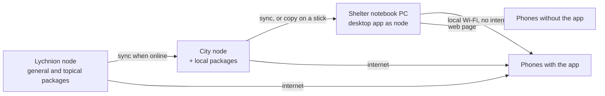

# Distribution: apps and data packages

Design note, 2026-11-18. Status: agreed direction; step 1 built
(records and app checks, see [download-results.md](download-results.md#catalog)).
Not over-engineered on purpose: every step below works on its own.

## The situation we design for

**Ideal:** people install the app and its packages while they have
internet, and keep them up to date before anything happens. Outdoor users
(hiking, skiing, sailing) mostly do this.

**Realistic, for disasters:**

- People hear about the app only after something happened, for example at
  a shelter.
- People who installed it long ago never updated the packages.
- New information appears during the emergency: new official guidance, a
  local map, closed roads, shelter status.
- Internet is down or comes back only now and then.
- Local governments set up their own distribution on site, often on an
  ordinary notebook PC, sometimes on prepared hardware.

So the data has to move over **whatever connection exists**: internet,
the shelter's local Wi-Fi, a USB stick, later phone to phone. And every
copy, from wherever it came, must be **provably genuine and current**.

## Principles

1. **Trust the signature, not the source.** A package is trusted because
   its publisher signed it, not because of the server, stick or phone it
   came from. Then any transport is fine.
2. **Content is addressed by its hash** (SHA-256, as in today's catalog).
   A file either matches or is thrown away.
3. **Versions only go up.** A device never accepts an older version of
   something it has (no rollback to outdated or tampered data).
4. **Packages are data, never code.** SQLite, PMTiles, JSON. The app
   opens only files whose signature and hash it has checked.
5. **Small steps.** Each step below is useful alone. P2P networks are a
   possible later transport, not a foundation.

## Building blocks

### Publishers and keys

Every publisher has an Ed25519 key pair: Lychnion for the general
packages, and for example a city for its local packages. The app ships
with the Lychnion public key. Other publishers' keys are added by the
user, for example by scanning the shelter's QR code, which already carries
the shelter computer's key (`ShelterQrCard`, `lib/facts/signing.dart`).

### Package records

For each package version, the publisher signs a small record:

```json
{
  "id": "jp.outdoor.hiking",
  "version": "2026.11.1",
  "publisher": "lychnion",
  "title": {"ja": "登山（基本）", "en": "Hiking (basics)"},
  "licence": "PDL1.0; sources listed in the package",
  "files": [{"name": "jp.outdoor.hiking.sqlite", "size": 401408, "sha256": "…"}],
  "signed": "2026-11-18T09:00:00+09:00",
  "signature": "…"
}
```

A record stays valid wherever it is copied. A catalog is then just a list
of records, so a node can carry packages of several publishers **without
re-signing them**.

### Node

A node is anything that serves records and files to apps. It does three
things:

1. **Serves** its catalog (a list of signed records) and the files, over
   plain HTTP: on the internet, or on a local network without internet.
2. **Syncs** the catalogs it follows (for example Lychnion's general and
   topical packages, or a neighbouring city's), whenever it has internet.
   It copies the records unchanged, so their signatures stay valid.
3. **Publishes** its own packages, signed with its own key.

No Git or GitHub needed. A node is meant to be run by a city's staff or a
club, so it comes in forms they can operate:

- **The Lychnion desktop app** (macOS, Windows): a "share packages" switch
  turns any notebook PC into a node, for example the shelter computer.
  Following catalogs and adding own packages happen in the app.
- **A headless node** for a server or a small box: the same Dart code as a
  single program (`dart compile exe`) or a container. For people who
  operate servers.
- **A static folder.** A node can export its catalog and files as plain
  files, to put on any web host or a USB stick. GitHub Pages works too,
  for those who already use GitHub, but it is one option, not a
  requirement.

The signing key stays on the machine that publishes the node's own
packages (or on a separate machine), never in a shared folder or
repository.



Open question: how a city makes its own package without our Python build
tools (for example from its own web pages or PDFs, in the desktop app).

### What phones do

Phones do not join any network of nodes. They fetch records and files
directly: from a catalog over the internet when they can, from the shelter
computer when they are on its Wi-Fi. They check the signature and hash,
keep the newest version, and the app loads it.

## Security

| Risk | Answer |
|---|---|
| Fake or changed package | Signature of a trusted publisher on the record, SHA-256 of every file |
| Old package replayed as new | Versions only go up; the app refuses older ones |
| Stolen node key | Each key signs only its publisher's packages; Lychnion's key is not on any node. Key rotation and revocation: a later step |
| Malicious file content | Packages are data; opened read-only, only after the checks; size limits |
| Wrong publisher trusted | Keys are added only by an explicit action (QR at the shelter), shown with the publisher's name; the user can remove them |
| Licence problems | Every source has a licence entry; each package carries its licences and attributions |

A threat model for nodes (Alpha-Omega style) should come with step 3.

## Steps

1. **Signed records.** Sign the records of the Lychnion packages in
   `lychnion-data` and make the app check them. Bundled packages stay as
   they are; downloads and updates must be signed.
2. **Shelter computer serves packages.** The desktop app serves its
   records and files on the local network; phones connected to it update
   from it without internet. (Phones already talk to it for answers.)
3. **Nodes for others.** Following catalogs and publishing own packages
   in the desktop app, plus the headless node. A city or a club runs one
   without Git or a server background; phones trust its key by QR.
4. **On-site help.** A web page served by the shelter computer, so phones
   without the app (all iPhones without it, since iOS installs apps only
   from the App Store) can ask questions in the browser. A "shelter kit":
   one folder or stick with the desktop app, all packages and maps, and
   the Android app file.

## Later, if needed

- **Updates flowing up.** When internet comes back, even briefly, a
  shelter computer sends its new local information (shelter status,
  closed roads, already signed as facts) to its city's node, and pulls
  updates. The node then also holds the most recent updates.
- **Peer to peer.** Hypercore (key-addressed, signed append-only logs,
  Holepunch) fits "keep it current from any peer" well; IPFS gives content
  addressing, with IPNS for updates. Both need internet-reachable servers
  to find peers, and neither has a usable Flutter implementation today.
  Because records are signed and files hash-addressed, either can be added
  later as one more transport without changing the format. Most useful
  between nodes, not on phones.
- **Phone to phone** (Wi-Fi Direct, Bluetooth), using the same records.
- **Several catalogs in the app** with priorities, and key revocation.

## Apps

Separate topic, notes for later:

- Stores: App Store and Google Play under the app store exception
  (`LICENSE-APPSTORE-EXCEPTION.md`); F-Droid fits the AGPL.
- On site: Android can install the app file from the shelter kit; iOS
  cannot, hence the web page in step 4.
- Desktop (shelter computer): macOS and Windows builds as GitHub release
  files; who signs and publishes them is still open.
- The source repository must be public before the app reaches anyone
  outside the team (AGPL).
