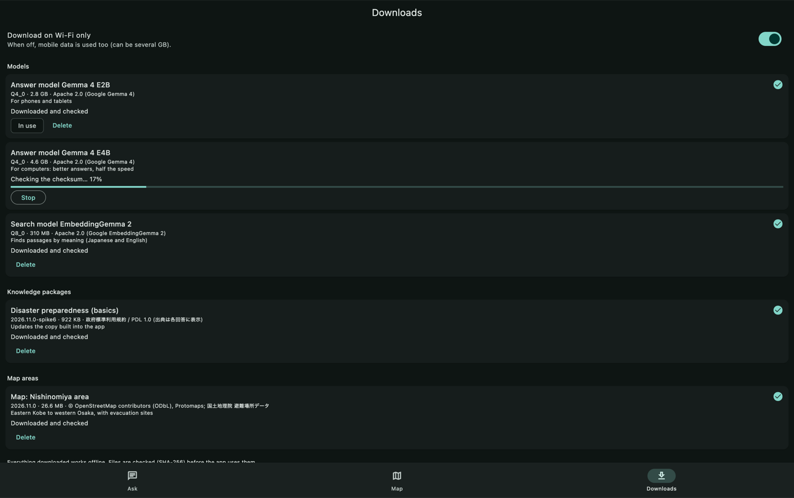
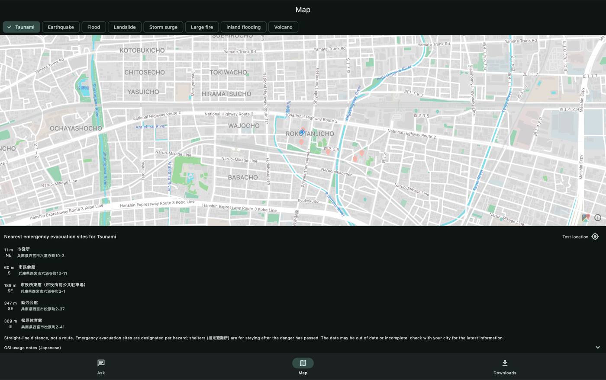
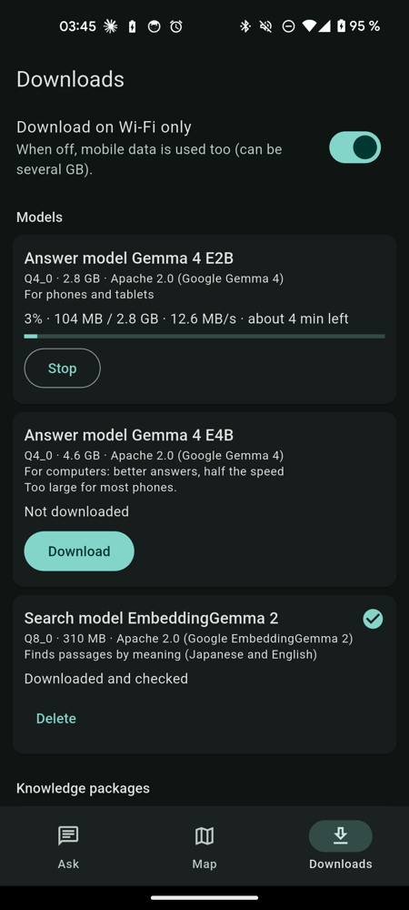
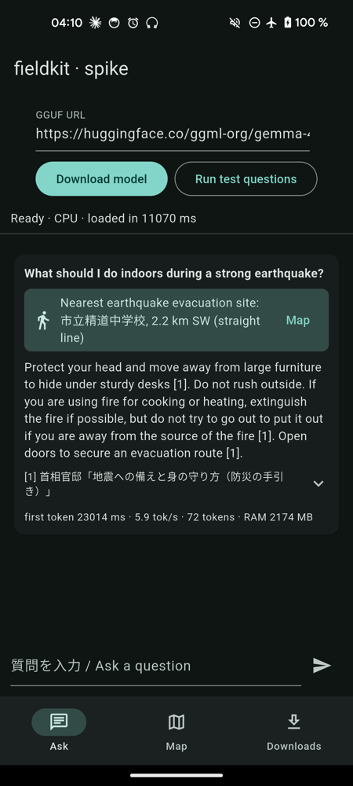
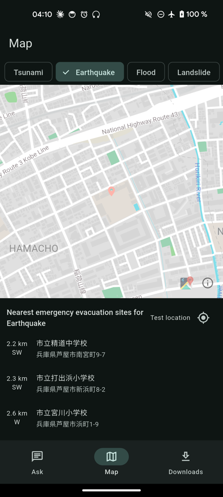

# Downloads inside the app

Date: 2026-11-05. macOS (M4 Max), release build. Android and iOS not tested
yet.

Models, knowledge packages and map areas can now be downloaded in the app
(**Downloads** tab, ダウンロード). Before, they were copied over the cable
(`docs:` paths) or bundled.



## What it does

- One list for all three kinds, with size, version, licence, progress,
  speed and time left. Japanese or English follows the system language.
- **Resume:** files go to `<name>.part`; after a lost connection, a crash or
  "Stop", the download continues with an HTTP Range request. The part is
  hashed again first, so the final check covers the whole file.
- **Checksum:** every file is checked against its SHA-256 before it gets its
  real name. Models use the Hugging Face LFS oid (from
  `https://huggingface.co/api/models/<repo>/tree/main`, field `lfs.oid`). A
  damaged file is deleted and the user is told to download again.
- **Only checked files are used:** a verified download gets a record
  `<id>.installed.json`. Loaders only use files with a record, at the
  recorded size. Files already there without a record (copied by cable or
  picked with "Load GGUF file") show **Check file**, which hashes and adopts
  them without downloading again.
- **Delete** removes the files, any partial download and the record. The
  package falls back to the copy built into the app.
- **Wi-Fi only** is on by default: on mobile data alone the download does not
  start. Files of 1 GB or more ask first and say how much space they need.
- **One writer per file:** the part file is locked, so a second app window
  (desktop) cannot write the same file; it shows "already downloading".
- After a download, the app uses it at once: the chat model loads (the first
  one installed, or the one picked with **Use this model**), the search
  model switches on vector search (cut-off 0.70), the map tab opens the map
  area, a package update reloads the answers.

Storage (app support folder, the same folders as before):

| Kind | Folder | Before |
|---|---|---|
| Models | `models/` | same folder ("Load GGUF file" copied here) |
| Packages | `packages/` | bundled copy was written here; now goes to `bundled/packages/` |
| Map areas | `maps/` | pmtiles copied by cable; sites copied from assets (now `bundled/maps/`) |
| Settings, cached catalog | `downloads/` | – |

## Catalog

Since 2026-11-18 the catalog is a list of **signed records** (format 2,
see [distribution.md](distribution.md), step 1). Each record names one
version of a model, package or map area: id, kind, version, title and note
ja/en, licence, notices, and its files with name, size and SHA-256. The
publisher signs it with Ed25519 (`lib/download/record.dart`); the app has
Lychnion's public key built in (`lib/download/publishers.dart`). Records do
not say where a file is: the catalog's `urls` map (SHA-256 → address)
names files hosted elsewhere (models on Hugging Face, files in older
releases); all others are fetched by name next to the catalog, or from its
`base` (or `DOWNLOAD_BASE_URL`).

The app:

- leaves out records with a bad signature or an unknown publisher, also in
  the bundled and the cached catalog;
- installs a file only after its size and SHA-256 match the signed record,
  and keeps the signed record in `<id>.installed.json`;
- checks those install records again on every start; records from before
  signing count as not installed, so their files show as "unverified" and
  are checked once more against a signed record;
- never installs an older version than the installed one (`older`), and
  shows no update for one. A record without a valid signature fails with
  `signature`.

Bundled packages are not affected. The refresh URL is
`…/releases/latest/download/catalog.json` of the public repo
[lychnion/lychnion-data](https://github.com/lychnion/lychnion-data) (its
README lists sources and licences, including the GSI notes). Apps from
before format 2 cannot read the new catalog and keep their old one.

To publish a new package or map version: build it, raise its `version`
in [tool/items.json](../tool/items.json) (packages: the same as in the
package's meta), then sign and assemble with the key from 1Password:

```bash
op read op://Private/lychnion-package-signing-key/credential | dart run tool/records.dart sign --key - --items tool/items.json --records ../lychnion-data/records jp.bousai.core
```

```bash
dart run tool/records.dart catalog --items tool/items.json --records ../lychnion-data/records --base https://github.com/lychnion/lychnion-data/releases/download/<tag>/ --out assets/downloads/catalog.json
```

```bash
gh release create <tag> -R lychnion/lychnion-data assets/downloads/catalog.json assets/packages/jp.bousai.core.sqlite
```

The signing tool refuses a version that is lower than one already signed,
and the same version with other content. Files that did not change stay
in their old release: give them a `url` in `tool/items.json`. Commit the
new records to lychnion-data.

## Test on macOS

Package and map from a local server (`tool/serve_downloads.py`, Range
support), models from Hugging Face. Driven by the dev flag
`AUTO_DOWNLOAD=id,…` (a leading `!` downloads even if a matching file is
already there).

| Step | Result |
|---|---|
| Package (922 KB), map area (26.6 MB, 2 files) | 0.06 s and 0.2 s, checked |
| EmbeddingGemma 2 Q8_0 from Hugging Face (310 MB) | 9.2 s (about 34 MB/s), checked |
| Gemma 4 E2B Q4_0 (2.84 GB): app killed (`kill -9`) at 919 MB | part kept |
| Second app instance started during the download | refused ("already downloading"), part untouched |
| App started again | resumed at byte 919,048,768, finished and checked in 61 s |
| Gemma 4 E4B (4.6 GB) already on disk, no record | **Check file**: hashed in 21 s, adopted |
| After the downloads | E2B loaded from the download (GPU), tsunami question answered with sources, map from the downloaded files |
| Network use after the downloads | none (`lsof -i` on the app: no connections) |
| From GitHub release 2026.11.0, no local server | catalog refreshed from `releases/latest`; package 0.7 s, map area 2.1 s, both checked |



Seen once, not reproduced: in one run with several app instances killed
just before, the Downloads tab screenshot showed only the loading spinner.
Three later release runs showed the list normally.

## Tests

`test/download_test.dart` (11 tests): download and verify; resume after a
dropped connection (checks the Range header); Range kept across a redirect
(Hugging Face redirects to its CDN); server ignoring Range; wrong checksum;
a part of another version is not resumed; stop keeps the part; the bundled
catalog matches the bundled package; URL resolution; install records,
chat model choice, Wi-Fi setting default.

## Open

- Android (Pixel 5a) and iOS not tested yet. Hashing runs on the main
  isolate; about 200 MB/s on the Mac, a phone will be slower (the UI stays
  usable, but checking 2.8 GB may take a minute).
- iOS: downloads stop when the app goes to the background (resume works on
  return). Model files should be excluded from iCloud backup.
- No free-space check before starting; a full disk shows "not enough free
  space" when writing fails.
- The old "Download model" field on phones (`fromNetwork`) is still there;
  it can go once the Downloads tab is tested on phones.

## Test on Android (Pixel 5a, 2026-11-05)

Clean install of the `main` build (old app and files removed first), then
everything downloaded inside the app over office Wi-Fi: package and map area
from the `lychnion/lychnion-data` release, models from Hugging Face. Driven by
`AUTO_DOWNLOAD`; screenshots and taps over adb.

| Item | Size | Result |
|---|---|---|
| Knowledge package | 0.9 MB | 0.5 s, checked |
| Map area Nishinomiya | 26.6 MB | 3 s, checked |
| Search model EmbeddingGemma 2 | 310 MB | 27 s, checked |
| Answer model Gemma 4 E2B | 2.84 GB | about 12.6 MB/s; **Stop** at 574 MB showed "Paused", **Resume** continued; checked (the SHA-256 of 2.8 GB takes a minute or two on this phone) |



Then **airplane mode** (no Wi-Fi, no mobile data) and a question typed in the
app: "What should I do indoors during a strong earthquake?" Answer in 35 s
(CPU), cited from 首相官邸「地震への備えと身の守り方」, with the nearest
earthquake site and a working link to the offline map.

 

### Finding: cities without earthquake sites in the GSI data

The nearest earthquake sites for 西宮市役所 are in 芦屋市 (2.2 km and more). In
the GSI data for this area, 西宮市 (0 of 200 emergency sites) and 尼崎市
(0 of 113) mark no site for earthquakes, while 神戸市 marks all 154 and 芦屋市
19 of 40. The app follows the data and sends a Nishinomiya resident to the
next city. It should instead say when the user's own city has no site for
that hazard in the data, and point to the city's own hazard map.

### Notes

- After the run, Android's log no longer showed the start of the download
  (the log buffer rolls over); the Downloads tab is the reliable view.
- With a Japanese keyboard, adb's Enter key goes to the keyboard, not the
  send button; tap the button.
