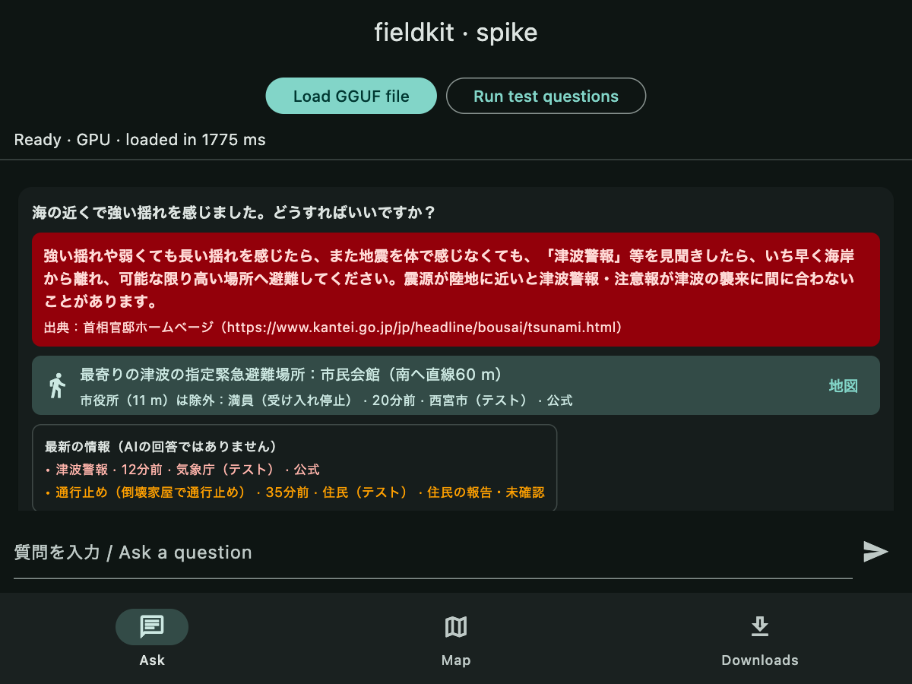
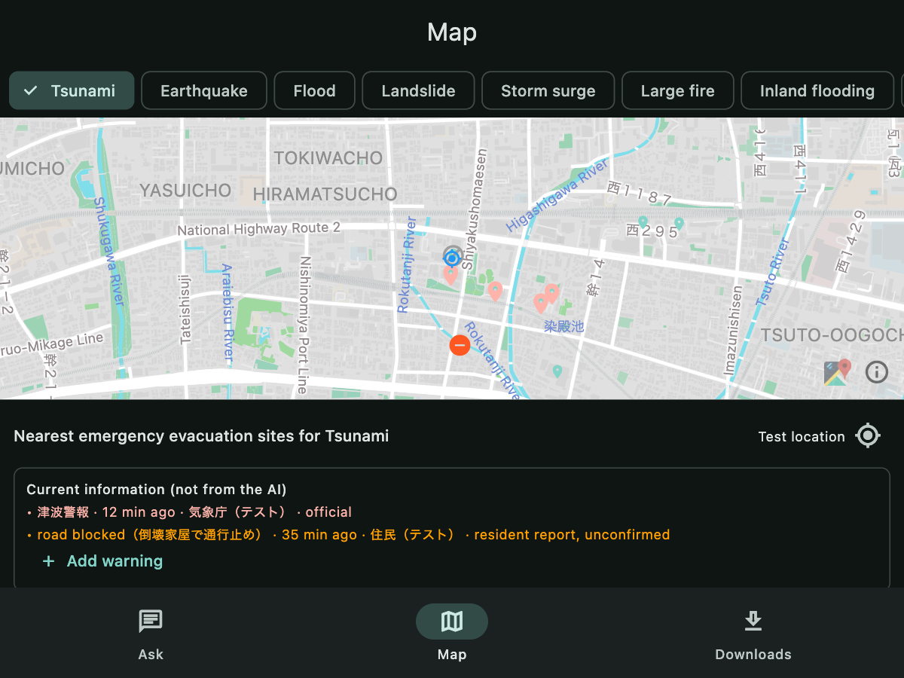

# Current facts (2026-11-05)

Facts that change during a disaster: a shelter is full, a road is blocked,
a warning is in force, water is handed out. They are kept apart from the
model and the knowledge packages, and the app never lets the model write
them. The app shows them as they are, with their age and source.

## What a fact is

| Field | Example |
|---|---|
| kind | S shelter status, R road blocked, W water point, A warning |
| subject | GSI site ID (共通ID), a point `lat,lon`, or a city name |
| value | `open` / `crowded` / `full` / `closed`, `blocked`, 「津波警報」 |
| observed / expires | every fact expires; expired facts are never shown |
| source | official (3), sensor (2), citizen (1), plus a name |

When two facts about the same thing disagree, the most trusted source
wins, then the newest. A citizen report is shown as 「住民の報告・未確認」 /
"resident report, unconfirmed".

Code: `lib/facts/`. Facts are stored in `facts.jsonl` in app support,
append only.

## Where they show

- **Answer:** the nearest site skips a shelter that is full or closed, and
  says why: 「市役所（11 m）は除外：満員（受け入れ停止）· 20分前 · 西宮市（テスト）· 公式」.
  Below it, a box 「最新の情報（AIの回答ではありません）」 lists warnings and
  blocked roads.
- **Map:** full or closed sites are grey; blocked roads have an orange
  marker; the same box sits above the site list; each site shows its status.




Demo run (made-up facts, marked 「テスト」 in their source):

```bash
flutter run -d macos --release ... --dart-define=DEMO_FACTS=true \
  --dart-define=MOCK_LOCATION=34.7376,135.3417 \
  "--dart-define=ASK=海の近くで強い揺れを感じました。どうすればいいですか？"
```

## Entering facts (shelter computer)

On the shelter computer (`SHELTER_SERVER=true`, or `FACTS_EDIT=true` for
testing) the map tab lets staff enter facts:

- ✎ next to a site: set it to 開設 / 混雑 / 満員 / 閉鎖, with a note.
- Long press on the map: report a blocked road or a water point there.
- 「警報・注意報を追加」 in the current-information box: add a warning for the
  city; tap a line to change it.
- Every entry has a lifetime (1, 3, 6 or 24 hours) and a source: 公式
  (staff, city) or 住民の報告 (a resident told the staff). The source name is
  the shelter's name (`SHELTER_NAME`).
- 「解除する」 marks a road as reopened or a warning as lifted. This adds a
  new "cleared" fact rather than deleting the old one, so phones that only
  pull facts apply it too. A resident report cannot clear an official fact.

Phones connected to the shelter computer pull its facts once a minute.



Checked: widget tests for the form (status, lifetime, note, source; `|` and
`;` are removed because the radio format uses them), store tests for
clearing, and a macOS run as shelter computer: the map tab shows the entry
controls and `GET /facts` returns the facts. The form was not clicked
through on the running app, and no phone was connected for this run.

## Sharing

- **Shelter computer:** `GET /facts` returns all unexpired facts, so phones
  apply the same rules. A connected phone pulls them at once and then every
  minute.
- **Radio-sized format:** `GET /facts?compact=1` packs facts for slow links
  (LoRa, SMS). One shelter update is 16 bytes (`So|1b7|f|9ivw|3c`: kind+source,
  site number, status, minute, lifetime). 12 updates fit in one 190-byte
  message. Sites are numbered by their position in the map area's site list,
  so both sides need the same map version.

## Open

- No official feed yet (e.g. city open data); facts come from the
  shelter computer or the demo flag.
- Anyone using the shelter computer can enter an "official" fact. Fine for
  staff-run computers; a public or shared device needs a sign-in or
  signatures.
- Facts are not signed. Anyone on the shelter Wi-Fi network could only read
  them, not write, but a future write path needs signatures.
- The answer shows the status of a skipped site, not yet the status of the
  suggested one (in the demo 市民会館 is 「混雑」, shown only on the map).
- The compact format is not yet sent over any radio, and it drops the note
  and source name to save space. It counts UTF-8 bytes (a Japanese warning
  takes 3 bytes per character).
