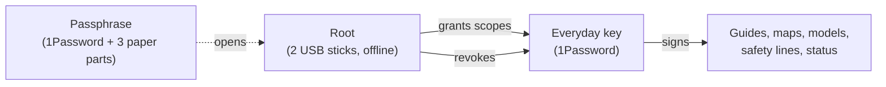

# Key custody

How Lychnion's keys are kept and used, and what to do when one is lost or
stolen (lychnion/lychnion#118, stage 1). Whoever holds Lychnion's keys can
sign models, safety lines and guides that every phone trusts, so this page
is part of the security contract (threat-model.md §1.3).

For now one maintainer holds every key. Stage 1 keeps that safe against
loss (fire, a lost laptop, a forgotten passphrase) and limits what a
stolen everyday key can do. Stages 2 and 3 (more than one key holder,
several signatures, a public log) are in #118.

## The keys

| Key | What it signs | Where it lives |
| --- | --- | --- |
| **Root** (the key built into the app) | Only key statements: grants, revocations of granted keys, its own replacement | An encrypted key backup on two USB sticks. Never on a disk, in 1Password or online. |
| Root backup passphrase | (opens the root's backup) | 1Password item `lychnion-root-passphrase`, apart from the sticks; split on paper with SLIP-39 (3 parts, any 2 restore it) |
| **Everyday key** | Data, models, safety lines, attestations (the scopes the root granted it; never `keys`) | 1Password item `lychnion-everyday-key` |
| Android upload key | App bundles and APKs for Google Play and testers | 1Password item `lychnion-android-upload-key` ([release-builds.md](release-builds.md)) |



Why it is split this way:

- A thief of the **everyday key** can sign data until the root revokes
  it. The root then grants a new everyday key. Phones learn of the
  revocation from Lychnion's status in the next catalog they get
  (docs/distribution.md, "Freshness: publisher status").
- A thief of a **USB stick** gets an encrypted file. Without the
  passphrase it can neither sign nor revoke anything: the root's backup
  carries no ready-made revocation (the app's own backups do).
- A thief of **1Password** gets the everyday key and the passphrase, but
  not the root: that is only on the sticks.
- If **1Password is lost**, any 2 of the 3 paper parts restore the
  passphrase. If **one stick is lost**, the other one still has the root.

Where the two sticks and the three paper parts are kept is written down
privately, not in this repository. Keep them in different places (for
example: at home, in a bank safe deposit box, and in a sealed envelope
with someone trusted), never a stick and two paper parts in the same
place.

## Rules for the root

- The root signs only key statements. Data is signed with the everyday
  key.
- The root is used on the maintainer's Mac **with the network off**
  (Wi-Fi off, cable out), for the few minutes it takes, and the stick is
  removed right after.
- Every use of the root ends in a pull request to lychnion-data that
  changes `keys/lychnion.json`. The pull request says when, why, and with
  which stick. Together with git history this is the log of every root
  signature.
- The root's backup file is never copied to a disk, a server, a
  repository, cloud storage or a chat.

## Using the root (checklist)

For a grant, a revocation, or opening a stick for the yearly check.

1. On the everyday Mac, prepare what the root will sign (for a grant:
   `grant-request` with the new key, and note the key it prints, on
   paper or by reading it out, separately from the file).
2. Turn off Wi-Fi and unplug network cables.
3. Plug in one root stick.
4. Run the command with `--key /Volumes/<stick>/lychnion-root.lychnion-key`.
   Copy the passphrase from 1Password when asked (1Password works
   offline). For a grant, `--expect-key` is the key noted in step 1.
5. Eject the stick and put it back in its place.
6. Turn the network back on, commit `keys/lychnion.json`, and open the
   pull request in lychnion-data.

The commands are in the lychnion-data README, "The root and the everyday
key" and "The offline root".

## Moving the root offline (once)

Today the root is the key in 1Password item
`lychnion-package-signing-key`. It leaves 1Password in this order, so
that data releases never stop:

1. **Split the passphrase.** While online, install Trezor's
   `shamir-mnemonic` tool (SLIP-39) in its own folder:

   ```bash
   python3 -m venv ~/slip39 && ~/slip39/bin/pip install 'shamir-mnemonic[cli]'
   ```

   Then, with the network off:

   ```bash
   ~/slip39/bin/shamir create 2of3 -s 128
   ```

   It prints `Using master secret: <32 characters>` and three parts of
   20 words each. The 32 characters are the backup passphrase. Write each
   part on its own sheet of paper, with the part's number and the date.
   Save the passphrase in a new 1Password item,
   `lychnion-root-passphrase`. Clear the terminal (`clear`, then close
   the window). Check: `~/slip39/bin/shamir recover` with any two parts
   prints the same 32 characters.
2. **Make the backup.** On two USB sticks named `ROOT-A` and `ROOT-B`,
   with the network off:

   ```bash
   op read op://Private/lychnion-package-signing-key/credential \
     | dart run tool/records.dart backup --key - \
         --out /Volumes/ROOT-A/lychnion-root.lychnion-key
   cp /Volumes/ROOT-A/lychnion-root.lychnion-key /Volumes/ROOT-B/
   dart run tool/records.dart public --key /Volumes/ROOT-B/lychnion-root.lychnion-key
   ```

   The last command must print the key in lychnion-data's
   `keys/lychnion.pub`.
3. **Make and grant the everyday key.**

   ```bash
   dart run tool/records.dart keygen --1password --title lychnion-everyday-key \
     | op item create --vault Private -
   ```

   Then grant it `data,models,safety-lines,attestations` with the root
   from a stick (the two-step grant in the lychnion-data README), and
   merge the pull request with `keys/lychnion.json`.
4. **Switch data releases to the everyday key**, once the app release
   with key scopes (#140, #141) is out and most phones have it: older
   app builds ignore grants and would reject records the everyday key
   signed. From then on, `sign`, `catalog` and `attest` read
   `op://Private/lychnion-everyday-key/credential`.
5. **Delete the root from 1Password**: the item
   `lychnion-package-signing-key`, and again from 1Password's "Recently
   Deleted". Check that `op read` of it fails. From now on the root is
   only on the sticks.

## When a key is lost or stolen

| What happened | What to do |
| --- | --- |
| Everyday key stolen or leaked | Root: `revoke-key` of it (from a stick), then grant a new everyday key. Publish a catalog right away: phones stop trusting the old key once they get it. Records it signed stop counting; sign those items again with the new key. |
| Everyday key lost (no theft) | Grant a new everyday key. Revoke the old one too if it might turn up somewhere. |
| One stick lost | The other stick still works. Make a new second stick from it. The lost one is useless without the passphrase; replace the root anyway if the passphrase might also be known to someone else. |
| 1Password lost or locked out | Restore the passphrase from 2 of the 3 paper parts (`shamir recover`); make a new everyday key and grant it. |
| One paper part lost | Make new parts: `shamir create 2of3` with the same passphrase as master secret (`-S <the 32 characters>`), and destroy the old ones. |
| Root stolen together with its passphrase | The root can be replaced with the existing key statements only while the maintainer still holds it, and a thief can race that (a theft proof makes phones distrust both). The way out is an app update with a new built-in root. A `replace` command in tool/records.dart is not built yet. |

## Accounts and releases

- **GitHub:** the lychnion organisation requires two-factor
  authentication. In lychnion-data, `main` changes only through a pull
  request with green CI, and release tags can never be moved or deleted.
  In lychnion, `main` needs green CI.
- **App stores:** use two-factor authentication with a hardware key on
  the Google Play and Apple developer accounts. Whoever can ship the app
  can change the built-in keys, so the root is only as safe as the
  releases.
- **Release signing:** [release-builds.md](release-builds.md) and
  [releasing.md](releasing.md). Builds are made on the maintainer's Mac;
  iOS and macOS signing is not written down yet. Builds in CI with
  provenance are stage 3 of #118.

## Once a year

- Open each stick (`public --key …`) and check it prints the root's key.
- Restore the passphrase from two paper parts and compare it with the
  1Password item.
- Check that the sticks and paper parts are still in their places.
- Read this page and fix what has changed.

The grant, revocation and backup commands are also tested end to end in
lychnion-data's CI with throwaway keys (`tool/test_keys.sh`).
