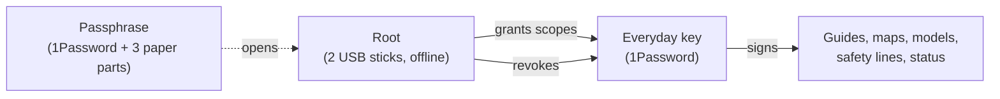

# Key custody

How Lychnion's keys are kept and used, and what to do when one is lost or
stolen (lychnion/lychnion#118, stage 1). Whoever holds Lychnion's keys can
sign models, safety lines and guides that every phone trusts. The keys
themselves are outside the threat model (threat-model.md §1.3); this page
is how they are kept safe instead.

For now one maintainer holds every key. Stage 1 protects against loss
(fire, a lost laptop, a forgotten passphrase) and keeps the root, which
can grant and revoke keys, away from everyday use. It does not make a
stolen everyday key harmless (see "The keys"), and with one key holder
there is no one to take over (see "When a key is lost or stolen").
Stages 2 and 3 (more key holders, several signatures, a public log) are
in #118.

## The keys

This is the state after the one-time move below. Until its last step,
the root is also still in 1Password.

| Key | What it signs | Where it lives |
| --- | --- | --- |
| **Root** (the key built into the app) | By rule only key statements: grants, revocations of granted keys, its own replacement | An encrypted key backup on two USB sticks, never on a computer's disk |
| Root backup passphrase | (opens the root's backup) | 1Password item `lychnion-root-passphrase`, apart from the sticks; split on paper with SLIP-39 (3 parts, any 2 restore it) |
| **Everyday key** | Data, models, safety lines, attestations (the scopes the root granted it; never `keys`) | 1Password item `lychnion-everyday-key` |
| Android upload key | App bundles, and the APKs testers install | 1Password item `lychnion-android-upload-key` ([release-builds.md](release-builds.md)) |



What each loss gives away:

- A thief of the **everyday key** can sign anything it holds a scope for,
  models, safety lines and "Checked by Lychnion" attestations included,
  until the root revokes it. Phones stop trusting it only once they get
  a catalog, stick or base that carries the revocation (in Lychnion's
  status, docs/distribution.md "Freshness: publisher status"); a phone
  that gets nothing new keeps trusting it.
- A thief of a **USB stick** gets an encrypted file. Without the
  passphrase it can neither sign nor revoke anything: the root's backup
  carries no ready-made revocation (the app's own backups do).
- A thief of **1Password** gets the everyday key and the passphrase, but
  not the root, which is only on the sticks. The passphrase is then
  burnt (see the table below).
- If **1Password is lost**, any 2 of the 3 paper parts restore the
  passphrase. If **one stick is lost**, the other one still has the root.

**The root's rule is not enforced yet.** Until an app update limits the
built-in key to `keys` (docs/distribution.md "Backing up and replacing the key"; planned once
data releases are signed with the everyday key), every phone trusts the
root for every scope, so a stolen root could sign data directly. That
update should ship before the first store release.

Where the two sticks and the three paper parts are kept is written down
privately, not in this repository. Keep them in different places, never
a stick and two paper parts in one place. Label the sticks neutrally (not
"root" or "Lychnion"). Places to consider: at home, in a bank safe
deposit box (closed in a disaster, so never the only place you can
reach), and in a sealed envelope with someone trusted.

## Rules for the root

- By rule, the root signs only key statements. Data is signed with the
  everyday key.
- The root is used on the maintainer's Mac in a **clean session**: a
  separate macOS user account used for nothing else, with a fresh clone
  of lychnion-data at a merged `main` commit (`git status` clean, no
  agent, editor plug-in or other tool attached). `dart pub get` is run
  there before the network goes off. The tool and its dependencies see
  the root and its passphrase, so they must be code that went through a
  reviewed pull request.
- The network is **off** while the root is open (Wi-Fi off, cable out),
  and the stick is ejected before it comes back. This does not help
  against a tool that saves the key and sends it later: that is what the
  clean session is for.
- The passphrase is copied from 1Password and pasted at the prompt only.
  Turn off Universal Clipboard (Handoff) and clipboard managers in that
  account, and copy something else afterwards.
- Every signature by the root ends in a pull request to lychnion-data
  that changes `keys/lychnion.json`. The pull request says when, why, and
  with which stick. With git history, this is the log of the root's
  intended signatures; it cannot show one a thief made.
- The root's backup file is never copied to a computer's disk, a server,
  a repository, cloud storage or a chat.

## Using the root (checklist)

1. In your everyday account, prepare what the root will sign. For a
   grant, run `grant-request` with the new key, and note the key it
   prints (on paper, or read it out), apart from the file.
2. Log in to the clean account. Update its lychnion-data clone to the
   merged `main`, check `git status` is clean, and run `dart pub get`.
3. Turn off Wi-Fi and unplug network cables. Plug in one root stick.
4. Run the command with `--key /Volumes/<stick>/lychnion-root.lychnion-key`,
   and paste the passphrase from 1Password when asked. For a grant,
   `--expect-key` is the key noted in step 1.
5. Eject the stick and put it back in its place. Log out of the clean
   account.
6. Turn the network back on, commit `keys/lychnion.json`, and open the
   pull request in lychnion-data.

The commands are in the lychnion-data README, "The root and the everyday
key" and "The offline root".

## Moving the root offline (once)

Today the root is the key in 1Password item
`lychnion-package-signing-key`. It leaves 1Password in this order, so
that data releases never stop. lychnion/lychnion-data#41 (the `backup`
command) must be merged first.

1. **Split the passphrase.** In the clean account, while online, install
   Trezor's SLIP-39 tool, pinned:

   ```bash
   python3 -m venv ~/slip39 && ~/slip39/bin/pip install 'shamir-mnemonic[cli]==0.3.0'
   ```

   Then turn the network off, open a new Terminal window with no agent
   or other session attached, and start a shell that keeps no history:

   ```bash
   HISTFILE=/dev/null zsh
   ~/slip39/bin/shamir create 2of3 -s 128
   ```

   It prints `Using master secret: <32 characters>` and three parts of 20
   words each. The 32 characters are the backup passphrase. Write each
   part on its own sheet of paper with its number, the date, and "SLIP-39,
   shamir-mnemonic 0.3.0" (its parts are of the newer, extendable kind).
   Save the passphrase in a new 1Password item, `lychnion-root-passphrase`.
   Check that `~/slip39/bin/shamir recover` with any two parts prints the
   same 32 characters. Then clear the window (Cmd+K), close it, and quit
   Terminal.
2. **Make the backup.** In the clean account, with the network off and two
   USB sticks plugged in:

   ```bash
   op read op://Private/lychnion-package-signing-key/credential \
     | dart run tool/records.dart backup --key - \
         --out /Volumes/<stick A>/lychnion-root.lychnion-key
   cp /Volumes/<stick A>/lychnion-root.lychnion-key /Volumes/<stick B>/
   ```

   Paste the 32 characters from 1Password at both prompts (no other
   passphrase). Eject both sticks, plug in stick B alone, and run
   `dart run tool/records.dart public --key /Volumes/<stick B>/lychnion-root.lychnion-key`.
   It must print the key in lychnion-data's `keys/lychnion.pub` and in
   `packages/lychnion_format/lib/src/publishers.dart`. Do the same for
   stick A.
3. **Make and grant the everyday key.** In your everyday account:

   ```bash
   dart run tool/records.dart keygen --1password --title lychnion-everyday-key \
     | op item create --vault Private -
   ```

   Then grant it `data,models,safety-lines,attestations` with the root
   from a stick (the two-step grant, "Using the root" above), and merge
   the pull request with `keys/lychnion.json`.
4. **Switch data releases to the everyday key** once phones can take it:
   the app's first tagged release (0.1.0) includes key scopes, and testers
   on builds from before #140 have updated. Older builds ignore grants and
   would reject records the everyday key signed. From then on, `sign`,
   `catalog` and `attest` read
   `op://Private/lychnion-everyday-key/credential`.
5. **Check before deleting.** A data release signed by the everyday key
   passes `verify --release`, and a current build of the app installs it.
   (Until step 6, the root still works from 1Password; after it, every
   command takes the root from a stick.)
6. **Delete the root from 1Password**: the item
   `lychnion-package-signing-key`, then again from "Recently Deleted".
   Check that `op read` of it fails, also on other devices that sync the
   vault. Delete any other copy of the root, above all an app-style
   backup made earlier (it carries a ready-made revocation of the root).
   Update the comment in `packages/lychnion_format/lib/src/publishers.dart`
   that says where the root's private key is.

## When a key is lost or stolen

| What happened | What to do |
| --- | --- |
| Everyday key stolen or leaked | Make a new everyday key and its `grant-request` first. Then, in one root session, `revoke-key` the old key and `grant` the new one, in one pull request, and publish a catalog right away. Records the old key signed stop counting; sign those items again with the new key. A thief can publish a very high version, and a phone never installs an older version than one it installed (threat-model.md §1.11 `no-downgrade-installed`): such phones only take the real version again after the item is deleted on the phone. Tell users how, with the revocation. |
| Everyday key lost (no theft) | Make a new one and grant it. Revoke the old one too if it might turn up somewhere. |
| 1Password stolen or compromised | Treat the everyday key as stolen (row above) and the passphrase as burnt. While the sticks are still safe, make new root backups under a new passphrase (new SLIP-39 parts, the old parts destroyed), and delete the old backups from both sticks. |
| 1Password lost or locked out (no theft) | Restore the passphrase from 2 of the 3 paper parts (`shamir recover`). Make a new everyday key and grant it. |
| One stick lost | The other stick still works: make a new second stick from it. The lost one is useless without the passphrase. If the passphrase might be known to anyone, make new backups under a new passphrase. |
| Both sticks lost or destroyed | The root is gone: no new grants or revocations. The everyday key keeps signing until it is lost too. The way out is an app update with a new built-in root. |
| One paper part lost or stolen | Make new parts: in a history-free shell as in step 1, `shamir create 2of3 -S <the 32 characters>`, and destroy the old parts you still have. A stolen part plus one other restores the passphrase, so if one might be stolen, also make new backups under a new passphrase. |
| Root stolen together with its passphrase | The root can be replaced with key statements only while the maintainer still holds it, and a thief can race that (a theft proof makes phones distrust both chains). The way out is an app update with a new built-in root. A `replace` command in tool/records.dart is not built yet. |
| The Mac, or the maintainer's GitHub account, compromised | Treat everything used on it as stolen: the everyday key, the passphrase if it was used there since, and possibly the root if a root session ran on it. Check the repositories for changes nobody reviewed. |
| Android upload key stolen | It signs app builds, which can change the built-in keys. Reset it with Google Play (upload key reset); testers' APKs signed with it can no longer be trusted. |
| Maintainer unavailable | With one key holder, nobody can sign. The sealed paper part alone does not restore the passphrase. Handing over is stage 2 of #118. |

## Accounts and releases

- **GitHub:** the lychnion organisation requires two-factor
  authentication (to be switched on in the organisation's settings; the
  API cannot). In lychnion-data, `main` changes only through a pull
  request with green CI, and tags can never be moved or deleted; the
  maintainer, as admin, can still merge a pull request past the checks.
  In lychnion, `main` needs green CI.
- **App stores:** use two-factor authentication with a hardware key on
  the Google Play and Apple developer accounts. Whoever can ship the app
  can change the built-in keys, so the root is only as safe as the
  releases.
- **Release signing:** [release-builds.md](release-builds.md) and
  [releasing.md](releasing.md). Builds are made on the maintainer's Mac;
  iOS and macOS signing is not written down yet. Builds in CI with
  provenance are stage 3 of #118.

## Once a year

Check one thing at a time, so that the sticks and paper parts are never
together in one place:

- Open each stick in a clean session (`public --key …`), and check it
  prints the root's key.
- Restore the passphrase from two paper parts, and compare it with the
  1Password item.
- Check that the sticks and paper parts are still in their places.
  Replace sticks every few years: they wear out.
- Read this page and fix what has changed.

The grant, revocation and backup commands are also tested end to end in
lychnion-data's CI with throwaway keys (`tool/test_keys.sh`,
`tool/test_passphrase_tty.py`).
