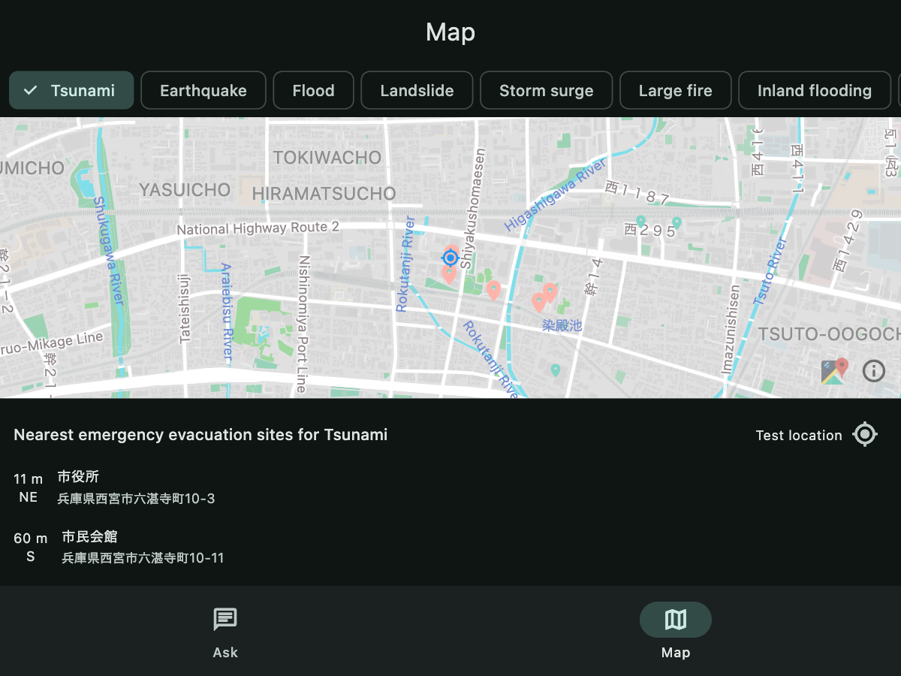
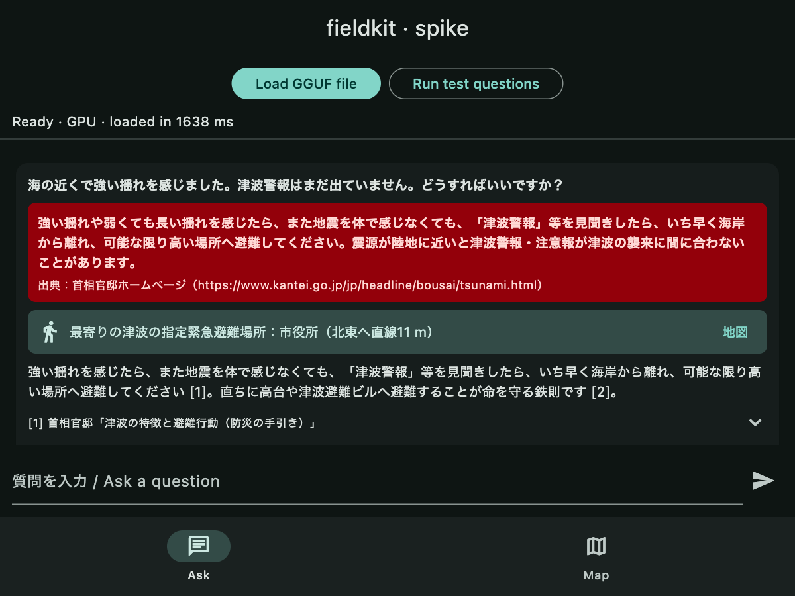

# Offline map: Nishinomiya area

Date: 2026-11-04. macOS (M4 Max), release build.



## What it does

- Base map from one local PMTiles file, no network: OpenStreetMap data via a
  Protomaps build, cut to eastern Kobe – Nishinomiya – western Osaka
  (bbox 135.20,34.66 to 135.48,34.88), zoom 0 to 15. **24 MB.**
- Evacuation sites from GSI (国土地理院): 1,613 指定緊急避難場所 (694 of them
  for tsunami) and 1,001 指定避難所 in the area. **392 KB** SQLite in the
  app's assets.
- Pick a hazard (tsunami, earthquake, flood, landslide, storm surge, large
  fire, inland flooding, volcano): the map shows the sites designated for it,
  and the list shows the five nearest with straight-line distance and compass
  direction. Shelters (指定避難所) are never offered as places to flee to.
- Location from the device GPS (works without network); `MOCK_LOCATION` for
  testing. Japanese or English labels follow the system language.
- The GSI usage notes are shown on the map screen, as the GSI terms require
  when the data is passed on.

## How to build the data

```bash
brew install pmtiles
python3 -I tool/build_map.py tool/maps/nishinomiya.json
```

Writes `assets/maps/jp.map.nishinomiya.sites.sqlite` and
`build/maps/jp.map.nishinomiya.pmtiles` (not in git). Another area is a new
manifest with its bbox and prefecture codes.

## Licences

| Data | Licence | What we do |
|---|---|---|
| GSI 指定緊急避難場所・指定避難所データ | 国土地理院コンテンツ利用規約 + usage notes (agreed on 2026-11-04 by Daniel) | Attribution and the notes in the app; marked as edited (area cut) |
| OpenStreetMap via Protomaps | ODbL 1.0 | Attribution on the map |

## Open points

- ~~No street or place names~~ Fixed: the Protomaps v4 label expressions
  (per-script `case`) are not drawn by vector_tile_renderer 5, so
  `lib/map/offline_theme.dart` replaces them with a plain name lookup
  (Japanese or English), removes the online sprites, and drops minor-road
  labels (mostly road numbers). Labels need the vector render mode.
- **Old library versions.** The PMTiles plugin pins flutter_map 7 and
  vector_map_tiles 8; the newer betas conflict. Fine for the PoC, to revisit.
- **Distance is straight-line.** Routes would need a routing graph; a later
  step (Valhalla offline tiles or simpler).
- ~~Not linked with the assistant~~ Done, see below.
- Data freshness: GSI updates often (Hyogo 2026-10-22, Osaka 2026-10-21 at
  download). The package should carry the date and the app should show it.

## Linked with the assistant (2026-11-04)



When the question is about a hazard (the tsunami safety line fired, or a
keyword such as 地震 / flood / 土砂 in Japanese or English), the answer shows
the nearest emergency evacuation site for that hazard, with direction and
straight-line distance. The 地図 / Map button opens the map tab on that site
with the hazard selected. Questions without a hazard (bleeding, hiking gear)
show no site. Keyword list: `lib/map/hazard_detect.dart`.

Demo run without clicking:

```bash
flutter run -d macos --release \
  --dart-define=GGUF_MODEL_PATH=... --dart-define=EMBED_MODEL_PATH=... --dart-define=MIN_COS=0.70 \
  --dart-define=MAP_PMTILES_PATH=... --dart-define=MOCK_LOCATION=34.7376,135.3417 \
  "--dart-define=ASK=海の近くで強い揺れを感じました。…|What should I do indoors during a strong earthquake?"
```

It asks the questions, then saves screenshots of the answers and of the map
to the app's Documents folder.

Open: the site suggestion uses the nearest site only. It does not know
whether the way there leads toward the sea, or whether higher ground is
closer; that needs routing and elevation data.
