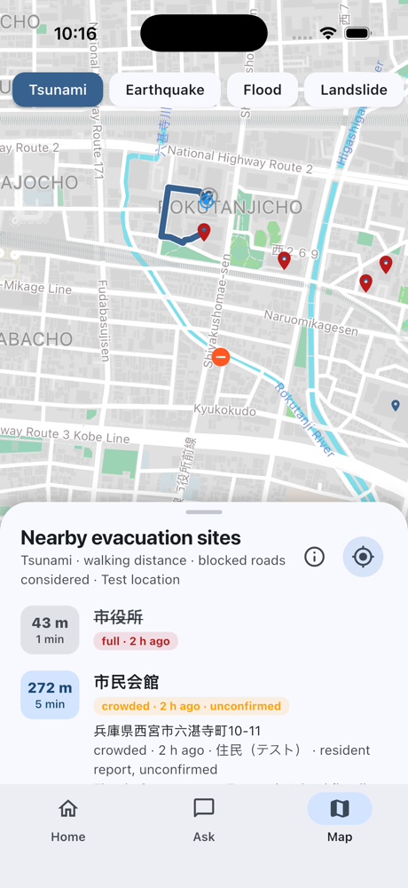
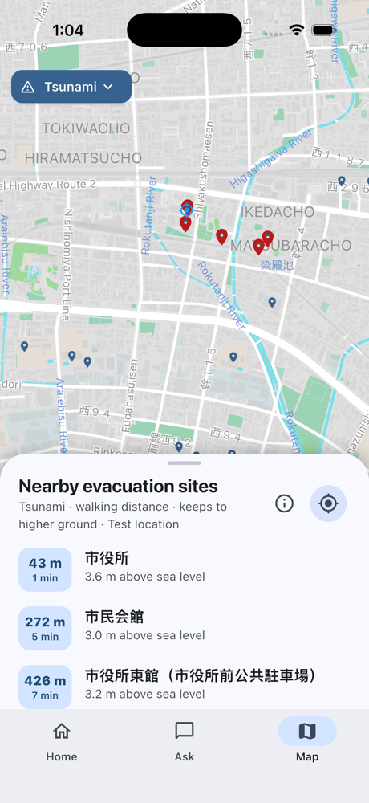
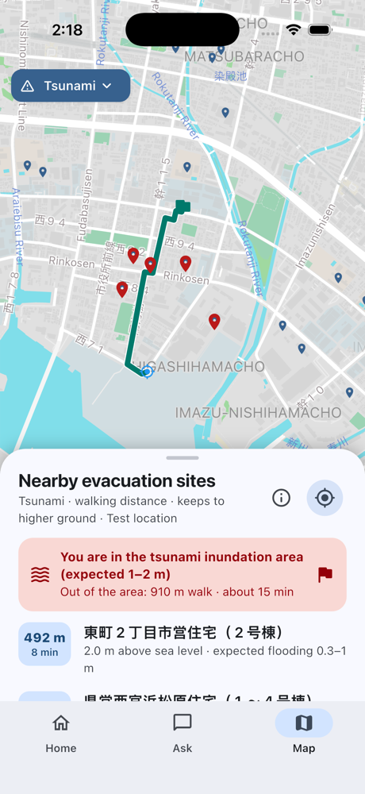
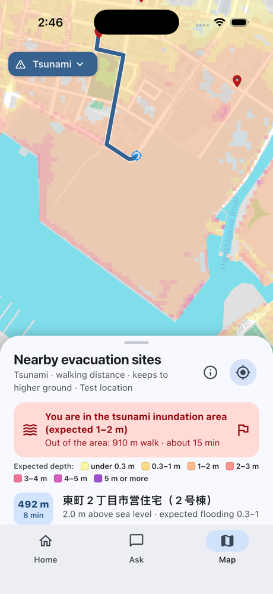

# Offline map: Nishinomiya area

Date: 2026-11-04. macOS (M4 Max), release build.


## What it does

- Base map from one local PMTiles file, no network: OpenStreetMap data via a
  Protomaps build, cut to eastern Kobe – Nishinomiya – western Osaka
  (bbox 135.20,34.66 to 135.48,34.88), zoom 0 to 15. **24 MB.**
- Evacuation sites from GSI (国土地理院): 1,613 指定緊急避難場所 (694 of them
  for tsunami) and 1,001 指定避難所 in the area. **392 KB** SQLite in the
  app's assets.
- Pick a hazard (tsunami, earthquake, flood, landslide, storm surge, large
  fire, inland flooding, volcano): the map shows the sites designated for it,
  and the list shows the five nearest with straight-line distance and compass
  direction. Shelters (指定避難所) are never offered as places to flee to.
- Location from the device GPS (works without network); `MOCK_LOCATION` for
  testing. Japanese or English labels follow the system language.
- The GSI usage notes are shown on the map screen, as the GSI terms require
  when the data is passed on.

## How to build the data

```bash
brew install pmtiles
python3 -I tool/build_map.py tool/maps/nishinomiya.json
```

Writes `assets/maps/jp.map.nishinomiya.sites.sqlite` and
`build/maps/jp.map.nishinomiya.pmtiles` (not in git). Another area is a new
manifest with its bbox and prefecture codes.

## Licences

| Data | Licence | What we do |
|---|---|---|
| GSI 指定緊急避難場所・指定避難所データ | 国土地理院コンテンツ利用規約 + usage notes (agreed on 2026-11-04 by Daniel) | Attribution and the notes in the app; marked as edited (area cut) |
| OpenStreetMap via Protomaps | ODbL 1.0 | Attribution on the map |
| OpenStreetMap via Geofabrik (walking graph) | ODbL 1.0 | Attribution on the map |
| GSI 標高タイル (DEM5A, DEM10B) | 国土地理院コンテンツ利用規約 | 「標高：国土地理院 標高タイル」 on the map |
| 国土数値情報 津波浸水想定 (A40): 兵庫県 2016, 大阪府 2023 | CC BY 4.0 (both prefectures in the open-data group) | 「津波浸水想定：国土数値情報（国土交通省）CC BY 4.0・加工」 on the map |

## Open points

- ~~No street or place names~~ Fixed: the Protomaps v4 label expressions
  (per-script `case`) are not drawn by vector_tile_renderer 5, so
  `lib/map/offline_theme.dart` replaces them with a plain name lookup
  (Japanese or English), removes the online sprites, and drops minor-road
  labels (mostly road numbers). Labels need the vector render mode.
- **Old library versions.** The PMTiles plugin pins flutter_map 7 and
  vector_map_tiles 8; the newer betas conflict. Fine for the PoC, to revisit.
- ~~Distance is straight-line.~~ Fixed: walking routes, see below.
- ~~Not linked with the assistant~~ Done, see below.
- Data freshness: GSI updates often (Hyogo 2026-10-22, Osaka 2026-10-21 at
  download). The package should carry the date and the app should show it.

## Linked with the assistant (2026-11-04)


When the question is about a hazard (the tsunami safety line fired, or a
keyword such as 地震 / flood / 土砂 in Japanese or English), the answer shows
the nearest emergency evacuation site for that hazard, with direction and
straight-line distance. The 地図 / Map button opens the map tab on that site
with the hazard selected. Questions without a hazard (bleeding, hiking gear)
show no site. Keyword list: `lib/map/hazard_detect.dart`.

Demo run without clicking:

```bash
flutter run -d macos --release \
  --dart-define=GGUF_MODEL_PATH=... --dart-define=EMBED_MODEL_PATH=... --dart-define=MIN_COS=0.70 \
  --dart-define=MAP_PMTILES_PATH=... --dart-define=MOCK_LOCATION=34.7376,135.3417 \
  "--dart-define=ASK=海の近くで強い揺れを感じました。…|What should I do indoors during a strong earthquake?"
```

It asks the questions, then saves screenshots of the answers and of the map
to the app's Documents folder.

Open: the site suggestion uses the nearest site only. It does not know
whether the way there leads toward the sea, or whether higher ground is
closer; that needs routing and elevation data.

## Cities without sites for a hazard (2026-11-05)

In the GSI data 西宮市 (0 of 200) and 尼崎市 (0 of 113) mark no emergency site
for earthquakes, so the nearest earthquake site for 西宮市役所 is in 芦屋市
(2.2 km). The app now finds the user's city (the city of the nearest site of
any kind) and, when that city has no site for the hazard, says so in the
answer box and on the map: 「国土地理院のデータでは、西宮市に地震の指定緊急避難場所が
登録されていません。最寄りの場所は別の市町村の可能性があります。西宮市のハザードマップや
避難情報を確認してください。」

## Walking routes (2026-11-05)



Distances are now walking distances along roads and paths, not straight
lines.

- **Data:** a walking graph built from the OpenStreetMap Kansai extract
  (Geofabrik, ODbL) for the same bbox as the map: all roads and paths people
  may walk on (no motorways, nothing marked `foot=no` or private), both
  directions. **396,353 points, 10.4 MB** (`<id>.routes.bin`, next to the
  PMTiles file). Builds in 21 s.
- **On the phone:** one shortest-path search from the current position
  (up to 6 km) serves every site; it is redone when the position or the
  blocked roads change. iPhone simulator, debug build: graph loads in
  166 ms, search 19 ms. No routing library, about 250 lines of Dart
  (`lib/map/route_graph.dart`).
- **Sites are sorted by walking distance.** The 25 nearest in a straight
  line are checked; a site with no route goes last.
- **Minutes** at 60 m a minute (1 m/s), slower than everyday walking, as
  tsunami evacuation plans assume.
- **Blocked roads** (current facts) are not walked through: points within
  25 m of a blocked-road report are left out of the search.
- **Map:** the route to the site opened in the list (or the nearest one
  that takes people) is drawn as a line. The home card and the answer say
  「徒歩272 m・約5分」 / "272 m walk · about 5 min".

Without a `routes.bin` file the app falls back to straight lines, as before.

How to build:

```bash
python3 -m venv build/route-venv && build/route-venv/bin/pip install osmium
build/route-venv/bin/python -I tool/build_routes.py tool/maps/nishinomiya.json
```

Tested: 6 unit tests (shortest path, detour round a blocked point, snapping
a position to the nearest road, no road nearby, wrong file, the real
Nishinomiya graph), and on the iPhone simulator: home card, site list,
route line and answer. A blocked road on the route was tested only in the
unit tests, not in the app.

Open:
- ~~The route does not know about tsunami.~~ Partly done, see below.
- Not in the download catalog yet: the downloaded map area has no graph,
  so phones that downloaded the map still see straight lines.
- The graph has no information on damage, narrow alleys, steps for
  wheelchairs, or crowds.

## Tsunami: higher ground (2026-11-05)



- **Heights:** every road point now has its ground height from the GSI
  elevation tiles (標高タイル, 5 m grid from laser survey, 10 m grid where
  that has no value). 396,323 of 396,353 points have a height; the graph
  grew from 10.4 to 11.1 MB. 776 tiles, fetched once at build time.
- **Tsunami routes:** roads below 10 m cost more (up to 3 times at sea
  level) and every metre down costs 20 m extra. The route keeps to higher
  ground and avoids going down, even if it is a little longer. Sites are
  sorted by this cost; the distance shown is still the real walk. Other
  hazards use the shortest walk.
- **Shown:** ground height near each site (「海抜3.6 m」 / "3.6 m above sea
  level") and, in red, when the route goes 2 m or more below the start
  (「途中で海抜1.2 mまで下がる」). The answer card adds 「高い道を優先」.
- **Speed:** the high-ground search takes 16 ms on the simulator.

How much it changes (500 m to 2 km walks, real graph):

| Start | Height | Routes changed | Walk longer | Mean dip |
|---|---|---|---|---|
| 西宮市役所 | 3.6 m | 56 % | +2 % | 1.54 → 1.36 m |
| 今津 (near the port) | 1.1 m | 44 % | +1 % | 0.52 → 0.38 m |
| 甲子園 | 1.2 m | 33 % | 0 % | 1.03 → 0.89 m |
| 芦屋 south | 1.0 m | 61 % | +6 % | 0.05 → 0.03 m |

The effect is small here: southern Nishinomiya is flat, 1 to 4 m above
sea level, so there is little higher ground to keep to. Most remaining
dips cannot be avoided (the site is lower than the start). In hilly
coastal towns (Sanriku, Kii peninsula) the same rule should matter more;
not tested.

Open:
- In flat low areas the real answer is a tall building (津波避難ビル), not
  higher ground. The GSI sites include those buildings, but the data does
  not say how high their safe floor is.
- ~~The route does not know the inundation area.~~ Done, see below.
- Heights are ground heights: bridges and elevated roads get the height
  of the ground or water below.

## Tsunami inundation area (2026-11-05)



- **Data:** 国土数値情報 津波浸水想定 (MLIT, A40), the prefectures' official
  expected inundation for the largest assumed tsunami, as polygons with a
  depth class. 兵庫県 (2016 file) and 大阪府 (2023 file), CC BY 4.0. 25,629
  polygons fall in the map area. (The 2018 兵庫県 file covers only the
  Sea of Japan coast.)
- **Per road point:** inside (with the depth class), within 50 m of an
  area, or clear. 57,156 road points are inside, 13,528 near the edge. The
  graph grew from 11.1 to 11.5 MB; the build takes 26 s.
- **Tsunami routes** also cost more inside the area, more the deeper it
  is (1.4 times below 0.3 m, up to 3.8 times at 5 m or more), on top of
  the height rules.
- **Shown in tsunami mode:**
  - a card at the top of the map list: 「現在地は津波浸水想定区域内です
    （想定1〜2 m）· 区域の外まで 徒歩910 m・約15分」 (test position 今津), or that you are near
    or outside the area; tap it to draw the way out (teal line, flag);
  - each site's expected flooding: 「海抜1.5 m · 浸水想定1〜2 m」 (many
    tsunami evacuation buildings are inside the area: go upstairs);
  - the answer card adds the way out.
- **The way out** is the best tsunami walk to a road point at least 50 m
  clear of every inundation area.

Spot checks: 西宮市役所, 甲子園, 阪急西宮北口 and the 夙川 hills are outside,
今津 near the port is in a 1–2 m area, south 芦屋 under 0.3 m.

Open:
- The data are the prefectures' assumptions (Nankai Trough, largest
  class). A real tsunami can be larger or smaller: the app says so.
- ~~The inundation areas are not drawn on the map.~~ Done, see below.
- Other areas need their prefecture's A40 file named in the manifest.
  京都府 and 長崎県 ask to be contacted for commercial use; 香川県 is not
  available from MLIT.

## Inundation areas on the map (2026-11-05)



- `tool/build_inundation_tiles.py` draws the same A40 polygons into
  transparent map tiles, coloured by expected depth (light yellow below
  0.3 m to purple at 5 m or more, after the hazard map portal's colours),
  zoom 10 to 16. Tiles without inundation are left out. **818 tiles,
  1.5 MB** (`<id>.inundation.mbtiles`, next to the PMTiles file), built in
  9 s.
- The app shows the layer in tsunami mode only, under the route line, with
  a legend under the inundation card. It reads the tiles straight from the
  MBTiles file with SQLite (`lib/map/inundation_tiles.dart`), no new
  library.

How to build:

```bash
build/route-venv/bin/python -I tool/build_inundation_tiles.py tool/maps/nishinomiya.json
```

Open:
- Above zoom 16 the tiles are scaled up and look blocky. Zoom 17 would
  roughly quadruple the tile count (still a few MB).
- Like the walking graph, the tiles are not in the download catalog yet.
