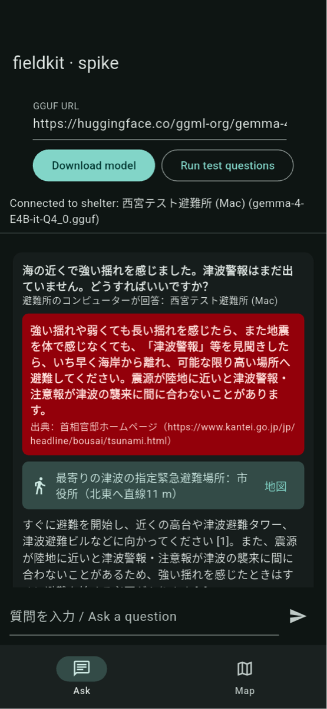

# Shelter computer over local Wi-Fi

Date: 2026-11-05. The desktop app answers phones on the local network, so
slow or older phones get fast answers from a bigger model. This is the
"desktop version for shelters" from the Idea 4 plan.

## How it works

- **Shelter (desktop):** `SHELTER_SERVER=true` (optional `SHELTER_NAME`)
  starts a small HTTP server on port 8642 after the model has loaded
  (`lib/shelter/shelter_server.dart`).
  - `GET /info`: name, model, package and version, number of answers.
  - `POST /ask` `{"question": "…"}`: the full answer: safety lines,
    answer text, the passages given to the model with source and licence,
    timings (`lib/shelter/shelter_protocol.dart`, version 1).
  - One model, so questions are answered one after another. Questions are
    limited to 500 characters and request bodies to 8 KB.
- **Phone:** `SHELTER_URL=http://<shelter>:8642` connects at start-up. Questions
  go to the shelter first; if it is not reachable, the phone's own model
  answers (if it has one). The phone rebuilds the same answer objects, so
  the citation check, safety lines, map link and licences work unchanged.
  Answers are marked 「避難所のコンピューターが回答：…」 / "Answered by
  shelter: …". The map stays on the phone.
- **Platforms:** macOS may accept incoming connections
  (`com.apple.security.network.server`); iOS allows plain `http` on the local
  network (`NSAllowsLocalNetworking`) and asks the user
  (`NSLocalNetworkUsageDescription`); Android allows plain `http`
  (`usesCleartextTraffic`, PoC only).

## Test

Shelter: MacBook Pro M4 Max with Gemma 4 E4B. Phone: Pixel 5a with **no model
of its own**.

| Question | Through the shelter | Pixel 5a alone (E2B, earlier test) |
|---|---|---|
| Tsunami (ja), from `curl` on the LAN | 1.9 s | |
| Bear (en), from `curl` on the LAN | 2.9 s (incl. translation) | |
| Heatstroke (not covered) | 0.06 s, "no answer in the sources" | |
| Tsunami (ja), Pixel app | **2.5 s** | 48 s median |

## Finding: Wi-Fi that blocks devices from each other

The office Wi-Fi used for the test ("biz-nishinomiya-work") puts every device
in the same address range but blocks traffic between them (client or AP
isolation, common on guest and shared networks). `curl` from the Mac's own
LAN address worked; the Pixel got "No route to host". The phone test
therefore ran through a USB tunnel (`adb reverse tcp:8642 tcp:8642`, phone
uses `http://127.0.0.1:8642`): same app code, different path.

For a real shelter this means: the shelter computer should run its own Wi-Fi
(a hotspot or a small router it controls), or the shelter's network must
allow device-to-device traffic. This belongs in the shelter setup guide.

## Open points

- **No login:** anyone on the shelter network can ask. Fine for a shelter;
  rate limits and an optional PIN for staff-only functions later.
- **Finding the shelter:** the address is set by hand. Next: announce it on
  the network (Bonjour / mDNS) or show a QR code on the shelter screen.
- **Plain http:** acceptable on a closed local network for the PoC; answers
  could be signed by the shelter later (as planned for facts in Idea 5).
- **Several phones at once:** answered one after another; E4B needs about
  1.5 to 3 s per answer, so a queue forms with many users. Not load-tested.
