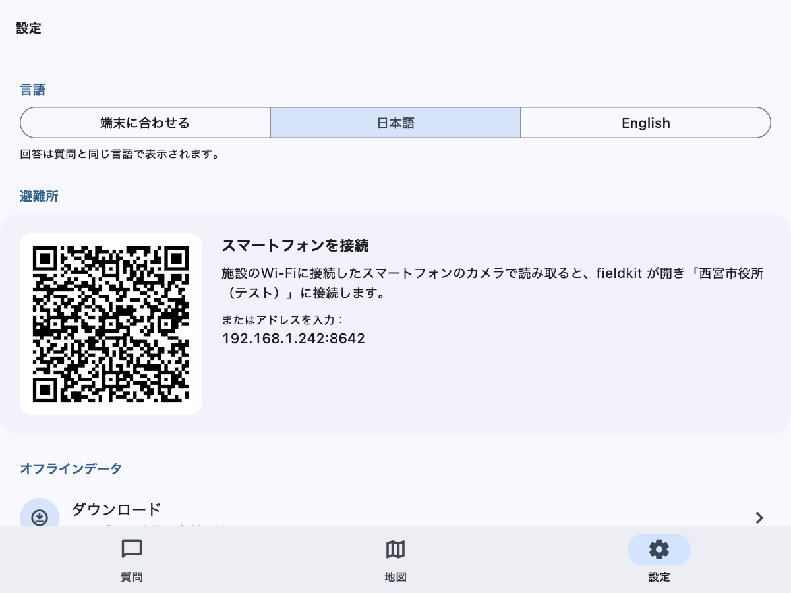
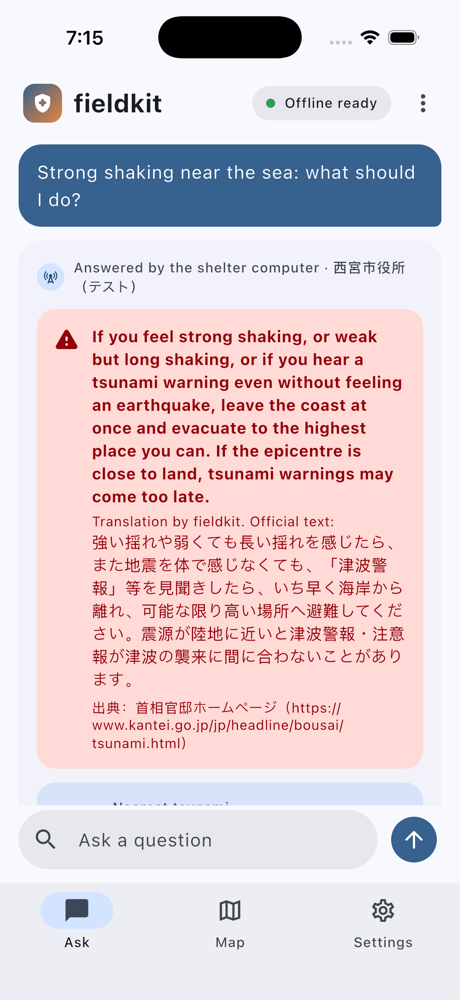

# Shelter computer over local Wi-Fi

Date: 2026-11-05. The desktop app answers phones on the local network, so
slow or older phones get fast answers from a bigger model. This is the
"desktop version for shelters" from the Idea 4 plan.

## How it works

- **Shelter (desktop):** `SHELTER_SERVER=true` (optional `SHELTER_NAME`)
  starts a small HTTP server on port 8642 after the model has loaded
  (`lib/shelter/shelter_server.dart`).
  - `GET /info`: name, model, package and version, number of answers.
  - `POST /ask` `{"question": "…"}`: the full answer: safety lines,
    answer text, the passages given to the model with source and licence,
    timings (`lib/shelter/shelter_protocol.dart`, version 1).
  - One model, so questions are answered one after another. Questions are
    limited to 500 characters and request bodies to 8 KB.
- **Phone:** `SHELTER_URL=http://<shelter>:8642` connects at start-up. Questions
  go to the shelter first; if it is not reachable, the phone's own model
  answers (if it has one). The phone rebuilds the same answer objects, so
  the citation check, safety lines, map link and licences work unchanged.
  Answers are marked 「避難所のコンピューターが回答：…」 / "Answered by
  shelter: …". The map stays on the phone.
- **Platforms:** macOS may accept incoming connections
  (`com.apple.security.network.server`); iOS allows plain `http` on the local
  network (`NSAllowsLocalNetworking`) and asks the user
  (`NSLocalNetworkUsageDescription`); Android allows plain `http`
  (`usesCleartextTraffic`, PoC only).

## Test

Shelter: MacBook Pro M4 Max with Gemma 4 E4B. Phone: Pixel 5a with **no model
of its own**.

| Question | Through the shelter | Pixel 5a alone (E2B, earlier test) |
|---|---|---|
| Tsunami (ja), from `curl` on the LAN | 1.9 s | |
| Bear (en), from `curl` on the LAN | 2.9 s (incl. translation) | |
| Heatstroke (not covered) | 0.06 s, "no answer in the sources" | |
| Tsunami (ja), Pixel app | **2.5 s** | 48 s median |

## Finding: Wi-Fi that blocks devices from each other

The office Wi-Fi used for the test ("biz-nishinomiya-work") puts every device
in the same address range but blocks traffic between them (client or AP
isolation, common on guest and shared networks). `curl` from the Mac's own
LAN address worked; the Pixel got "No route to host". The phone test
therefore ran through a USB tunnel (`adb reverse tcp:8642 tcp:8642`, phone
uses `http://127.0.0.1:8642`): same app code, different path.

For a real shelter this means: the shelter computer should run its own Wi-Fi
(a hotspot or a small router it controls), or the shelter's network must
allow device-to-device traffic. This belongs in the shelter setup guide.

## Open points

- **No login:** anyone on the shelter network can ask. Fine for a shelter;
  rate limits and an optional PIN for staff-only functions later.
- **Finding the shelter:** the address is set by hand. Next: announce it on
  the network (Bonjour / mDNS) or show a QR code on the shelter screen.
- **Plain http:** acceptable on a closed local network for the PoC; answers
  could be signed by the shelter later (as planned for facts in Idea 5).
- **Several phones at once:** answered one after another; E4B needs about
  1.5 to 3 s per answer, so a queue forms with many users. Not load-tested.

## Connect by QR code (2026-11-05)

Phones no longer need the shelter address at build time (`SHELTER_URL`).

- The shelter computer shows a QR code and its address under
  Settings → 避難所 (also in the status details on the Ask screen).
- The code holds `fieldkit://shelter?url=http://<address>:8642&name=<name>`.
  Scanned with the phone's normal camera, it opens fieldkit, which asks
  「〇〇に接続しますか？」 before it connects. No camera code in the app.
- Or, on the phone: Settings → 避難所のコンピューターに接続 → type the address
  (`192.168.1.20` is enough; http and port 8642 are added).
- The phone saves the shelter, reconnects after a restart, retries every
  30 s while the shelter is not reachable (e.g. before joining its Wi-Fi),
  and pulls current information once a minute. 切断 disconnects.

Tested: macOS as shelter computer, iPhone 17 simulator as phone. The link
opened the app, iOS asked "Open in Fieldkit?", the app asked to connect,
then pulled the facts and the shelter answered the question
(`answered: 1` on the shelter). Not yet tested on a real phone camera or
on Android (the intent filter is in place).

Notes:
- A QR code can point anywhere. The app only accepts http(s) addresses
  without a path, always asks first and shows the address, and the text
  says to connect only to the shelter you are at. A fake shelter could
  still send wrong answers or facts: signed facts are still open.
- `app_links` only receives links in debug builds started by `flutter run`
  (its own check); release builds on phones are not affected.

## Sharing switch and browser page (2026-11-18)

- **Switch:** Settings → 避難所 on computers (macOS, Windows, Linux):
  「この端末を避難所として公開」 / "Share on the local network", and the
  shelter's name (asked when turning it on). The server starts, stops and
  renames itself to match, once the model has loaded
  (`ShelterShareSection`, `_syncServer` in `lib/main.dart`). The
  `SHELTER_SERVER` flag still works for development.
- **Browser page:** `GET /` serves `assets/web/shelter.html`, one
  self-contained file (no internet, no files from elsewhere).
  `GET /web.json?lang=` gives its texts from the app's ARB files, the
  language list and the current facts as display lines; `POST /ask`
  returns the answer ready to show (`lib/shelter/shelter_web.dart`).
  Answers follow the question's language, labels included. Text is shown
  with `textContent` only, never as HTML.
- **QR card:** one code at a time, browser first, the app on request;
  「大きく表示」 for a screen at the entrance.

Tested with the Mac (Gemma 4 E2B) as shelter and a Pixel 5a over Wi-Fi
(no USB tunnel this time):

| Check | Result |
|---|---|
| Browser page from `http://192.168.1.242:8642/` | Loads; Chrome shows "not secure" in the address bar, no warning page |
| Current information on the page | Shown, with shelter names (fixed: first showed site IDs) |
| "What should I do after a tick bite?" in the browser | Answered with two sources |
| Japanese question on an English page | Japanese answer, Japanese labels |
| App linked to the shelter | 「Shelter computer · 南小学校 避難所」 answers, with source |

Fixed during the test: site IDs instead of names on the page; the phone
keyboard staying open over the answer.

Not tested yet: scanning the codes with a phone camera (the links were
opened over USB), an iPhone, several phones at once, Windows as shelter.

