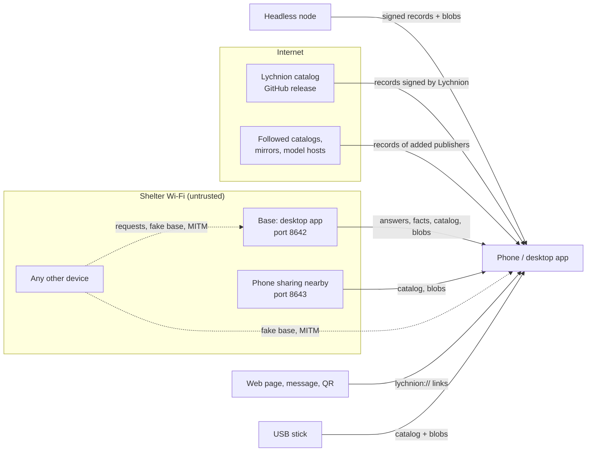

# Threat model — Lychnion

## 1.1 Header

- **Project**: Lychnion (リクニオン), an offline safety assistant for Japan.
  Repository `lychnion/lychnion`.
- **Version binding**: commit `be565e8` on `main` (2026-11-19), app version
  `0.1.0+1`, not tagged yet. The draft was first written against `6ee5dea`
  and re-bound after thirteen commits added key statements, key backups,
  `lychnion://base` links and `packages/lychnion_guide`. A report against a later commit is triaged
  against the model as it stood at that commit, not against HEAD.
- **Date and authors**: 2026-11-19. Drafted with AI assistance for the
  Lychnion authors; the maintainer answers were given in the drafting session.
- **Generation metadata**: model Claude Opus 5.5 (`claude-opus-5-5`), effort
  low. Skills: Alpha-Omega `threat-model` plugin 1.2.1 at commit `192fd60`
  (`threat-model`, `threat-model-recon`, `threat-model-surface`,
  `threat-model-interview`, `threat-model-authoring`, `threat-model-backtest`,
  `threat-model-sidecar`). The surface pass ran as four read-only sub-agents.
  The maintainer questions are this repository's own bank,
  `docs/threat-model-questions.md`.
- **Reporting cross-reference**: findings against a §1.11 property go to
  GitHub private vulnerability reporting, as `SECURITY.md` says. Findings that
  §1.3 or §1.12 rule out are closed by citing this document. `SECURITY.md`
  keeps a short summary; where the two differ, this model wins
  *(maintainer, 2026-11)*.
- **Status**: accepted, 2026-11-19. The maintainer answered all 33
  questions (Q1 to Q33); no **inferred** or **assumption** claim is left.
  The closure constraint still holds for anything added later: an
  **inferred** claim may escalate a report but never close it, and an
  **assumption** closes nothing under the declared policy.
- **Triage policy**: `strict`. An **assumption** escalates like an
  **inferred** claim.
- **Provenance legend**: *(documented, source)* = stated in a named public
  source of the project (docs, help, `SECURITY.md`, `CHANGELOG.md`, a README, or
  a code comment that states a contract); *(maintainer, 2026-11)* = answered
  by the maintainer during this review; *(assumption, QN)* = a conservative
  default the author applies until §1.18 question `QN` is answered;
  *(inferred, QN)* = reasoned from code and still open as `QN`.
- **Glossary**: a *disposition* is the label a triager gives a report (§1.17).
  A *sink* is the code that consumes attacker input. A *disclaimed property*
  is a protection the project says it does not give (§1.12). *Escalated* means
  the model points at a route but lacks the authority to close; the report
  goes to the maintainer. A *base* is a computer running the desktop app that
  serves phones on the same Wi-Fi. A *node* is anything that serves signed
  records and files; the headless node is `packages/lychnion_node`. A *record*
  is the small signed JSON that names a package version and its files by
  SHA-256. *Pinning* a key means the phone remembers it as the base's key.
- **Draft confidence**: 120 documented / 150 maintainer / 0 inferred / 0 assumption.
- **Backtest note**: routed a 41-item corpus in 15 clusters across all 9
  component families and all 8 contract dimensions. 15 items carry a real
  historical outcome: 13 security fixes in the git history and 2 acknowledged
  open items of issue 36. 26 are synthesized, built from defects this review
  found in the code and from the key statements added before the re-bind.
  Dispositions: 28 `VALID`, 6 `BY-DESIGN: property-disclaimed`, 3
  `OUT-OF-MODEL: adversary-not-in-scope`, 1 `OUT-OF-MODEL: non-default-build`,
  1 `OUT-OF-MODEL: dependency-contract`, 2 `KNOWN-NON-FINDING`, 0
  `MODEL-GAP`. All 13 historically-fixed items route `VALID`, so the
  fail-safe figure is 0. 13 of 41 items take a closing route (32%) and all
  13 close; one escalated until Q21 was answered. No contradiction with a historical
  call; the two open items of issue 36 now close on maintainer rulings (Q12,
  Q18). Routing added the "not checked" note to `base-answer-signature` and
  the crash outcome to `client-response-limits`.
- **Sibling models**: none. `lychnion/lychnion-data` (package building and the
  Lychnion signing key) and `lychnion/lychnion-studio` (publisher tools) are
  separate repositories without a model yet.

Lychnion answers safety questions offline. A phone or computer runs a small
language model (Gemma, through llama.cpp) over installed *knowledge
packages*: official pages cut into passages, one SQLite file each. Every
answer shows its sources, and hazard questions start with a fixed safety line
quoted from an official source. Packages, maps and models come from signed
catalogs, over the internet, a base on the local Wi-Fi, a nearby phone, a USB
stick or a headless node. A base also shares "current facts" such as shelter
status. The app is a prototype and an aid: it does not replace official
warnings.

> **Triager quick-start.** Given an inbound finding:
> 0. Read the triage policy above (`strict`). It decides what an
>    **assumption** may do in step 8: here, escalate only.
> 1. Locate the sink and find its row in the §1.7 input-trust table, or the
>    §1.8 output row for "a user or another component may assume X" findings.
> 2. Locate the contract dimension (numeric domain, failure atomicity,
>    recursive or cyclic topology, callback execution,
>    serialization/reconstruction, reference lifecycle, concurrency, resource
>    complexity) and follow the component's §1.7 matrix row to its claim.
> 3. Check the attacker capability against §1.10. Distinguish a device on the
>    Wi-Fi, a sender of links, a catalog or file host, a USB stick, an added
>    publisher and a pinned base: they hold different capabilities.
> 4. Check the component against §1.2 and §1.3, and any build flag or setting
>    against §1.6.
> 5. If the root cause is in a dependency (llama.cpp, sqlite3, dart:io, a
>    plugin), apply §1.9.
> 6. Apply the §1.17 precedence, starting with an exact §1.15 match.
> 7. Assign exactly one §1.17 disposition and cite its licensing section. If
>    none fits, assign `MODEL-GAP` and trigger §1.16 — do not improvise.
> 8. **Before closing, check the provenance of the licensing claim.** This
>    applies to every `OUT-OF-MODEL: *`, `BY-DESIGN: *` and
>    `KNOWN-NON-FINDING` route; `VALID` and `MODEL-GAP` are unaffected.
>    - **documented** or **maintainer** → close.
>    - **inferred** → escalate, never close.
>    - **assumption** → escalate (this model is `strict`).
>    - A disclaimer resting only on the docs being silent never closes a
>      security-critical report.
>    Record the outcome as `closed`, `provisional` or `escalated`. An
>    escalated finding keeps its disposition; it is not a `MODEL-GAP`.

## 1.2 Scope and intended use

Lychnion is meant for people in Japan who prepare for disasters or go
hiking, skiing or sailing, and for people who reach a shelter, hut or school
after something has happened *(documented, docs/distribution.md "The
situation we design for"; docs/base.md intro)*. It is an aid. It promises three things about an
answer: it comes only from installed signed guides, it shows its sources, and
a matching hazard question starts with the fixed official safety line. It
does not promise that the AI's wording is correct or complete
*(maintainer, 2026-11)*.

Deployment shapes:

- **Phone app** (Android, iOS): asks, maps, downloads, connects to a base,
  shares with phones nearby.
- **Desktop app** (macOS, Windows): the same, plus *base* mode (serves phones
  on the Wi-Fi), publishing with its own key, and USB stick copy.
- **Headless node**: one Dart program or container that pulls catalogs into a
  folder and serves it *(documented, packages/lychnion_node/README.md
  "Commands")*.

Callers and trust levels:

- The **user** of a device is trusted on that device. A question the user
  types is input against themselves.
- A **base operator** runs the desktop app in base mode. Phones that scanned
  the base's QR code trust it for the content of its facts and answers
  *(maintainer, 2026-11)*.
- **Everyone else on the Wi-Fi** is untrusted *(maintainer, 2026-11)*.
- A **node operator** chooses the catalogs and publisher keys of a node
  *(maintainer, 2026-11)*.

One model covers everything this repository ships *(maintainer, 2026-11)*.

| Component family | Representative entry point | Touches outside the process? | In model? | Provenance |
| --- | --- | --- | --- | --- |
| `answers`: retrieval, LLM, safety lines, source links | `GroundedAnswerer.answer` | no (reads package files) | in | *(maintainer, 2026-11)* |
| `downloads`: catalogs, downloads, install store, publishers, followed catalogs, USB stick; `packages/lychnion_fetch` as used by the app | `DownloadManager.download` | network, file system | in | *(maintainer, 2026-11)* |
| `records`: `packages/lychnion_format`: records, key statements, key backups, catalog document | `TrustedKeys.check`, `KeyStatement.check` | no | in | *(maintainer, 2026-11)* |
| `publishing`: desktop publisher key, its backup, replacement and revocation, signing; `packages/lychnion_guide` (guide check before signing) | `publish`, `restoreKey` | file system | in | *(maintainer, 2026-11)* |
| `base-server`: base and Share nearby server, browser page, mDNS announcement | `BaseServer._handle` | listening socket, mDNS | in | *(maintainer, 2026-11)* |
| `base-client`: phone side of a base, discovery, deep links | `BaseClient.ask`, `_openLink` | network, mDNS | in | *(maintainer, 2026-11)* |
| `facts`: signed current facts and their use on the map | `FactStore.addAll` | file system | in | *(maintainer, 2026-11)* |
| `device-data`: saved conversations, settings, logs, location | `ThreadStore`, `MapState.locate` | file system, location, system log | in | *(maintainer, 2026-11)* |
| `node`: `packages/lychnion_node` | `serve`, `pull` | listening socket, network, file system | in | *(maintainer, 2026-11)* |
| `lib/spike/`, `tool/` | bench prompts, build scripts | varies | out (§1.3) | *(maintainer, 2026-11)* |
| Release and CI machinery | `.github/workflows/ci.yml`, `tool/build_release.sh` | network | out (§1.3) | *(maintainer, 2026-11)* |

## 1.3 Out of scope (explicit non-goals)

- **Correctness of advice.** Wrong, outdated or harmful wording from the model,
  while the source and safety line are shown, is a content bug for a normal
  issue, not a vulnerability *(maintainer, 2026-11)*. Wrong or outdated
  content in an official source is a normal issue too *(documented,
  SECURITY.md "In scope", the "Out of scope:" paragraph)*.
- **Someone who already controls a device** (malware, root, an unlocked
  phone, a user account on the base computer) *(documented, SECURITY.md "Out
  of scope")*. This includes changing files in the app's own folder after
  install *(maintainer, 2026-11)*.
- **The Lychnion signing key and the maintainers' accounts.** A stolen
  Lychnion key, a compromised maintainer GitHub account or build machine is
  out of model *(maintainer, 2026-11)*. Key statements that replace or revoke
  the `lychnion` key are in model and verified like any publisher's
  *(maintainer, 2026-11)*.
- **Release and CI machinery.** CI only analyzes and tests, with read-only
  permissions and no secrets; release builds are made on a maintainer's
  machine. A CI report that cannot reach a shipped build or a secret is a
  hardening item *(maintainer, 2026-11)*.
- **`lib/spike/` and `tool/`** are dev-only *(maintainer, 2026-11)*. The build
  compiles `lib/spike/bench_prompts.dart` and `eval_questions.dart` into the
  app, but they run only behind the `AUTO_BENCH` dev flag or the Developer
  menu, which §1.6 marks unsupported *(documented, docs/dev-flags.md "Scripted
  tests and screenshots")*.
- **Sibling repositories** `lychnion-data` and `lychnion-studio`
  *(maintainer, 2026-11)*.
- **Licence compliance** (the AGPL, the app store exception, data licences)
  is not a security property; such questions are normal issues
  *(maintainer, 2026-11)*. One related fact: a base that answers phones over
  the network falls under the AGPL network clause *(documented, README.md
  "Licence")*.
- **The radio message reader** (`unpackSigned` in `lib/facts/signing.dart`)
  is not wired into the app *(maintainer, 2026-11)*.

## 1.4 Trust boundaries and data flow

Trust transitions:

1. **Bytes to record.** Any catalog, stick, base or phone delivers JSON. A
   record becomes trusted only when its Ed25519 signature checks out against
   the built-in Lychnion key or a key the user added for that publisher name,
   or a successor of one named by a valid key statement, and no statement
   revoked it. *Trust the signature, not the source* *(documented,
   docs/distribution.md "Principles")*.
2. **Statement to key.** Catalogs, sticks, bases, nearby phones and nodes
   also carry key statements. A statement changes trust only when a key the
   device already trusts for that publisher signed it *(documented,
   docs/distribution.md "Backing up and replacing the key")*.
3. **Record to file.** A file becomes trusted only when its size and SHA-256
   match the signed record *(documented, docs/data-packages.md "Signing and
   trust")*.
4. **Installed file to answer.** Package passages go into the model prompt.
   The model's text is shown with the sources and the safety line.
5. **Base to phone.** A base link pins the base's key, which checks its
   signed answers; its facts are trusted only after the user compared the
   key's code with the base's screen, in person *(maintainer, 2026-11)*.
   Until the code is compared, its answers carry a "not checked" note and
   its facts show as unconfirmed *(documented, CHANGELOG.md "Security")*.
6. **Link to setting.** A `lychnion://` link changes nothing before the user
   says yes in a dialog *(documented, docs/base.md "QR codes")*.

Reachability preconditions:

- `answers`: in model if reachable from an installed package (any trusted
  publisher), a question, or a base answer.
- `downloads`, `records`, `node`: in model if reachable from the bytes of a
  catalog, record, file response, redirect or stick folder.
- `base-server`: in model if reachable by a client that can reach port 8642
  or 8643. Reaching it from outside the local Wi-Fi or hotspot is itself a
  violation (§1.11 `lan-only-exposure`).
- `base-client`: in model if reachable from a base's responses, an mDNS
  record, or a `lychnion://` link (`base`, `shelter`, `share`, `publisher`,
  `catalog`).
- `facts`: in model if reachable from facts a base serves.
- `device-data`: in model if data leaves the app sandbox: network, the system
  log, or shared storage.
- `publishing`: in model only for what crosses to phones; the operator's own
  files are trusted.

## 1.5 Assumptions about the environment

- **Platforms**: Android, iOS, macOS and Windows from one Flutter codebase
  *(documented, README.md intro, "One Flutter codebase")*. The headless node
  runs as a program or container on a server *(documented,
  packages/lychnion_node/README.md intro)*.
- **Network**: a base needs a Wi-Fi that lets devices reach each other; the
  safest is a hotspot or router the shelter controls *(documented,
  docs/base.md "Network")*. The base page uses plain http *(documented,
  docs/base.md "Network")*.
- **OS protections**: the app folder is private to the app (sandbox on
  macOS, iOS and Android; per-user AppData on Windows). The desktop
  publisher key relies on them *(maintainer, 2026-11)*.
- **Files after install** are trusted. The app checks size and SHA-256 at
  install and only the signed record and the size at load *(maintainer,
  2026-11)*.

No-surprise side-effects inventory, confirmed by the maintainer
*(maintainer, 2026-11)*:

| Effect | Stance | Where |
| --- | --- | --- |
| Analytics, crash reporting, telemetry | absent | all components |
| Environment variables at run time | absent | app; only `--dart-define` at build |
| Child processes | conditional | `chmod` for the publisher key, on desktops other than Windows |
| Listening sockets | conditional | base on 8642 (desktop) and Share nearby on 8643 (phone), only while switched on |
| mDNS | conditional | announce `_lychnion._tcp` while a base serves; browse while a phone lists bases |
| Wake lock | conditional | only on the Share nearby screen |
| Outbound HTTP(S) | present | catalog, mirror, model and base addresses only |
| Native libraries' own network use | absent | llama.cpp (`flutter_edge_ai`, `llamadart_llama_cpp_flutter`), bonsoir, geolocator |

The desktop also writes a key backup file only where the operator saves
it, and derives the backup key with Argon2id (at most 128 MiB) in a
background isolate *(documented, docs/distribution.md "Backing up and
replacing the key")*.

The headless node opens one listening socket (default `0.0.0.0:8642`), makes
outbound HTTP(S) to catalog and file hosts, writes only inside its folder,
handles SIGINT and SIGTERM, reads no environment variables, starts no child
process, and logs client IP addresses to stdout *(maintainer, 2026-11)*.

## 1.6 Build-time and configuration variants

| Variant | Default | Effect on the model | Support stance | Provenance |
| --- | --- | --- | --- | --- |
| `--dart-define` dev flags: `GGUF_MODEL_PATH`, `GGUF_MODEL_URL`, `EMBED_MODEL_PATH`, `BARE`, `MIN_COS`, `TOP_K`, `RELEVANCE_CHECK`, `CATALOG_URL`, `DOWNLOAD_BASE_URL`, `AUTO_DOWNLOAD`, `MAP_PMTILES_PATH`, `MOCK_LOCATION`, `BASE_SERVER`, `BASE_URL`, `BASE_NAME`, `FACTS_EDIT`, `DEMO_FACTS`, `AUTO_BENCH`, `ASK`, `LLM_BACKEND`, `START_TAB`, `SCREENSHOT_AFTER_S`, `MAP_THEME_LOG`, and the old names `SHELTER_SERVER`, `SHELTER_NAME`, `SHELTER_URL` | unset | Load unsigned models, drop the guides, change sources, fake a position, sign made-up facts | unsupported for users; reports that need one close as `OUT-OF-MODEL: non-default-build` | *(maintainer, 2026-11)* |
| `DEV_MENU=true` tester builds, and debug builds | off in release | Show "Open a model file…", which loads any GGUF without a check | unsupported for users | *(maintainer, 2026-11)* |
| Base switch "Use this computer as a base" | off | Opens port 8642 and announces the base | supported | *(documented, help/en/05-base.md "How do I make my computer a base?")* |
| "Keep everything for phones" | off | A base downloads every item of every trusted publisher | supported | *(documented, docs/distribution.md "Sync between nodes")* |
| Android `usesCleartextTraffic="true"` | on | Plain http to any host | supported (shipped) | *(documented, docs/shelter-results.md "How it works")* |
| Android release without the upload key | n/a | Signed with the debug key; cannot update a signed install | unsupported for distribution | *(documented, docs/release-builds.md "Signing")* |
| Node `--publisher NAME=KEY` | none | Trusts an extra publisher key for that run | supported; the operator checks the key | *(maintainer, 2026-11)* |
| Node directly on the internet without a reverse proxy | n/a | No TLS, no rate limits | unsupported; a reverse proxy is required | *(maintainer, 2026-11)* |
| Node `serve` on a folder it did not `pull` (for example a USB stick) | n/a | Symlinks in `blobs/sha256` are followed | unsupported; pull the stick into the folder | *(maintainer, 2026-11)* |

## 1.7 Assumptions about inputs

Inputs reach the app from five places: package files, catalogs and file
servers, the local Wi-Fi, links, and the user. The table has one row per
security-relevant operand of every network route, link kind and loader. It
covers 7 of 7 base routes, 3 of 3 phone-to-base calls, 4 of 4 link kinds
(the base kind has two hosts, `base` and `shelter`), key statements, the key
backup,
mDNS discovery, the catalog parser, the downloader, the stick reader, the
answer pipeline, the fact store and the node's 3 commands. UI widgets are
covered only where they show input.

| Entry point | Input operand | Attacker-controllable? | Control kind | Caller must enforce | Provenance |
| --- | --- | --- | --- | --- | --- |
| `TrustedKeys.check` | record JSON from any catalog, stick, base or marker | yes | serialized-state | none — `signed-install-only` | *(documented, docs/data-packages.md "Signing and trust")* |
| `TrustedKeys.verify` | `publisher`, `key`, `signature` | yes | data | none — `signed-install-only` | *(documented, docs/distribution.md "Publishers and keys")* |
| `PackageRecord.fromJson` | `id`, `files[].name` | yes, by a trusted publisher | resource-name | none — `publisher-namespace` | *(maintainer, 2026-11)* |
| `PackageRecord.fromJson` | `version` | yes; replay of older signed versions by anyone | data | none — `no-downgrade-installed` | *(documented, docs/versioning.md "Data: calendar versions")* |
| `PackageRecord.fromJson` | `files[].size` | yes, by a trusted publisher | size | disk space | *(documented, docs/distribution.md "Security", "A bad mirror costs time, not safety"; "Sync between nodes", "a full disk ends the run")* |
| `Catalog.parse` | `urls`, `mirrors`, `base`, `refresh` (unsigned) | yes | resource-name | none — `signed-install-only` | *(documented, docs/distribution.md "Storage: files by hash, any server")* |
| `relevantStatements` | `keys` statements from any catalog, stick, base, phone or node | yes | serialized-state | none — `key-statement-verification` | *(documented, docs/distribution.md "Backing up and replacing the key")* |
| `KeyBackup.open` | backup file and passphrase | the operator only | serialized-state | keep the backup offline and the passphrase strong | *(maintainer, 2026-11)* |
| `fetchCatalogText` | response body, length, timing | yes | size, rate | none — `client-response-limits` | *(documented, docs/distribution.md "Following catalogs")* |
| `fetchCatalogText` | redirect target | yes | resource-name | accept that catalogs may point anywhere | *(documented, docs/distribution.md "Following catalogs")* |
| `Downloader.fetch` | status, `Content-Length`, `Content-Range`, body | yes | data, size | none — `atomic-file-install` | *(documented, docs/distribution.md "Storage: files by hash, any server")* |
| `Downloader.fetch` | trickle rate of a file host | yes | rate | accept slow downloads | *(documented, docs/distribution.md "Security", "A bad mirror costs time, not safety"; "Sync between nodes", "a full disk ends the run")* |
| `Downloader._open` | redirect from a base or nearby phone | yes | resource-name | none — `lan-device-same-origin` | *(documented, CHANGELOG.md "Security")* |
| `loadFromStick` | stick `catalog.json`, `urls`, files, links | yes | serialized-state, resource-name | none — `signed-install-only` | *(documented, docs/distribution.md "Sync between nodes")* |
| `PublisherList.add` | `lychnion://publisher` `name`, `key`, `title` | yes, from any app or web page | data | the user confirms only publishers they know | *(documented, help/en/07-publishers.md "How do I add a publisher, such as my city?")* |
| `FollowedCatalogs.add` | `lychnion://catalog` `url`, `name` | yes | resource-name | the user confirms; following trusts no key | *(documented, docs/distribution.md "Following catalogs")* |
| `_prompt` | passage text, heading, publisher, title | yes, by a trusted publisher | data | none — publisher content is trusted (§1.12 `publisher-content`) | *(maintainer, 2026-11)* |
| package `alerts` | safety line text and trigger words | yes, by a trusted publisher | data | none — `safety-line-lychnion-only` | *(maintainer, 2026-11)* |
| package `vectors`, `synonyms` | retrieval data | yes, by a trusted publisher | data | none — publisher content is trusted | *(maintainer, 2026-11)* |
| `KnowledgePackage.open` | SQLite bytes | yes, by a trusted publisher | serialized-state | none; parser defects go to sqlite3 | *(maintainer, 2026-11)* |
| `LocalLlm.loadFile` | GGUF bytes, chat template | only Lychnion | serialized-state, callback-code | none — `models-lychnion-only` | *(maintainer, 2026-11)* |
| `GroundedAnswerer.answer` | the user's question | the user only | data, size | none; no limit on the device | *(maintainer, 2026-11)* |
| `SourceLink._open` | `source.url`, attribution label | yes, by a trusted publisher or a base | resource-name | the reader checks the address in the browser | *(maintainer, 2026-11)* |
| base TCP accept | connections per address | yes, any device on the Wi-Fi | rate | accept flooding | *(maintainer, 2026-11)* |
| base TCP accept | the network a client comes from | yes | resource-name | none — `lan-only-exposure` | *(maintainer, 2026-11)* |
| base `POST /ask` | body (≤8 KiB, ≤10 s), `question` (≤500 characters) | yes | data, size | none — `base-request-limits` | *(documented, docs/shelter-results.md "How it works")* |
| base `POST /ask` | `nonce` | yes | data | none — `base-answer-signature` | *(documented, docs/shelter-results.md "How it works")* |
| base `POST /ask`, `GET /info`, `/facts` | `Host`, `Origin`, `Content-Type` | yes, also from a web page | data | keep bases offline (§1.12 `cross-site-requests`) | *(maintainer, 2026-11)* |
| base `GET /blobs/sha256/<hash>` | path, `Range` | yes | resource-name, size | none — `blob-serving-by-hash` | *(documented, CHANGELOG.md "Security")* |
| browser page | `/web.json` and `/ask` text | the operator, facts, or a Wi-Fi attacker | data | none — `browser-page-text-only` | *(documented, docs/shelter-results.md "Sharing switch and browser page (2026-11-18)")* |
| `BaseClient.info`, `.facts`, `.ask` | response status, body, size | yes, any host at the base address | data, size | none — `client-response-limits` | *(documented, CHANGELOG.md "Security")* |
| `BaseClient.ask` | `x-lychnion-signature`, or its absence | yes, by a man in the middle | data | none — `base-answer-signature` | *(documented, docs/shelter-results.md "How it works")* |
| `BaseFinder` | mDNS name, addresses, TXT key | yes | data | the user confirms one base | *(documented, docs/distribution.md "Security", row "Fake base announced on the Wi-Fi")* |
| `lychnion://base` link (also `shelter`) | `url`, `name`, `key`, `s` | yes, from any app, web page or message | data, resource-name | none — `key-consent` | *(maintainer, 2026-11)* |
| `lychnion://share` link | `url` | yes | resource-name | the user confirms | *(documented, help/en/06-share-nearby.md "What does the other phone do?")* |
| `FactStore.addAll` | facts from a base | yes, any base or a man in the middle | data, size | none — `fact-verification` | *(documented, docs/facts-results.md "Signed facts (2026-11-05)")* |
| `FactStore.current` | `observedAt`, `expiresAt` | yes | data | none — `fact-time-bounds` | *(maintainer, 2026-11)* |
| node `serve` | path, method, `Range`, connections | yes, any client | resource-name, rate | reverse proxy on the internet | *(documented, packages/lychnion_node/README.md "Operating")* |
| node `pull` | catalog body with key statements, file responses, hosts it names | yes, a non-publisher host | serialized-state, resource-name | none — `signed-install-only` | *(maintainer, 2026-11)* |
| node `pull` | `--publisher NAME=KEY` | operator only | collaborator-implementation | the operator checks the key | *(maintainer, 2026-11)* |
| node `pull` from a folder | stick contents | yes | serialized-state | none — `signed-install-only` | *(documented, packages/lychnion_node/README.md "Commands")* |

Size and shape: catalogs are capped at 2 MB while they arrive; at most 20
followed catalogs *(documented, docs/distribution.md "Following
catalogs")*; at most 10 mirrors *(documented, docs/distribution.md
"Storage: files by hash, any server")*. A phone keeps at most 1000 key statements and 50
replacements per publisher *(documented, docs/distribution.md "Backing up
and replacing the key")*. A file is never larger than its signed size. There is
no overall time limit per download and no disk quota *(documented, docs/distribution.md "Security", "A bad mirror costs time, not safety"; "Sync between nodes", "a full disk ends the run")*.

Contract-dimension matrix. Every in-scope family has one row per required
dimension.

| Component | Dimension | Status | Conditions / boundary | Routes to | Provenance |
| --- | --- | --- | --- | --- | --- |
| answers | numeric domain | disclaimed | package vectors and cut-off scores come from the publisher | §1.12 `publisher-content` | *(maintainer, 2026-11)* |
| answers | failure atomicity | claimed | a failed load never leaves an unmarked bare-model answer | §1.11 `grounded-answer-presentation` | *(maintainer, 2026-11)* |
| answers | recursive/cyclic topology | N/A | passages are flat rows | §1.7 | *(documented, docs/data-packages.md "Data packages and trust")* |
| answers | callback execution | claimed | the GGUF chat template runs in the engine; only Lychnion models | §1.11 `models-lychnion-only` | *(maintainer, 2026-11)* |
| answers | serialization/reconstruction | disclaimed | SQLite and GGUF parse in native code | §1.12 `native-parser-safety` | *(maintainer, 2026-11)* |
| answers | reference lifecycle | N/A | no caller-held references; the answerer is replaced whole | §1.7 | *(maintainer, 2026-11)* |
| answers | concurrency/reentrancy | claimed | answers to phones and to the base computer's own Ask page never mix | §1.11 `answers-never-mix` | *(maintainer, 2026-11)* |
| answers | resource complexity | disclaimed | no limit on a question typed on the device | §1.12 `local-resource-bounds` | *(maintainer, 2026-11)* |
| downloads | numeric domain | claimed | catalog ≤2 MB; file ≤ signed size | §1.11 `client-response-limits` | *(documented, docs/distribution.md "Following catalogs")* |
| downloads | failure atomicity | disclaimed | per file atomic; a multi-file network update is not | §1.12 `multi-file-update-atomicity` | *(maintainer, 2026-11)* |
| downloads | recursive/cyclic topology | claimed | deeply nested JSON is rejected without a crash or hang | §1.11 `client-response-limits` | *(maintainer, 2026-11)* |
| downloads | callback execution | N/A | no caller code; progress callbacks are internal | §1.7 | *(maintainer, 2026-11)* |
| downloads | serialization/reconstruction | claimed | signed record and hash decide | §1.11 `signed-install-only` | *(documented, docs/data-packages.md "Signing and trust")* |
| downloads | reference lifecycle | claimed | a revoked key's items stop being used; removing a publisher deletes its items (`publisher-removal-deletes`) | §1.11 `revocation-unloads` | *(documented, docs/distribution.md "Backing up and replacing the key")* |
| downloads | concurrency/reentrancy | claimed | only a file whose size and hash match is renamed | §1.11 `atomic-file-install` | *(documented, packages/lychnion_fetch/lib/src/downloader.dart `Downloader` doc comment)* |
| downloads | resource complexity | disclaimed | no overall download deadline, no disk quota | §1.12 `download-time-and-disk` | *(documented, docs/distribution.md "Security", "A bad mirror costs time, not safety"; "Sync between nodes", "a full disk ends the run")* |
| records | numeric domain | claimed | versions 1–4 parts of ≤9 digits; missing parts count as 0 | §1.11 `no-downgrade-installed` | *(documented, packages/lychnion_format/lib/src/record.dart `compareVersions` comment)* |
| records | failure atomicity | claimed | a record that fails is ignored | §1.11 `signed-install-only` | *(documented, packages/lychnion_format/lib/src/record.dart `TrustedKeys.check` doc comment)* |
| records | recursive/cyclic topology | claimed | deeply nested JSON is rejected without a crash or hang | §1.11 `client-response-limits` | *(maintainer, 2026-11)* |
| records | callback execution | N/A | pure functions | §1.7 | *(maintainer, 2026-11)* |
| records | serialization/reconstruction | claimed | any JSON formatting of a record verifies the same | §1.11 `signed-install-only` | *(documented, packages/lychnion_format/lib/src/record.dart `canonicalJson` comment)* |
| records | reference lifecycle | claimed | trusted keys change only through verified key statements | §1.11 `key-statement-verification` | *(documented, docs/distribution.md "Backing up and replacing the key")* |
| records | concurrency/reentrancy | N/A | no shared mutable state | §1.7 | *(maintainer, 2026-11)* |
| records | resource complexity | claimed | one signature check per record; key statements capped per list and per publisher | §1.11 `client-response-limits` | *(documented, docs/distribution.md "Backing up and replacing the key")* |
| publishing | numeric domain | claimed | a version must be higher than any signed or installed | §1.11 `no-downgrade-installed` | *(documented, docs/distribution.md "Publishers and keys")* |
| publishing | failure atomicity | claimed | the signed record is kept first; leftover copies are removed | §1.11 `atomic-file-install` | *(documented, lib/publish/publish.dart `publish` step comments)* |
| publishing | recursive/cyclic topology | N/A | the operator picks single files | §1.7 | *(maintainer, 2026-11)* |
| publishing | callback execution | N/A | no callbacks | §1.7 | *(maintainer, 2026-11)* |
| publishing | serialization/reconstruction | claimed | the key file stays on the computer, never served | §1.11 `publisher-key-local` | *(documented, docs/distribution.md "Publishers and keys")* |
| publishing | reference lifecycle | claimed | backup, restore, replacement and revocation of the desktop key | §1.11 `key-backup-confidentiality` | *(documented, docs/distribution.md "Backing up and replacing the key")* |
| publishing | concurrency/reentrancy | N/A | one operator; a lock file guards key creation | §1.7 | *(maintainer, 2026-11)* |
| publishing | resource complexity | N/A | operator-chosen files | §1.7 | *(maintainer, 2026-11)* |
| base-server | numeric domain | claimed | 500 characters, 8 KB body | §1.11 `base-request-limits` | *(documented, docs/shelter-results.md "How it works")* |
| base-server | failure atomicity | N/A | no route writes state from the network | §1.7 | *(maintainer, 2026-11)* |
| base-server | recursive/cyclic topology | N/A | body ≤8 KB; three fields read | §1.7 | *(documented, docs/shelter-results.md "How it works")* |
| base-server | callback execution | claimed | the model is shared with the base computer's Ask page; answers never mix | §1.11 `answers-never-mix` | *(maintainer, 2026-11)* |
| base-server | serialization/reconstruction | claimed | the signature covers the exact bytes sent | §1.11 `base-answer-signature` | *(documented, docs/shelter-results.md "How it works")* |
| base-server | reference lifecycle | claimed | an answer stops when its phone leaves | §1.11 `base-request-limits` | *(documented, CHANGELOG.md "Security")* |
| base-server | concurrency/reentrancy | claimed | one question per phone; questions answered one after another | §1.11 `base-request-limits` | *(documented, docs/shelter-results.md "How it works"; lib/base/base_server.dart `BaseServer` doc comment)* |
| base-server | resource complexity | claimed | per-request limits hold; flooding is disclaimed | §1.11 `base-request-limits` | *(maintainer, 2026-11)* |
| base-client | numeric domain | claimed | 16 KiB info, 1 MiB facts and answers | §1.11 `client-response-limits` | *(documented, lib/base/base_client.dart `maxInfoBytes` comment)* |
| base-client | failure atomicity | claimed | an answer that does not check out is dropped; the phone answers itself | §1.11 `base-answer-signature` | *(documented, CHANGELOG.md "Security")* |
| base-client | recursive/cyclic topology | claimed | deeply nested JSON is rejected without a crash or hang | §1.11 `client-response-limits` | *(maintainer, 2026-11)* |
| base-client | callback execution | N/A | no caller code | §1.7 | *(maintainer, 2026-11)* |
| base-client | serialization/reconstruction | claimed | wrong protocol version or too many hits are refused | §1.11 `client-response-limits` | *(documented, lib/base/base_protocol.dart `answerFromWire` comment)* |
| base-client | reference lifecycle | claimed | the signing memory lasts until another key or a disconnect | §1.11 `base-answer-signature` | *(documented, CHANGELOG.md "Security")* |
| base-client | concurrency/reentrancy | N/A | each request has its own timeout | §1.7 | *(maintainer, 2026-11)* |
| base-client | resource complexity | claimed | time and size caps per call | §1.11 `client-response-limits` | *(documented, CHANGELOG.md "Security")* |
| facts | numeric domain | claimed | no fact from the future, no endless lifetime | §1.11 `fact-time-bounds` | *(maintainer, 2026-11)* |
| facts | failure atomicity | N/A | the store is a local file; its failures cross no boundary | §1.7 | *(maintainer, 2026-11)* |
| facts | recursive/cyclic topology | N/A | flat records | §1.7 | *(maintainer, 2026-11)* |
| facts | callback execution | N/A | no callbacks | §1.7 | *(maintainer, 2026-11)* |
| facts | serialization/reconstruction | claimed | changing any field breaks the signature | §1.11 `fact-verification` | *(documented, docs/facts-results.md "Signed facts (2026-11-05)")* |
| facts | reference lifecycle | disclaimed | trusted keys cannot be revoked | §1.12 `key-revocation` | *(documented, docs/facts-results.md "Signed facts (2026-11-05)")* |
| facts | concurrency/reentrancy | N/A | writes are queued on one device | §1.7 | *(maintainer, 2026-11)* |
| facts | resource complexity | claimed | ≤5,000 facts kept, ≤500 per pull | §1.11 `client-response-limits` | *(documented, CHANGELOG.md "Security"; lib/base/base_client.dart `maxFacts` comment)* |
| device-data | numeric domain | N/A | no numeric input from outside | §1.7 | *(maintainer, 2026-11)* |
| device-data | failure atomicity | N/A | local files; tampering needs device control | §1.3 | *(maintainer, 2026-11)* |
| device-data | recursive/cyclic topology | N/A | flat JSON written by the app | §1.7 | *(maintainer, 2026-11)* |
| device-data | callback execution | N/A | no callbacks | §1.7 | *(maintainer, 2026-11)* |
| device-data | serialization/reconstruction | N/A | read back only by the app | §1.7 | *(maintainer, 2026-11)* |
| device-data | reference lifecycle | disclaimed | OS backup may copy app data | §1.12 `os-backup` | *(maintainer, 2026-11)* |
| device-data | concurrency/reentrancy | N/A | saves wait for the load | §1.7 | *(maintainer, 2026-11)* |
| device-data | resource complexity | N/A | grows only with the user's own use | §1.7 | *(maintainer, 2026-11)* |
| node | numeric domain | claimed | catalog ≤2 MB; `Range` numbers ≤18 digits | §1.11 `client-response-limits` | *(documented, packages/lychnion_fetch/lib/src/catalog_fetch.dart `maxCatalogBytes` comment)* |
| node | failure atomicity | claimed | the last good state stays | §1.11 `atomic-file-install` | *(documented, packages/lychnion_node/README.md "Operating")* |
| node | recursive/cyclic topology | claimed | deeply nested JSON is rejected without a crash or hang | §1.11 `client-response-limits` | *(maintainer, 2026-11)* |
| node | callback execution | N/A | no caller code | §1.7 | *(maintainer, 2026-11)* |
| node | serialization/reconstruction | claimed | records are carried unchanged | §1.11 `signed-install-only` | *(documented, docs/distribution.md "Node")* |
| node | reference lifecycle | disclaimed | a publisher cannot withdraw one version; revoking a key sets aside what it signed | §1.12 `freshness` | *(documented, packages/lychnion_node/README.md "Operating")* |
| node | concurrency/reentrancy | claimed | one pull per folder | §1.11 `atomic-file-install` | *(documented, packages/lychnion_node/README.md "Operating")* |
| node | resource complexity | disclaimed | at most 64 requests; flooding a directly exposed node is out | §1.12 `node-internet-dos` | *(maintainer, 2026-11)* |

## 1.8 Assumptions and guarantees about outputs

| Output channel | Component | Taint | Downstream must not assume | Provenance |
| --- | --- | --- | --- | --- |
| Answer text | `answers` | As untrusted as the passages and question that shaped it. Shown as plain text: no markup, no links | That it is correct. "Shows its source" is not "is right" | *(maintainer, 2026-11)* |
| Citation marks `[n]` | `answers` | The app checks only that each number points to a passage the model was given | That the cited passage supports the sentence | *(maintainer, 2026-11)* |
| Fixed safety line | `answers` | Word for word from a package's alerts table | That the app checked the quote against the official page; lychnion-data checks it at build time | *(maintainer, 2026-11)* |
| Source link | `answers` | `http` or `https` address from the package or base | That the label is the destination | *(maintainer, 2026-11)* |
| Base answer and its signature | `base-server`, `base-client` | Signed answers prove which base sent them; a refused answer is noted on the phone's own answer | That a signed answer is true or grounded in the phone's own packages | *(maintainer, 2026-11)* |
| Catalog `keys` list | `records` | Each statement is signed; the list is not | That the list is complete or current: a carrier can drop statements | *(documented, docs/distribution.md "Backing up and replacing the key")* |
| Key backup file | `publishing` | Encrypted private key, plus a readable revocation | That the file is harmless without the passphrase: anyone with it can revoke the key | *(documented, docs/distribution.md "Backing up and replacing the key")* |
| Browser page | `base-server` | Plain http, unsigned | Integrity: a device on the Wi-Fi can change it | *(maintainer, 2026-11)* |
| `/catalog.json`, blobs from a base, phone or node | `base-server`, `node` | Signed records and hash-named files; the server does not vouch | That the server checked the bytes; readers check signature and hash | *(documented, docs/distribution.md "Security")* |
| Facts on screen | `facts` | Value, note and source name as received; "unconfirmed" when not verified | That "official" means true, or that the signer is responsible for that shelter | *(maintainer, 2026-11)* |
| Map suggestion and route | `facts` | Built from current facts | Promised: only verified facts change it (`unverified-facts-not-acted-on`) | *(maintainer, 2026-11)* |
| System log | `device-data`, `base-server` | The app writes JSON lines; the base logs client addresses | Promised: release builds do not log questions, answers or position (`device-egress`) | *(maintainer, 2026-11)* |
| Node stdout | `node` | Time, client IP, path, status | That it holds no personal data | *(maintainer, 2026-11)* |
| Files in the app folder | `downloads` | Byte-exact to the signed hash at install | That a half-failed multi-file update is consistent | *(maintainer, 2026-11)* |

## 1.9 Assumptions about dependencies

| Dependency | Relied on for | Violation routed |
| --- | --- | --- |
| llama.cpp through `flutter_edge_ai`, `flutter_edge_ai_llama`, `llamadart_llama_cpp_flutter` | parsing GGUF models and running the chat template | upstream, `OUT-OF-MODEL: dependency-contract` |
| `sqlite3` | opening package files read-only | upstream |
| `cryptography` | Ed25519 signatures for records, facts and answers | upstream |
| `crypto` | SHA-256 of files and requests | upstream |
| Dart `dart:io` | `HttpServer`, `HttpClient`, header parsing | upstream |
| `bonsoir` | mDNS announce and browse | upstream |
| `app_links`, `url_launcher` | receiving links, opening source links | upstream |
| `vector_map_tiles`, `vector_map_tiles_pmtiles`, `flutter_map` | rendering downloaded map files | upstream |
| `geolocator` | one position fix on request | upstream |
| Gemma and EmbeddingGemma model files from Hugging Face | the answer and search models | covered here by the signed record hash |

The app treats these as trusted code. A defect in one of them, reached by
conformant use, is forwarded upstream *(maintainer, 2026-11)*. Misusing a
dependency, for example passing it an unchecked file, is in model. No
third-party code is vendored; pub packages are pinned by `pubspec.lock`
*(maintainer, 2026-11)*.

## 1.10 Adversary model

The baseline context is a shelter, hut or school Wi-Fi with no internet,
plus phones that also use the internet when they can.

| Actor | In scope? | Capabilities held | Capabilities excluded | Goals | Provenance |
| --- | --- | --- | --- | --- | --- |
| Device on the same Wi-Fi | yes | Send any request to a base or a sharing phone; announce a fake base; read and change plain http; flood connections | Holding a trusted base's private key; getting its own code compared in person as a base's; tapping dialogs for the user | Fake facts or answers, read questions, crash or hang a base or phone | *(maintainer, 2026-11)* |
| Host outside the local Wi-Fi | yes | Reach a port the base or a sharing phone opened on another interface | Reaching a port that is bound only to the Wi-Fi | Use the base or read installed items | *(maintainer, 2026-11)* |
| Sender of links (web page, message, other app, printed QR) | yes | Open `lychnion://` links with any parameters | Confirming the dialog for the user; being scanned in person as a base's QR code | Get a key trusted, follow a hostile catalog, point the phone at a hostile base | *(maintainer, 2026-11)* |
| Catalog, mirror or file host that is not a publisher | yes | Serve any bytes, old signed records, redirects; delay or withhold; drop or replay key statements | Signing records; forging a key statement; making a wrong file install | Install a tampered file, hide updates, learn what users download | *(maintainer, 2026-11)* |
| USB stick author | yes | Any catalog, files and links on the stick | Signing records | Install a tampered or squatting item | *(documented, docs/distribution.md "Sync between nodes")* |
| Publisher the user added | yes, for its own name | Sign any record, content and key statement for its name, including text that steers the model | Signing records or statements for `lychnion` or another name; naming a successor key it does not hold; shipping models; supplying the official safety line | Replace Lychnion's items or files, make its lines look official | *(maintainer, 2026-11)* |
| Holder of an old or stolen publisher key | yes, for that name until revoked | Sign records and statements for that name; revoke the key; name a second successor | Keys it does not hold; the user's dialogs | Impersonate the publisher, or make phones drop it | *(documented, docs/distribution.md "Backing up and replacing the key")* |
| Operator of a trusted base (code compared in person) | no, for content | Sign facts and answers that phones trust | — | — | *(maintainer, 2026-11)* |
| Lychnion key holder, maintainers, build machines | no | Sign anything as Lychnion, ship builds | — | — | *(maintainer, 2026-11)* |
| Someone controlling the device | no | Read and change app files and memory | — | — | *(documented, SECURITY.md "In scope", the "Out of scope:" paragraph)* |
| The user asking | no | Type any question | — | — | *(maintainer, 2026-11)* |

## 1.11 Security properties the project provides

- **`signed-install-only`** (`downloads`, `records`, `node`, `base-client`):
  a file from any source is installed or served onward only when its record
  verifies against a trusted key for that publisher name and the file's size
  and SHA-256 match. A trusted key is a built-in or added key, or a successor
  named by a valid key statement, and not revoked. *Violation symptom*: integrity-bypass. *Tier*:
  security-critical. *Voided by*: the dev flags in §1.6 —
  `GGUF_MODEL_PATH` loads a model at `lib/ask/model_loading.dart:22`,
  `EMBED_MODEL_PATH` at `lib/ask/model_loading.dart:108`, and "Open a model
  file…" at `lib/ask/model_loading.dart:216`. Bundled guides are trusted by
  the app signature, not a record (`lib/download/download_store.dart:612`).
  *(documented, docs/data-packages.md "Signing and trust")*
- **`publisher-namespace`** (`downloads`, `records`, `node`): an added
  publisher never replaces Lychnion's items or files, or another publisher's
  ids, also not by upper or lower case, and its key statements count only
  for its own name. *Violation symptom*: integrity-bypass.
  *Tier*: security-critical. *Voided by*: no switch. Known gap: a stick record
  for a Lychnion id not installed yet passes, because the owner check only
  looks at installed markers (`lib/download/download_store.dart:371`), and
  the installed copy then wins over the bundled one
  (`lib/download/download_store.dart:581`).
  *(documented, docs/distribution.md "Publishers and keys")*
- **`no-downgrade-installed`** (`downloads`, `records`, `publishing`, `node`): an
  installed item is never replaced with an older version.
  *Violation symptom*: bad-data-accepted. *Tier*: security-critical. *Voided by*:
  deleting the item (`lib/download/download_store.dart:459`), removing its
  publisher (`lib/download/download_manager.dart:540`), reinstalling the app,
  or a fresh node folder. After that an older signed version is accepted
  again (§1.12 `freshness`). After a revocation a node lists the version it
  listed before, never one below it. Known gap: a node drops a record whose
  current and new versions are both incomplete, then accepts an older one
  (`packages/lychnion_node/lib/src/pull.dart:196`). *(documented, docs/distribution.md
  "Principles")*
- **`key-consent`** (`downloads`, `base-client`): a publisher key or base key
  becomes trusted only after the user says yes, and a base key gets fact
  trust only after the user compared its code with the base's screen in
  person (`lib/base/base_key_code.dart`); a link alone, from the QR code
  or a web page, only pins the key. Two exceptions come from the
  publisher's own statements: a successor named by a trusted key's
  replacement is trusted without a dialog, and a revoked publisher's new
  link replaces its entry after a dialog. *Violation symptom*:
  integrity-bypass.
  *Tier*: security-critical. *Voided by*: `BASE_URL` (or `SHELTER_URL`) connects without a link
  (`lib/ask/base_connection.dart:9`). *(maintainer, 2026-11)*
- **`grounded-answer-presentation`** (`answers`): an answer is built only
  from installed guides and shows its sources; an answer whose citations do
  not check out carries a warning; the app never shows bare-model text as an
  answer. *Violation symptom*: x-ungrounded-answer. *Tier*:
  security-critical. *Voided by*: `BARE` skips the packages
  (`lib/ask/model_loading.dart:83`). Known violation: when loading fails after
  the model is up, the warning is drawn only if `grounded` is true
  (`lib/ask/ask_page.dart:587`). *(documented, SECURITY.md "In scope")*
- **`safety-line-lychnion-only`** (`answers`): when a hazard question matches,
  the fixed safety line from a Lychnion-signed package is shown word for word
  above the AI text; no other publisher supplies it. *Violation symptom*:
  x-missing-or-forged-safety-line. *Tier*: security-critical. *Voided by*:
  questions routed to the app help skip the line
  (`lib/knowledge/grounded_answer.dart:242`). Known violation: alerts of every
  installed package match (`lib/knowledge/grounded_answer.dart:253`).
  *(maintainer, 2026-11)*
- **`models-lychnion-only`** (`downloads`, `answers`): only models signed by
  Lychnion are installed and loaded. *Violation symptom*: integrity-bypass.
  *Tier*: security-critical. *Voided by*: the dev loaders under
  `signed-install-only`. Known violation: any trusted publisher's record kind
  is accepted (`lib/download/catalog.dart:186`). *(maintainer, 2026-11)*
- **`base-answer-signature`** (`base-client`, `base-server`): with a pinned
  key, the phone accepts a base answer only when its Ed25519 signature covers
  the phone's nonce, a hash of the request and the exact body; once that base
  has signed, unsigned answers are refused. A QR code with `s=1` says the
  base signs, so unsigned answers are refused from the first one. A late
  answer from a previous base is ignored. An answer from a base without a
  pinned key, or an unsigned one, carries a note saying so. *Violation symptom*:
  integrity-bypass. *Tier*: security-critical. *Voided by*: no pinned key
  (`lib/base/base_client.dart:96`); for a QR code without `s=1`, the first
  answers before the base has signed (`lib/base/base_checks.dart:78`);
  pinning another key (`lib/app/settings.dart:129`); a base without a signer
  (`lib/base/base_server.dart:581`). *(documented, docs/shelter-results.md
  "How it works")*
- **`fact-verification`** (`facts`): an official or sensor fact shows as
  verified only with a signature from a trusted key; others count as
  resident reports and are labelled. Signed fields never contain control
  characters, so a signature never fits a different split of the fields
  *(maintainer, 2026-11)*. *Violation symptom*: integrity-bypass.
  *Tier*: security-critical. *Voided by*: `DEMO_FACTS` signs made-up facts
  (`lib/app/app_shell.dart:185`). *(documented, docs/facts-results.md
  "Signed facts (2026-11-05)")*
- **`unverified-facts-not-acted-on`** (`facts`): only verified facts change
  the suggested evacuation site or walking route. *Violation symptom*:
  bad-data-accepted. *Tier*: security-critical. *Voided by*: no switch.
  Known violation: shelters are avoided whatever the trust
  (`lib/map/map_state.dart:59`). *(maintainer, 2026-11)*
- **`fact-time-bounds`** (`facts`): a fact dated in the future, or with a
  lifetime far beyond normal, does not win its topic. *Violation symptom*:
  bad-data-accepted. *Tier*: security-critical. *Voided by*: no switch.
  Known violation: the newest `observedAt` wins with no cap
  (`lib/facts/fact_store.dart:275`). *(maintainer, 2026-11)*
- **`base-request-limits`** (`base-server`): every request has limits:
  100 connections in all, body 8 KiB within 10 s, question 500 characters,
  8 live questions, one per address, 30 s idle, 30 s send stall, answers
  stop when the phone leaves. No
  single request makes the base hang, crash or allocate without bound.
  Threshold: a hang or unbounded allocation is a bug; slow under a flood is
  not (§1.12 `lan-availability`). *Violation symptom*: hang,
  unbounded-allocation. *Tier*: security-critical. *Voided by*: nothing at
  run time; the limits are constructor defaults
  (`lib/base/base_server.dart:58`) with no setting. Search:
  `grep -rn 'maxQuestions\|maxConnections' lib` — hits only in
  `lib/base/base_server.dart`, and no setting reads them. *(documented,
  docs/shelter-results.md "How it works"; lib/base/base_server.dart
  `BaseServer` doc comment)*
- **`client-response-limits`** (`base-client`, `downloads`, `records`,
  `facts`, `node`): what a phone or node accepts is capped: 16 KiB for a
  base's `/info`, 1 MiB for facts and answers, 500 facts per pull and 5,000
  kept, 2 MB per catalog read within 45 s, 500 key statements per list and
  1000 kept. A hostile response does not crash or hang the reader, and
  deeply nested JSON from any of these sources is rejected *(maintainer, 2026-11)*.
  *Violation symptom*: unbounded-allocation, crash, hang.
  *Tier*: security-critical. *Voided by*: nothing.
  Caps are constants or constructor defaults
  (`lib/base/base_client.dart:31`,
  `packages/lychnion_fetch/lib/src/catalog_fetch.dart:17`). Search:
  `grep -rn 'maxBodyBytes\|maxCatalogBytes\|maxFacts\|maxPerSource\|maxStatements' lib packages`
  — no setting or dev flag sets them. Known gap: key statements are
  canonicalised before any shape check
  (`packages/lychnion_format/lib/src/key_statement.dart:328`).
  *(documented, CHANGELOG.md "Security")*
- **`lan-only-exposure`** (`base-server`): the base and Share nearby are
  reachable only from the local Wi-Fi or hotspot. *Violation symptom*:
  info-leak. *Tier*: security-critical. *Voided by*: no switch. Known
  violation: both bind every IPv4 interface
  (`lib/base/base_server.dart:167`). *(maintainer, 2026-11)*
- **`blob-serving-by-hash`** (`base-server`, `node`): servers answer only
  fixed routes and serve files only by SHA-256 from verified records or the
  node folder; no request part becomes a path. *Violation symptom*: info-leak.
  *Tier*: security-critical. *Voided by*: node `serve` on a folder it did not
  pull follows symlinks (§1.6, unsupported). The blob routes match
  `lib/base/base_server.dart:494` and
  `packages/lychnion_node/lib/src/server.dart:61`. *(documented,
  CHANGELOG.md "Security")*
- **`browser-page-text-only`** (`base-server`): the browser page shows all
  data as text, never as HTML. *Violation symptom*: x-script-injection.
  *Tier*: security-critical. *Voided by*: nothing. Search:
  `grep -rn 'innerHTML\|outerHTML\|insertAdjacentHTML\|document.write' assets/web`
  — 0 hits. *(documented, docs/shelter-results.md "Sharing switch and browser
  page (2026-11-18)")*
- **`device-egress`** (`device-data`, `base-client`): questions leave the
  device only to a base the user connected to on the local network; position
  never leaves; release builds do not log questions, answers or position.
  *Violation symptom*: info-leak. *Tier*: security-critical. *Voided by*: no
  switch. Known violations: a base link may name any host
  (`lib/base/base_link.dart:88`), and questions, answers and the region go
  to the system log (`lib/ask/ask_page.dart:164`, with the phone's own
  answers at `lib/ask/ask_page.dart:384`). *(maintainer, 2026-11)*
- **`lan-device-same-origin`** (`downloads`): from a base or a nearby phone,
  the app downloads only files on that device, never from other addresses
  its catalog names or redirects to. *Violation symptom*: info-leak. *Tier*:
  correctness-only. *Voided by*: no switch. Known gap: the local-network test
  misses 100.64/10 and plain hostnames
  (`packages/lychnion_fetch/lib/src/downloader.dart:421`). *(documented,
  CHANGELOG.md "Security")*
- **`atomic-file-install`** (`downloads`, `publishing`, `node`): a file gets
  its final name only after its size and hash match; on failure the last good
  file stays. *Violation symptom*: bad-data-accepted. *Tier*:
  security-critical. *Voided by*: no switch; the rename happens only after
  the hash check (`packages/lychnion_fetch/lib/src/downloader.dart:219`,
  `packages/lychnion_fetch/lib/src/downloader.dart:251`). On Windows, where
  a rename cannot replace a file, the old file is deleted first
  (`packages/lychnion_fetch/lib/src/downloader.dart:255`), so a failure
  there can leave no file. Multi-file items are not atomic (§1.12). *(documented, packages/lychnion_node/README.md
  "Operating")*
- **`publisher-key-local`** (`publishing`): the plain desktop publisher key
  stays in the app folder and is never served or shared. The only copy that
  leaves it is the passphrase-encrypted backup the operator saves. *Violation symptom*:
  info-leak. *Tier*: security-critical. *Voided by*: on Windows the app does
  not restrict the file (`lib/publish/local_publisher.dart:258`); macOS
  relies on the sandbox. *(documented, docs/distribution.md "Publishers and
  keys")*
- **`publisher-removal-deletes`** (`downloads`): removing a publisher deletes
  and unloads its items. *Violation symptom*: wrong-output. *Tier*:
  correctness-only. *Voided by*: nothing; one call path
  (`lib/download/download_manager.dart:540`). *(documented,
  help/en/07-publishers.md "How do I add a publisher, such as my city?")*
- **`node-private-address-filter`** (`node`): a node skips file addresses on
  private or local networks, also after a redirect, unless the catalog itself
  is on such a network. DNS rebinding is not caught. *Violation symptom*:
  x-request-forgery. *Tier*: correctness-only. *Voided
  by*: a catalog on a private network or a folder
  (`packages/lychnion_node/lib/src/pull.dart:138`). *(documented,
  packages/lychnion_node/README.md "Operating")*

- **`key-statement-verification`** (`records`, `downloads`, `node`): a
  replacement counts only when the old key signed it and the new key
  countersigned it; a revocation only when the revoked key signed it; and
  only when the old key is trusted for that publisher at that moment. A
  revoked key, a key with two successors, and any key reached only through
  them is not trusted. This holds for the `lychnion` key too. *Violation
  symptom*: integrity-bypass. *Tier*: security-critical. *Voided by*: no
  switch; only `KeyStatement.check` admits a statement, at
  `packages/lychnion_format/lib/src/key_statement.dart:101` and
  `packages/lychnion_format/lib/src/key_statement.dart:105`.
  *(documented, docs/distribution.md "Backing up and replacing the key")*
- **`revocation-unloads`** (`downloads`): once a revocation is learned,
  items whose record the revoked key signed are no longer used. Their files
  stay on disk, and their version still blocks a downgrade. *Violation
  symptom*: bad-data-accepted. *Tier*: security-critical. *Voided by*: no
  switch; every trust change re-checks the install records
  (`lib/download/download_manager.dart:574`). *(documented,
  docs/distribution.md "Backing up and replacing the key")*
- **`key-backup-confidentiality`** (`publishing`): the private key in a
  backup is readable only with the passphrase (Argon2id, then AES-256-GCM;
  name and public key bound). Restore never replaces a key, never restores
  a key this computer knows as revoked or replaced, and writes nothing on a
  wrong passphrase or a damaged file. *Violation symptom*: info-leak. *Tier*:
  security-critical. *Voided by*: no switch. A file may ask for weaker
  Argon2id settings within limits
  (`packages/lychnion_format/lib/src/key_backup.dart:234`); weak passphrases
  are §1.12 `backup-passphrase-and-storage`. *(maintainer, 2026-11)*

- **`answers-never-mix`** (`answers`, `base-server`): while a computer
  serves phones, answers to phones and to its own Ask page never mix, and a
  phone that leaves stops only its own answer. *Violation symptom*:
  wrong-output. *Tier*: correctness-only. *Voided by*: no switch. Known
  gap: both use one chat with no lock; a new chat closes the shared one
  (`lib/llm/local_llm.dart:106`), and stopping a phone's answer stops the
  shared session (`lib/llm/local_llm.dart:160`). *(maintainer, 2026-11)*

### Worked routing examples

| Reported | Sink | Attacker needs | Symptom | Routes to | Licensed by |
| --- | --- | --- | --- | --- | --- |
| A web page opens a base link; its facts show as official without the code being compared (fixed in #63) | `lychnion://base` link | a link the user taps | integrity-bypass | `VALID` | `key-consent` |
| Base downloads go over plain http, so a man in the middle could swap files | base blobs | a device on the Wi-Fi | integrity-bypass | `KNOWN-NON-FINDING` **(closed)** | `plain-http-file-tamper` |
| A trusted base posts a false "shelter open" fact | `FactStore.addAll` | the trusted base's own key | bad-data-accepted | `OUT-OF-MODEL: adversary-not-in-scope` **(closed)** | §1.10 trusted base operator |
| Someone on the Wi-Fi reads the questions phones send to the base | `POST /ask` | passive Wi-Fi access | info-leak | `BY-DESIGN: property-disclaimed` **(closed)** | `lan-confidentiality` |

Row 2 shows the precedence: §1.12 does not cover it, but the §1.15 entry
matches first and cites `signed-install-only`. Row 3 shows that a signature
proves origin, not truth.

## 1.12 Security properties the project does *not* provide

| ID | The project does not provide | Conditions / boundary | Tier | False friend? | Provenance |
| --- | --- | --- | --- | --- | --- |
| `ai-wording-correctness` | Correct or complete wording of AI answers | Source and safety line are shown; stated limit, not silence | security-critical | no | *(maintainer, 2026-11)* |
| `citation-means-support` | Proof that a cited passage supports the sentence | `[n]` means only "this passage was given to the model" | security-critical | **yes** | *(maintainer, 2026-11)* |
| `signed-means-true` | Truth of signed content, or the signer's authority over a shelter | Records, facts and answers; a signature proves origin | security-critical | **yes** | *(documented, docs/facts-results.md "Signed facts (2026-11-05)")* |
| `publisher-content` | Vetting of an added publisher's guides, including text that steers the model, synonyms and vectors | Only under that publisher's own name; not its safety lines or models | security-critical | no | *(maintainer, 2026-11)* |
| `freshness` | Protection against being kept on old data | No expiry on records or key statements; catalogs unsigned; a carrier can withhold a revocation; older apps ignore statements; also after delete, publisher removal, reinstall or on a fresh node | security-critical | no | *(maintainer, 2026-11)* |
| `key-revocation` | Rotation, revocation or removal of base (fact) keys | Publisher keys, Lychnion's included, have signed replacement and revocation (`key-statement-verification`) | security-critical | no | *(documented, docs/facts-results.md "Signed facts (2026-11-05)")* |
| `old-key-denial` | Protection against the holder of an old or stolen publisher key who revokes it or names a second successor | Phones that added that key drop it and its successors until the user adds the new link | security-critical | no | *(maintainer, 2026-11)* |
| `backup-passphrase-and-storage` | Resistance of a key backup to offline guessing of a weak passphrase; protection of the backup file where the operator keeps it | Passphrase of at least 12 characters; the operator chooses where to save | security-critical | no | *(maintainer, 2026-11)* |
| `lan-confidentiality` | Confidentiality on the Wi-Fi of questions, answers, facts and the list of installed packages | Plain http on the local network; packages are public data | security-critical | no | *(maintainer, 2026-11)* |
| `browser-page-integrity` | Integrity of the browser page for phones without the app | Plain http, unsigned | security-critical | no | *(maintainer, 2026-11)* |
| `first-signature-strip` | Protection against stripping signatures before a pinned base has signed once | Only for a QR code without `s=1` (older codes), until the first signed answer; the "unsigned" note is the defence | security-critical | no | *(maintainer, 2026-11)* |
| `cross-site-requests` | Defence against cross-site requests and DNS rebinding from a web page | While bases run without internet; in scope again if bases are meant to have internet | security-critical | no | *(maintainer, 2026-11)* |
| `lan-availability` | Availability of a base against a device on the Wi-Fi that floods connections or questions | Per-request limits still hold (`base-request-limits`) | security-critical | no | *(maintainer, 2026-11)* |
| `node-internet-dos` | Availability of a node exposed to the internet without a reverse proxy | Unsupported setup (§1.6) | correctness-only | no | *(maintainer, 2026-11)* |
| `download-time-and-disk` | A time limit per download, or a disk quota | Size and hash still decide; a bad mirror costs time; a full disk ends a run | correctness-only | no | *(documented, docs/distribution.md "Security", "A bad mirror costs time, not safety"; "Sync between nodes", "a full disk ends the run")* |
| `catalog-network-reach` | Limits on which hosts a followed or main catalog sends the app to | Not for catalogs from a base or nearby phone (`lan-device-same-origin`) | correctness-only | no | *(documented, docs/distribution.md "Following catalogs")* |
| `multi-file-update-atomicity` | All-or-nothing network updates of items with several files | Each file still matches a signed hash; the USB stick path is atomic | correctness-only | no | *(maintainer, 2026-11)* |
| `on-disk-integrity` | Re-checking hashes of installed files at load | Changing app files needs device control | security-critical | no | *(maintainer, 2026-11)* |
| `native-parser-safety` | Safety of llama.cpp, sqlite3 and map renderers on crafted files | Files from Lychnion or a trusted publisher; defects go upstream | security-critical | no | *(maintainer, 2026-11)* |
| `os-backup` | Exclusion of app data from OS backups | The user's own backup choice | correctness-only | no | *(maintainer, 2026-11)* |
| `local-resource-bounds` | Limits on a question typed on the device | Input against the user's own device | correctness-only | no | *(maintainer, 2026-11)* |
| `base-key-id-collision` | Protection against a 48-bit key-id collision that replaces a trusted base key | Denial of service only; the attacker cannot sign as the base | correctness-only | no | *(maintainer, 2026-11)* |
| `source-label-destination` | That a source link's label names its destination, or that it uses https | Links from packages or bases | correctness-only | **yes** | *(maintainer, 2026-11)* |

Well-known attack classes left open: **prompt injection** by a trusted
publisher's text (`publisher-content`); **freeze and replay** of old signed
data (`freshness`); **flooding** a base from the Wi-Fi (`lan-availability`);
**DNS rebinding** while a base has internet (`cross-site-requests`)
*(maintainer, 2026-11)*.

## 1.13 Downstream responsibilities

- **Users**: add only publishers you know *(documented,
  help/en/07-publishers.md "How do I add a publisher, such as my city?")*.
  Follow official warnings first *(documented, help/en/02-asking.md "Are
  there things it cannot answer?")*.
- **Base operators**: run the base on a Wi-Fi you control, such as the
  computer's own hotspot *(documented, docs/base.md "Network")*. Treat the
  Wi-Fi as readable by everyone on it *(maintainer, 2026-11)*. Keep the base
  offline while serving, or accept §1.12 `cross-site-requests`
  *(maintainer, 2026-11)*.
- **Publishers**: save a passphrase backup of the key and keep it offline;
  restore only the newest backup; keep backups of replaced keys as safe as
  the newest one *(documented, docs/distribution.md "Backing up and
  replacing the key")*. Treat the key file as a secret of that user account
  *(maintainer, 2026-11)*.
- **Node operators**: check each `--publisher` key out of band; put a node
  behind a reverse proxy before exposing it to the internet; pull a USB stick
  into the node folder instead of serving it *(maintainer, 2026-11)*.
- **People who build and pass on the app**: build releases without
  `--dart-define` dev flags *(maintainer, 2026-11)*. Give every recipient the
  source, also for a base *(documented, LICENSE-APPSTORE-EXCEPTION.md
  "Additional permission under section 7 of the GNU AGPL version 3")*.

## 1.14 Known misuse patterns

- **A base on guest or office Wi-Fi.** It looks like any network will do.
  Others on it can read and change traffic, and client isolation often blocks
  phones anyway. Use a hotspot the shelter controls *(documented,
  docs/base.md "Network")*.
- **Adding a publisher from an unknown link.** The dialog looks routine, but
  the publisher's guides then appear as answers with its name. Add only
  publishers you know *(documented, help/en/07-publishers.md "How do I add a
  publisher, such as my city?")*.
- **Treating "signed" as "official and true".** A signature says who vouches,
  not that it is right *(documented, docs/facts-results.md "Signed facts
  (2026-11-05)")*.
- **Shipping a build with dev flags**, for example `DEV_MENU=true` to users:
  it loads unchecked models *(maintainer, 2026-11)*.
- **Serving a USB stick with `lychnion_node serve`** instead of pulling it
  *(maintainer, 2026-11)*.

## 1.15 Known non-findings (recurring false positives)

| ID | Components | Symptom / attack class | What gets reported | Conditions for an exact match | Discharged by | Provenance |
| --- | --- | --- | --- | --- | --- | --- |
| `unsigned-mirrors` | `downloads`, `node` | integrity-bypass | "Catalog `urls` and `mirrors` are unsigned, so an attacker can point downloads at their server" | The app or node contacts the host, and the file is installed only if its size and SHA-256 match the signed record | `signed-install-only` | *(documented, docs/distribution.md "Storage: files by hash, any server")* |
| `plain-http-file-tamper` | `downloads`, `base-client`, `node` | integrity-bypass | "Downloads from a base, phone or node use plain http, so files can be swapped" | Tampered bytes fail the hash and are not installed | `signed-install-only` | *(documented, docs/data-packages.md "Signing and trust")* |
| `unsigned-key-list` | `downloads`, `records`, `node` | integrity-bypass | "The catalog `keys` list is unsigned, so a host can inject key statements" | The injected statements are not signed by a key the device trusts for that publisher, and are not kept | `key-statement-verification` | *(documented, docs/distribution.md "Backing up and replacing the key")* |
| `ai-wrong-advice` | `answers` | wrong-output | "The model gave wrong or unsafe advice" | The answer shows its sources and the safety line where one matches; no forged citation or missing warning | `ai-wording-correctness` | *(maintainer, 2026-11)* |

## 1.16 Conditions that would change this model

- A new transport (Android Nearby, Bluetooth, peer to peer between nodes).
- Bases meant to have internet while serving (re-opens `cross-site-requests`).
- Signed catalogs with timestamps, or statements with an expiry (changes
  `freshness`). The key-statement trigger fired before this binding and is
  folded in.
- Rotation or revocation of base keys (changes `key-revocation`).
- Publishers allowed to ship models or safety lines.
- A release built in CI, or app store and desktop signing written down.
- Telemetry or issue reports from the app (issue 18).
- Any §1.6 default that changes, and any new `lychnion://` link kind.
- The radio message reader wired into the app.
- A report that cannot be routed to one §1.17 disposition.

## 1.17 Triage dispositions

| Disposition | Meaning | Licensed by |
| --- | --- | --- |
| `VALID` | Violates a §1.11 property through an in-scope actor and input. | §1.11, §1.7, §1.10 |
| `VALID-HARDENING` | No property violated, but a §1.14 misuse is easy to prevent. | §1.14 |
| `OUT-OF-MODEL: trusted-input` | Needs control of an input §1.7 marks trusted. | §1.7 |
| `OUT-OF-MODEL: adversary-not-in-scope` | Needs a capability §1.10 excludes. | §1.10 |
| `OUT-OF-MODEL: unsupported-component` | Lands in out-of-scope code (§1.3). | §1.3 |
| `OUT-OF-MODEL: non-default-build` | Needs a §1.6 configuration marked unsupported. Non-default alone is not enough. | §1.6 |
| `OUT-OF-MODEL: dependency-contract` | A dependency broke its own contract; use was conformant. Forward upstream. | §1.9 |
| `BY-DESIGN: property-disclaimed` | Concerns a property §1.12 disclaims. | §1.12 |
| `KNOWN-NON-FINDING` | Matches a §1.15 entry exactly. | §1.15 |
| `MODEL-GAP` | Fits none of the above; triggers §1.16. | §1.16 |

**Precedence — first matching rule wins.**

1. Exact §1.15 match → `KNOWN-NON-FINDING`.
2. Out-of-scope §1.3 component → `OUT-OF-MODEL: unsupported-component`.
3. Unsupported §1.6 configuration → `OUT-OF-MODEL: non-default-build`.
4. Conformant use of a dependency that broke its own §1.9 contract →
   `OUT-OF-MODEL: dependency-contract`.
5. Needs control of a §1.7 trusted input → `OUT-OF-MODEL: trusted-input`.
6. Needs an excluded §1.10 capability →
   `OUT-OF-MODEL: adversary-not-in-scope`.
7. Concerns a §1.12 disclaimed property → `BY-DESIGN: property-disclaimed`.
8. Violates a §1.11 property → `VALID`; otherwise an easy-to-prevent §1.14
   misuse may be `VALID-HARDENING`.
9. No unique conclusion → `MODEL-GAP`.

**Closure constraint.** A disposition that closes a report against the
reporter (`OUT-OF-MODEL: *`, `BY-DESIGN: *`, `KNOWN-NON-FINDING`) needs a
**documented** or **maintainer** licensing claim.

- An **inferred** claim only escalates, under either policy.
- This model is `strict`, so an **assumption** also only escalates. Under
  `relaxed` it could provisionally close a low-blast-radius route.
- **Security-critical floor.** An **assumption** never licenses
  `KNOWN-NON-FINDING`, a security-critical `property-disclaimed` or
  `dependency-contract`.
- **Silence floor.** A §1.12 disclaimer that rests only on the docs being
  silent never closes a security-critical report. Every disclaimer above
  rests on a stated limit or a maintainer ruling.
- `VALID` and `MODEL-GAP` are not closes.

Record each outcome as `closed`, `provisional` or `escalated`. An escalated
finding keeps its disposition and goes to the maintainer; it is not a
`MODEL-GAP`.

## 1.18 Open questions for the maintainers

Not applicable — every question is answered; the rulings are in `docs/threat-model-questions.md`.

## 1.19 Machine-readable companions

`threat-model.yaml` at the repository root is a schema-v2 index bound to the
SHA-256 of this file. `threat-model.json` is a flat export of the same model
for consumers of the Alpha-Omega report schema. It is lossy and carries no
triage precedence. The YAML keeps each property's known violations under
`x-known-violations`; the JSON has no place for them, so read the prose
before relying on a JSON property. The JSON also folds confidence into two
counts: **documented** plus **maintainer**, and **inferred** plus
**assumption**. Both are regenerated after every change to this file.
Authority order: this prose, then the YAML, then the JSON.

## Appendix: prior security-policy back-map

| `SECURITY.md` statement | Lands in |
| --- | --- |
| Installing a guide, map or model its publisher did not sign | §1.11 `signed-install-only` |
| Getting a key trusted without the user's consent | §1.11 `key-consent` |
| Installing an older version over a newer one | §1.11 `no-downgrade-installed`; §1.12 `freshness` |
| A device on the Wi-Fi that changes current information | §1.11 `fact-verification`, `unverified-facts-not-acted-on`; §1.10 |
| A device on the Wi-Fi that reads what it should not | §1.11 `lan-only-exposure`, `blob-serving-by-hash`; §1.12 `lan-confidentiality` |
| A device on the Wi-Fi that crashes the base or phones | §1.11 `base-request-limits`, `client-response-limits`; §1.12 `lan-availability` |
| Files used despite a wrong size or SHA-256 | §1.11 `signed-install-only`, `atomic-file-install` |
| The local AI drops its sources or safety line, or shows non-guide text | §1.11 `grounded-answer-presentation`, `safety-line-lychnion-only` |
| Out of scope: wrong or outdated official content | §1.3 |
| Out of scope: someone who already controls the device | §1.3, §1.10 |
